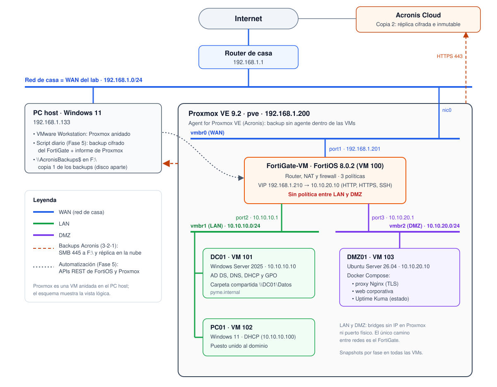

# homelab-pyme

Laboratorio casero que simula la infraestructura de una pyme: firewall perimetral con **FortiGate**, virtualización con **Proxmox VE**, dominio de Windows Server, servicios publicados en una DMZ con Docker, automatización por API y copias de seguridad con **Acronis Cyber Protect**.

Cada fase está documentada paso a paso, con capturas, las decisiones de diseño y las incidencias que aparecieron por el camino.

## Qué incluye

- **Red segmentada en WAN, LAN y DMZ** detrás de un FortiGate, sin ningún camino entre LAN y DMZ y con un servicio publicado mediante VIP.
- **Dominio de Active Directory** con DNS, DHCP, GPOs, carpeta compartida por departamentos y un puesto cliente unido al dominio.
- **DMZ con Docker:** proxy Nginx con TLS, web y Uptime Kuma, con SSH solo por clave y UFW como segunda capa.
- **Automatización diaria en Python** con las APIs de FortiOS y Proxmox: backup cifrado de la configuración del firewall e informe de estado, con tokens de mínimo privilegio.
- **Backup 3-2-1 con Acronis**, sin agente dentro de las VMs: copia local, réplica inmutable en la nube y dos pruebas de restauración reales.

| Prueba | Resultado |
|---|---|
| VM de la DMZ destruida (discos y snapshots) y restaurada con Acronis | Web de nuevo en marcha en **menos de 4 minutos**, misma IP y MAC, monitorización con el historial intacto |
| Archivo borrado de la carpeta compartida, recuperado desde Acronis Cloud | Mismo hash SHA-256 que el original |
| DMZ intentando llegar al controlador de dominio | Bloqueado por el FortiGate (*Implicit Deny*, verificado con `diagnose debug flow` y logs) |
| Token de la API de Proxmox intentando escribir | `403 Permission check failed` (rol de solo lectura) |

## Arquitectura



| Red | Bridge | Subred | Uso |
|---|---|---|---|
| WAN | vmbr0 | 192.168.1.0/24 | Red de casa: hace de "Internet" del lab y de red de gestión |
| LAN | vmbr1 | 10.10.10.0/24 | Servidores internos y puestos de trabajo |
| DMZ | vmbr2 | 10.10.20.0/24 | Servicios publicados, aislados de la LAN y de la red de casa |

| VM | Nombre | Sistema | IP | Recursos | Función |
|---|---|---|---|---|---|
| 100 | fortigate | FortiOS 8.0.2 | 192.168.1.201 · 10.10.10.1 · 10.10.20.1 | 1 vCPU, 2 GB | Router, NAT y firewall; VIP 192.168.1.210 → DMZ01 |
| 101 | DC01 | Windows Server 2025 | 10.10.10.10 | 4 GB | AD DS, DNS, DHCP, GPO y carpeta compartida (`pyme.internal`) |
| 102 | PC01 | Windows 11 | 10.10.10.100 (DHCP) | 4 GB | Puesto unido al dominio (apagado cuando no se usa) |
| 103 | DMZ01 | Ubuntu Server 26.04 | 10.10.20.10 | 2 vCPU, 2 GB | Docker: proxy Nginx, web y Uptime Kuma |

## Fases

| # | Fase | Qué se ve | Guía |
|---|---|---|---|
| 1 | Hipervisor Proxmox VE y redes virtuales | Instalación, repositorios y bridges aislados para LAN y DMZ | [docs/01-proxmox.md](docs/01-proxmox.md) |
| 2 | Firewall perimetral FortiGate-VM | Interfaces, VIP y políticas dentro del límite de la licencia (3 políticas) | [docs/02-fortigate.md](docs/02-fortigate.md) |
| 3 | Controlador de dominio Windows Server 2025 | AD, DNS, DHCP y GPOs con scripts de PowerShell idempotentes | [docs/03-controlador-dominio.md](docs/03-controlador-dominio.md) |
| 4 | Servidor Ubuntu con Docker en la DMZ | Bastionado, proxy inverso con TLS y verificación del aislamiento | [docs/04-dmz-docker.md](docs/04-dmz-docker.md) |
| 5 | Automatización con las APIs de FortiGate y Proxmox | Script en Python programado, tokens de mínimo privilegio y secretos fuera del repo | [docs/05-automatizacion.md](docs/05-automatizacion.md) |
| 6 | Backup y restauración con Acronis Cyber Protect | 3-2-1 con réplica inmutable, desastre simulado y recuperación de un archivo | [docs/06-acronis.md](docs/06-acronis.md) |

## Incidencias y diagnóstico

Algunos problemas reales que aparecieron durante el montaje, con su diagnóstico:

- **DNS a 1.1.1.1 sin respuesta desde la LAN.** `diagnose debug flow` en el FortiGate mostraba el tráfico permitido por la política y con SNAT, pero sin paquetes de vuelta. 8.8.8.8 sí respondía, así que el bloqueo estaba fuera del lab, en el router o el operador de casa. Se cambiaron los reenviadores DNS a 8.8.8.8 y 9.9.9.9. ([Fase 3](docs/03-controlador-dominio.md))
- **La DMZ llegaba a la red de casa.** En las pruebas, el servidor de la DMZ podía abrir la web del router: la política de salida tenía como destino `all` por la WAN, que es la red de casa. Sin espacio para una cuarta política, se corrigió **negando el destino** `Red-Casa` en la misma política. ([Fase 4](docs/04-dmz-docker.md))
- **FortiOS devuelve HTTP 200 en algunos errores de la API.** El script no se fía del código HTTP: comprueba que el archivo empiece por la cabecera de un backup (`#FGBK`) antes de darlo por bueno. ([Fase 5](docs/05-automatizacion.md))
- **La VM restaurada no era igual que la original.** Acronis recrea la VM con su propio modelo de hardware: 2 sockets en vez de 1, sin ballooning y con el CD en el orden de arranque. Se detectó comparando con `diff` la configuración guardada antes del desastre y se corrigió en una parada corta. ([Fase 6](docs/06-acronis.md))

## Decisiones de diseño destacadas

- **El FortiGate es el único camino entre redes:** los bridges de la LAN y la DMZ no tienen IP en Proxmox, y no hay ninguna política entre LAN y DMZ.
- **Mínimo privilegio en todas partes:** cuenta de administración del dominio separada de la diaria, usuario de API del FortiGate limitado a una IP, token de Proxmox de solo lectura y usuario de backup que solo puede escribir en su carpeta.
- **Una política de backup por tipo de equipo:** snapshots consistentes con QEMU Guest Agent para DC01 y DMZ01, y *crash-consistent* para el FortiGate, que no lleva agente.
- **Sin secretos en el repositorio:** tokens y claves en un `.env` excluido por `.gitignore`, y capturas con los datos sensibles tapados.
- **Configuración como código:** scripts idempotentes de PowerShell para AD y GPOs, y el stack de Docker de la DMZ en [`configs/`](configs/).
- **Snapshots al cerrar cada fase**, para volver a un estado que se sabe que funciona.

### Del lab a producción

Todo corre en un solo PC, así que algunas cosas se harían de otra forma en una pyme real: un clúster de Proxmox con almacenamiento compartido, la gestión en una VLAN aislada y no en la red de casa, un servidor de ficheros aparte del controlador de dominio, la copia local de los backups en un NAS dedicado y licencias completas. Cada guía explica estas diferencias en sus decisiones de diseño.

## Hardware

- **Host:** Windows 11, Ryzen 7 7700, 32 GB de RAM, HDD de 4 TB, red por cable 2.5GbE.
- **Proxmox VE 9.2** en una VM de VMware Workstation con virtualización anidada (8 vCPU, 20 GB de RAM, 300 GB).

## Estructura del repositorio

```
homelab-pyme/
├── README.md        ← este archivo
├── .env.example     ← plantilla de configuración de los scripts (sin secretos)
├── docs/            ← una guía por fase
│   └── img/         ← capturas (NN-descripcion.png, NN = número de fase)
├── diagrams/        ← diagrama de red (SVG editable)
├── scripts/         ← automatizaciones (Python, PowerShell y Bash)
└── configs/         ← configuraciones exportadas, sin contraseñas
```

`.env` (secretos) y `salida/` (backups, informes y logs generados por los scripts) están excluidos con `.gitignore`.

## Autor

**Ferran Bertomeu** — Administrador de sistemas · [LinkedIn](https://www.linkedin.com/in/ferran-bertomeu-bardeny-762932211/)
