# Fase 1 — Hipervisor Proxmox VE

Proxmox VE 9.2 (ISO 9.2.2, actualizado a 9.2.32) es la base del lab: aloja todas las VMs (FortiGate, controlador de dominio y servidor de la DMZ) y define las tres redes de la pyme simulada.

### Entorno

Proxmox corre como VM dentro de un hipervisor de escritorio en un PC con Windows 11, usando **virtualización anidada**. Los pasos son los mismos con VMware Workstation o con VirtualBox.

| Elemento | Valor |
|---|---|
| Host físico | Windows 11, Ryzen 7 7700, 32 GB RAM, HDD 4 TB, red por cable 2.5GbE |
| VM de Proxmox | 8 vCPU, 20 GB RAM, disco de 300 GB |
| Red de la VM | Modo puente con la tarjeta física, para que Proxmox tenga IP en la red de casa |
| Virtualización anidada | Activada en la VM. En el host se desactivaron Hyper-V y VBS, porque si no el hipervisor de escritorio no puede pasar VT-x/AMD-V a la VM |

### Instalación

| Paso del instalador | Valor |
|---|---|
| Disco destino | `/dev/sda` (300 GB), sistema de archivos **ext4** |
| País / Zona horaria / Teclado | Spain / Europe/Madrid / Spanish |
| Contraseña root y correo | Contraseña robusta; correo para las alertas (backups fallidos, etc.) |
| Interfaz de gestión | `nic0`, con *Pin network interface names* activado |
| Hostname (FQDN) | `pve.lab.local` |
| IP / Gateway | `192.168.1.200/24` / `192.168.1.1` |
| DNS | DNS del proveedor (`212.230.135.2`) |

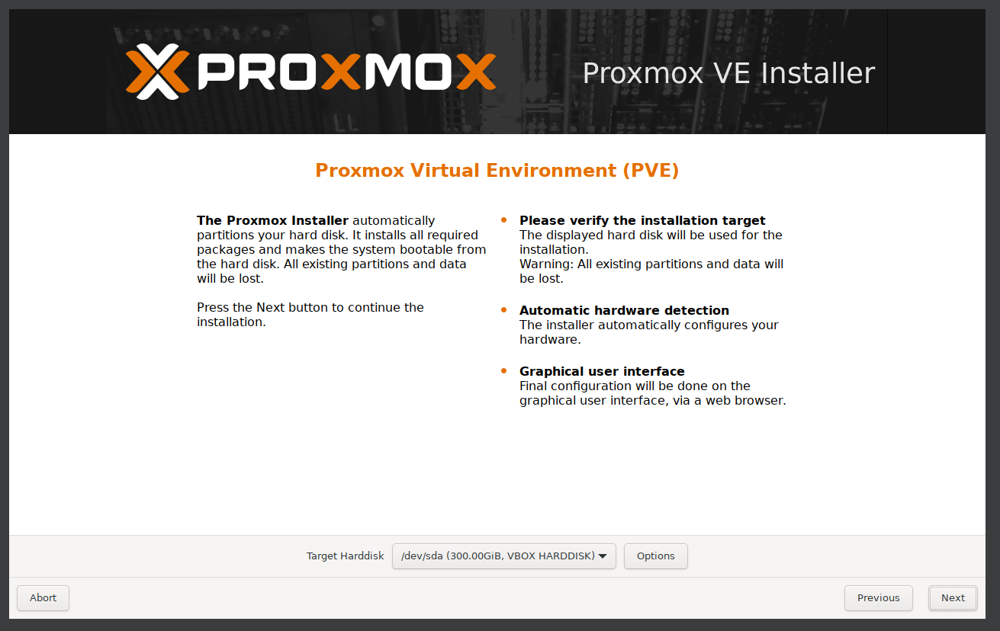
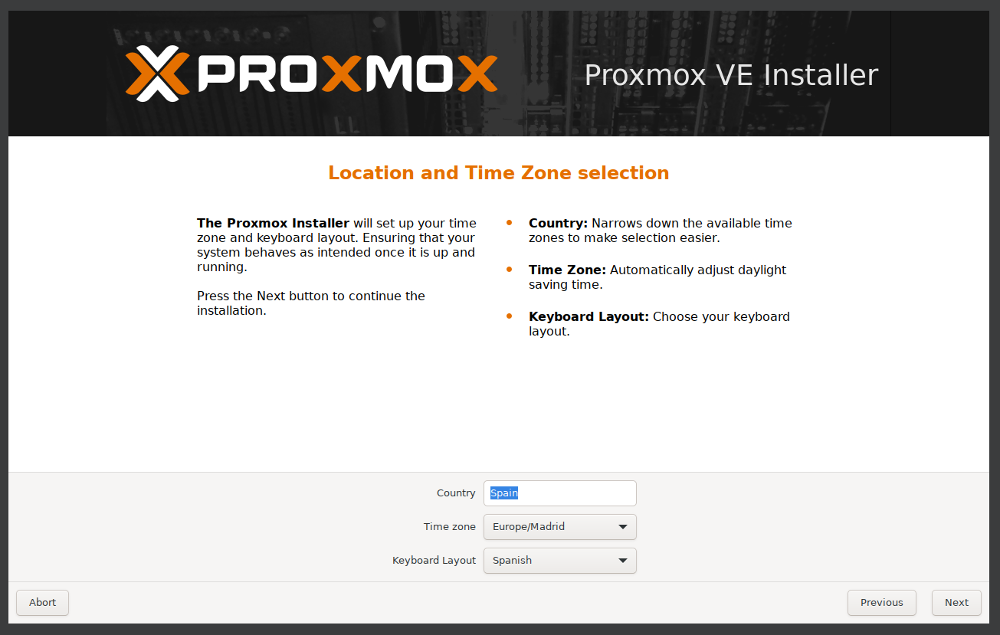
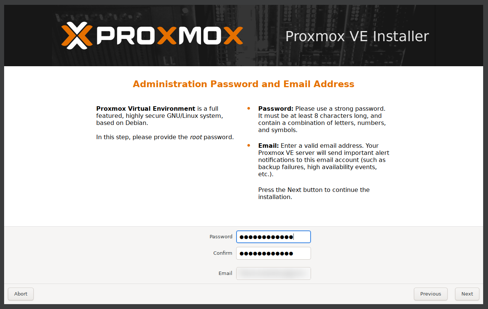
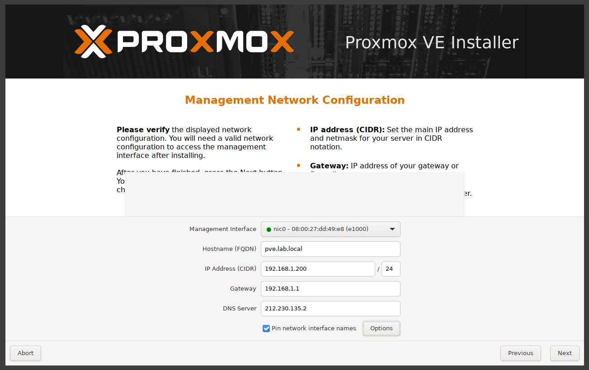
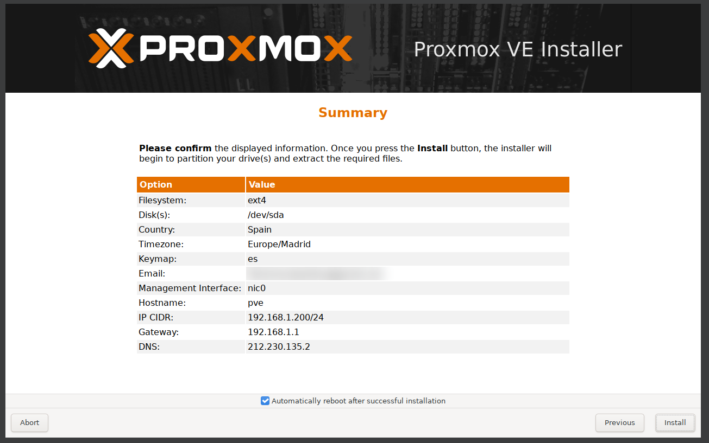

Al terminar, la interfaz web queda accesible en `https://192.168.1.200:8006` (usuario `root`, realm *Linux PAM*).

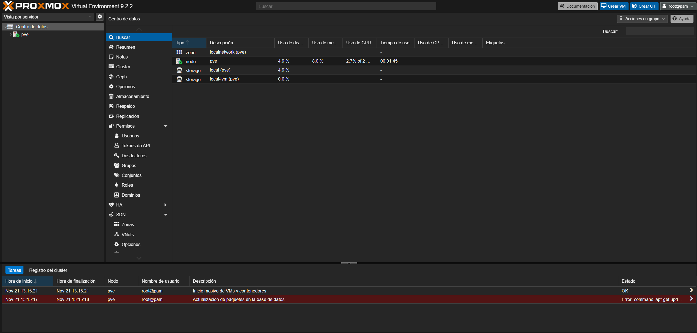

### Repositorios y actualización

En la primera actualización falla la tarea *apt-get update*: Proxmox trae activados por defecto los repositorios **enterprise**, que exigen suscripción, y en esta versión vienen deshabilitados, así que no queda ningún repositorio de Proxmox activo.

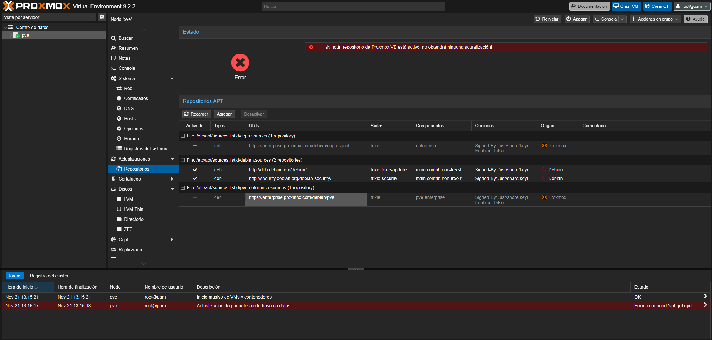

**Solución:** en *Nodo pve → Actualizaciones → Repositorios → Agregar*, añadir el repositorio **No-Subscription**, el recomendado para laboratorios y entornos que no son de producción.

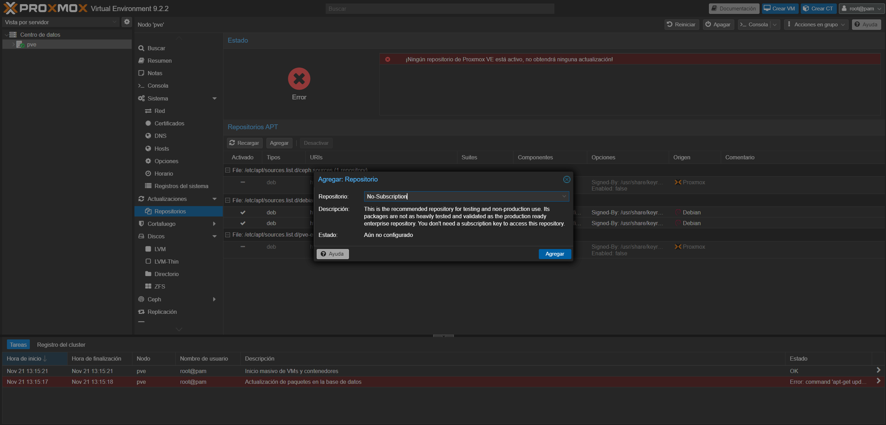

Después, *Actualizaciones → Refrescar*: el `apt-get update` termina en `TASK OK` y aparecen los paquetes pendientes.

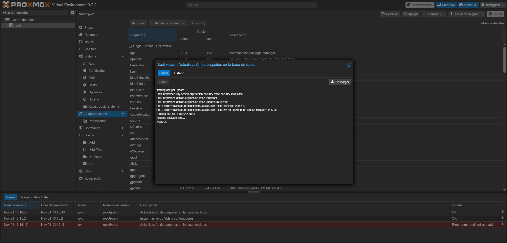
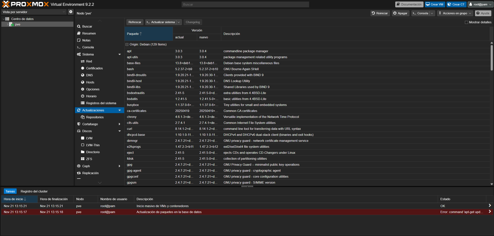

Actualización completa con *Actualizar sistema*, que abre una consola y ejecuta:

```bash
apt update && apt full-upgrade
```

Se actualizan 221 paquetes y se instalan 3 nuevos (unos 670 MB).

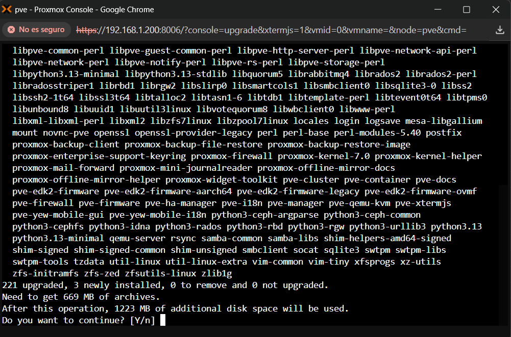
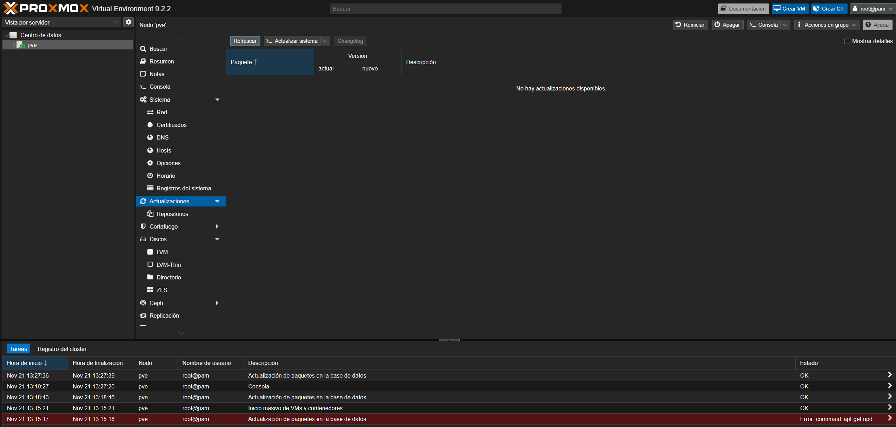

### Redes virtuales

Tras la instalación solo existe `vmbr0`, el bridge que crea el instalador sobre `nic0`. Se añaden dos bridges internos en *Sistema → Red → Crear → Linux Bridge*:

| Bridge | Rol | Puerto físico | IP en Proxmox | Comentario |
|---|---|---|---|---|
| vmbr0 | WAN (red de casa 192.168.1.0/24) | `nic0` | 192.168.1.200/24 | Gestión de Proxmox y WAN del FortiGate |
| vmbr1 | LAN (10.10.10.0/24) | ninguno | ninguna | `LAN` |
| vmbr2 | DMZ (10.10.20.0/24) | ninguno | ninguna | `DMZ` |

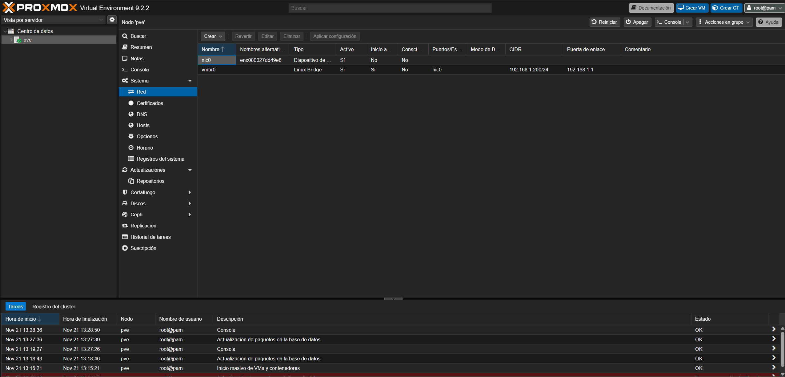
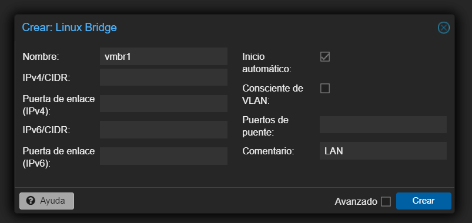
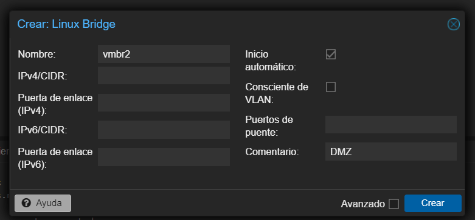

Los cambios quedan pendientes en `/etc/network/interfaces.new` y se activan con **Aplicar configuración** (usa `ifupdown2`, así que no hace falta reiniciar).

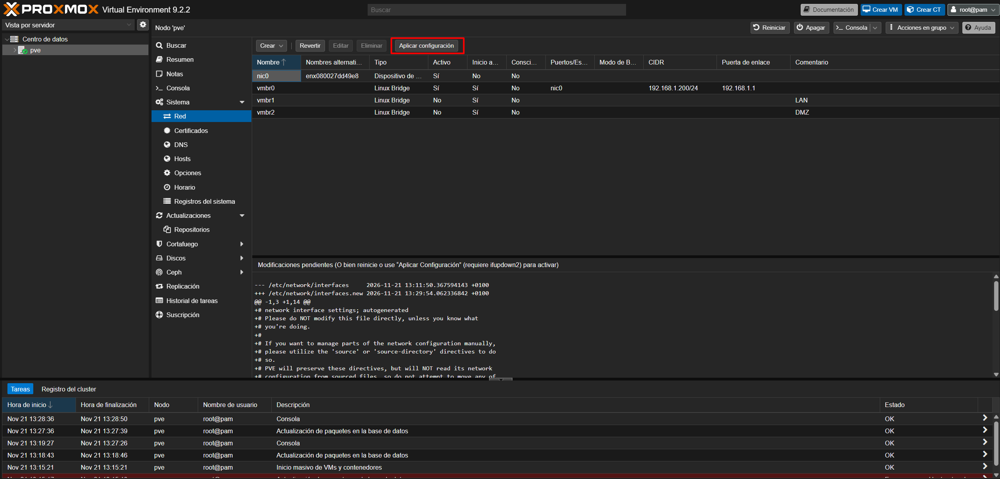

Configuración resultante en `/etc/network/interfaces`:

```
auto vmbr0
iface vmbr0 inet static
    address 192.168.1.200/24
    gateway 192.168.1.1
    bridge-ports nic0
    bridge-stp off
    bridge-fd 0

auto vmbr1
iface vmbr1 inet manual
    bridge-ports none
    bridge-stp off
    bridge-fd 0
#LAN

auto vmbr2
iface vmbr2 inet manual
    bridge-ports none
    bridge-stp off
    bridge-fd 0
#DMZ
```

### Decisiones de diseño

- **ext4 en vez de ZFS:** ZFS reserva mucha RAM para su caché (ARC), y en un entorno anidado con 20 GB la RAM es mejor dejarla para las VMs. Con un único disco virtual, ZFS tampoco aporta redundancia.
- **IP fija en Proxmox:** la gestión del hipervisor no puede depender de DHCP.
- **Bridges LAN y DMZ sin IP ni puerto físico:** son *switches* virtuales aislados. El único camino entre redes es el FortiGate, que hace de router y firewall. Como Proxmox no tiene IP en la LAN ni en la DMZ, el hipervisor no queda expuesto en esas redes.
- **Repositorio No-Subscription:** recibe las mismas actualizaciones que el enterprise, pero sin la validación extra de producción. Es la opción adecuada para un lab. En una pyme real se contrataría la suscripción.
- **Nombres de interfaz fijados (`nic0`):** evitan que la interfaz cambie de nombre tras una actualización de kernel o de hardware y que se rompa la red de gestión.

### Verificación

- Interfaz web accesible en `https://192.168.1.200:8006`.
- *Actualizaciones* muestra "No hay actualizaciones disponibles".
- `vmbr0`, `vmbr1` y `vmbr2` creados y activos tras aplicar la configuración.
