# Fase 2 — Firewall perimetral con FortiGate-VM

FortiGate-VM (FortiOS 8.0.2, imagen KVM) desplegado como VM 100 en Proxmox. Hace de router, NAT y firewall entre las tres redes del lab.

### 1. Subir la imagen a Proxmox

La imagen KVM de FortiGate-VM se descarga del portal de soporte de Fortinet (`FGT_VM64_KVM-v8.0.2.F-build0251-FORTINET.out.kvm.zip`). Dentro del zip viene el disco `fortios.qcow2`, que se copia al nodo por SCP desde Windows:

```powershell
scp .\fortios.qcow2 root@192.168.1.200:/root/
```

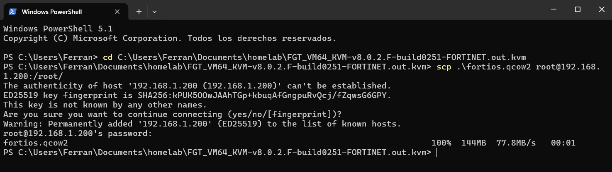

### 2. Crear la VM

Desde la consola del nodo (*pve → Consola*):

```bash
qm create 100 --name fortigate \
  --memory 2048 --cores 1 --cpu host --ostype l26 \
  --scsihw virtio-scsi-pci \
  --virtio0 local-lvm:0,import-from=/root/fortios.qcow2 \
  --virtio1 local-lvm:10 \
  --net0 virtio,bridge=vmbr0 \
  --net1 virtio,bridge=vmbr1 \
  --net2 virtio,bridge=vmbr2 \
  --boot order=virtio0
qm start 100
```

- **Recursos:** 1 vCPU y 2 GB de RAM, el máximo que permite la licencia de evaluación.
- **Discos:** `virtio0` con el sistema, importado del qcow2, y `virtio1` (10 GB) para logs.
- **Red:** `net0` → port1 (WAN, vmbr0), `net1` → port2 (LAN, vmbr1) y `net2` → port3 (DMZ, vmbr2). El orden de las NIC en Proxmox determina el número de puerto en FortiOS.

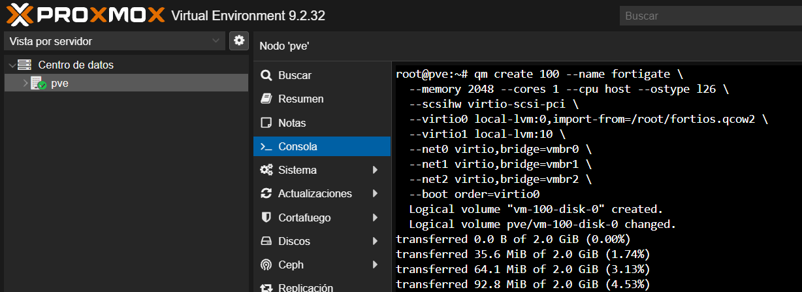
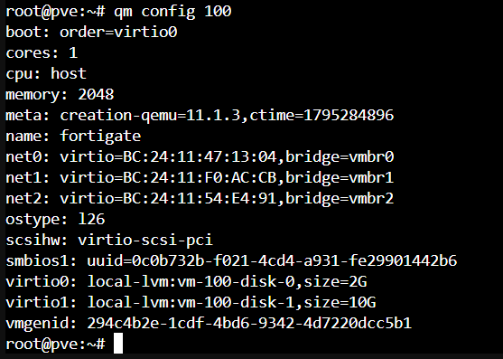

### 3. Primer arranque y acceso por CLI

Desde la consola noVNC de la VM: usuario `admin` sin contraseña. FortiOS obliga a cambiarla en el primer acceso, con una política de mínimo 12 caracteres, mayúscula, minúscula, número y símbolo.

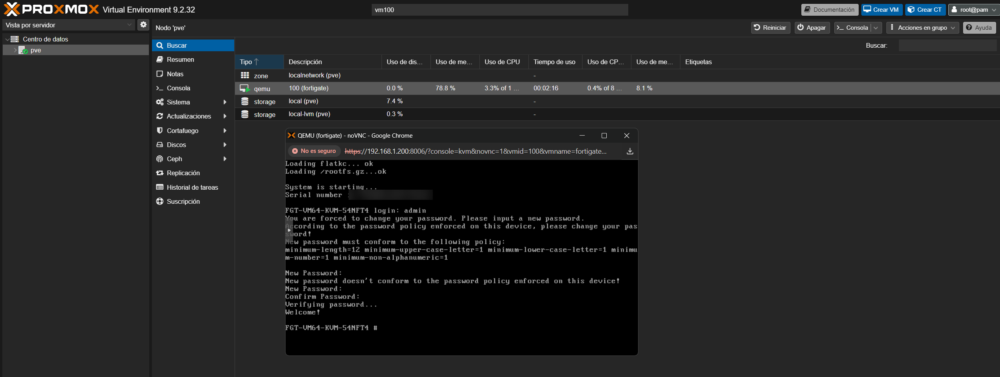

Configuración mínima de la WAN y la ruta por defecto, para poder llegar a la GUI y a FortiGuard:

```
config system interface
    edit port1
        set mode static
        set ip 192.168.1.201 255.255.255.0
        set allowaccess ping https ssh
    next
end

config router static
    edit 1
        set gateway 192.168.1.1
        set device port1
    next
end
```

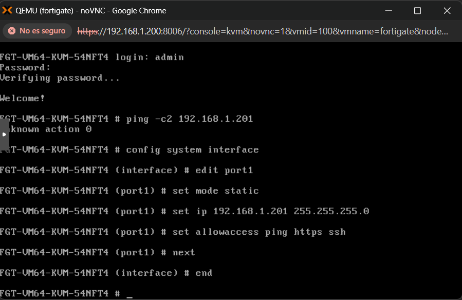
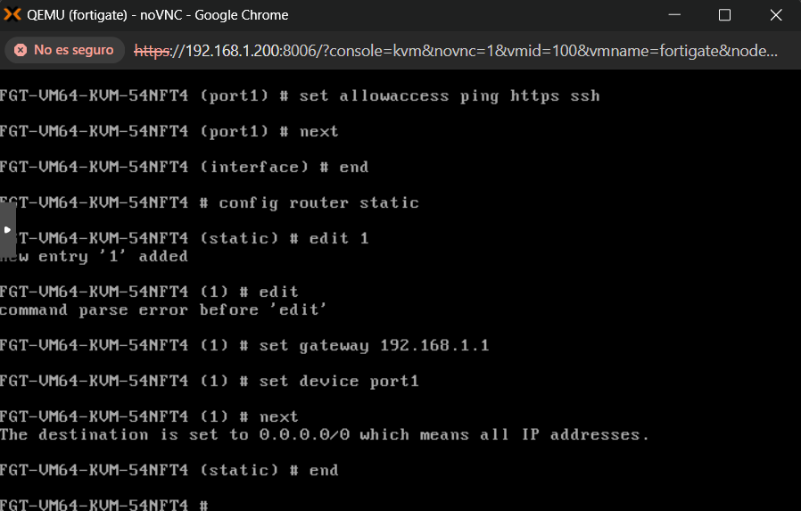

Comprobación de salida a Internet:

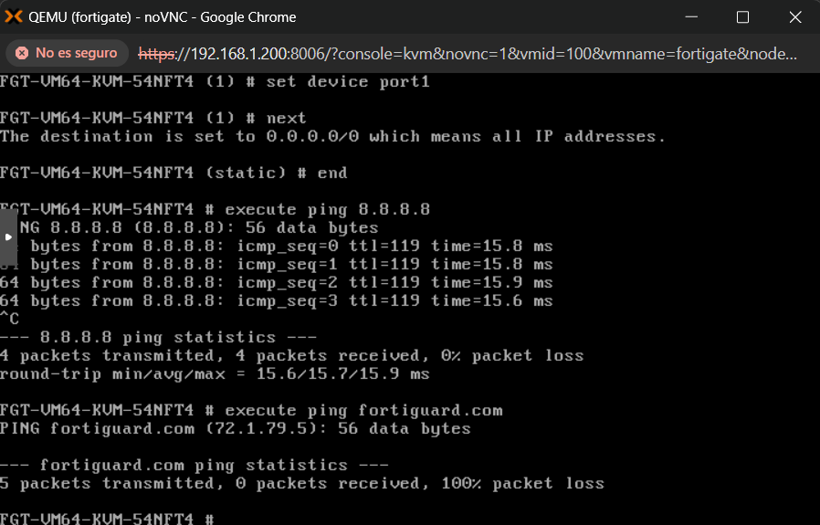

- `execute ping 8.8.8.8`: correcto, así que la ruta y la salida a Internet funcionan.
- `execute ping fortiguard.com`: el nombre resuelve pero no hay respuesta ICMP. Es normal, porque los servidores de FortiGuard filtran el ping.

### 4. Licencia de evaluación

Acceso a la GUI en `https://192.168.1.201` → *Evaluation license* → inicio de sesión con la cuenta FortiCloud. El equipo descarga la licencia y se reinicia.

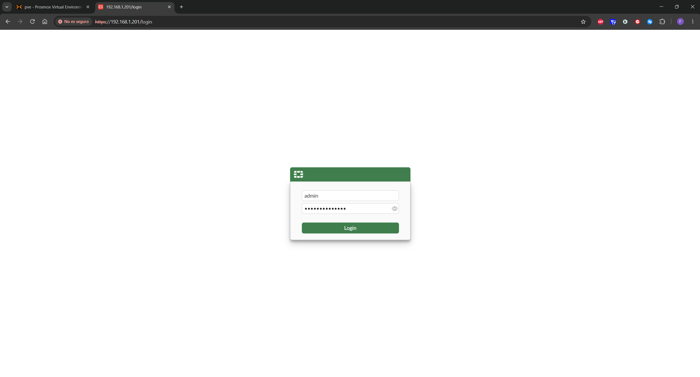
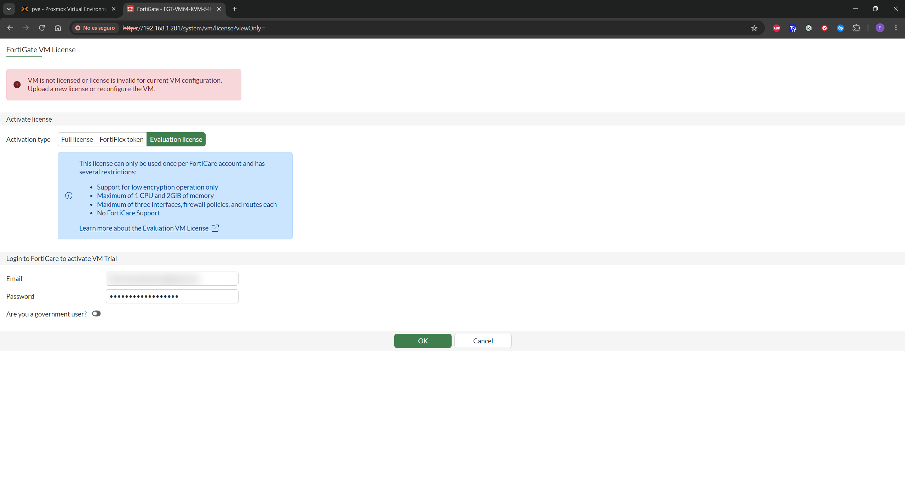
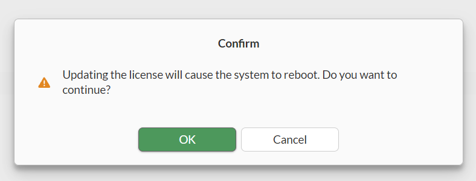
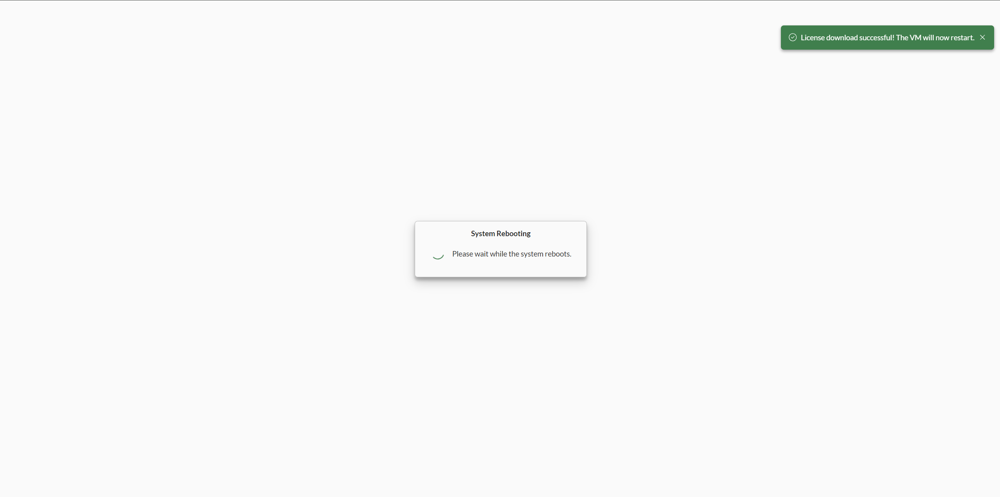

Restricciones de la licencia de evaluación permanente: solo cifrado bajo, 1 vCPU y 2 GB de RAM, máximo 3 interfaces, 3 políticas y 3 rutas, sin soporte FortiCare. Solo se puede activar **una vez por cuenta**.

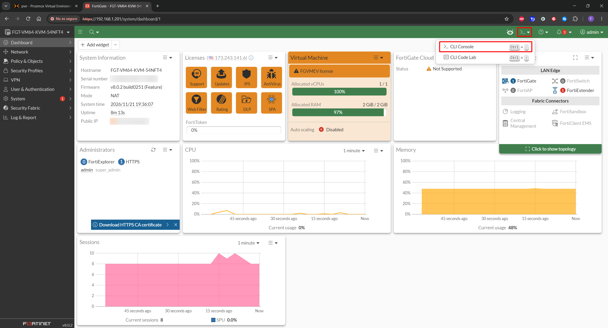

Como la licencia no se puede repetir, justo después se toma un **snapshot en Proxmox** (`licencia-ok`, con RAM) para poder volver atrás sin gastar otra.

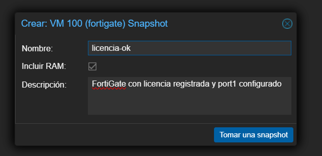

### 5. Configuración base

Hostname (*CLI Console* de la GUI):

```
config system global
    set hostname FGT-PYME
end
```

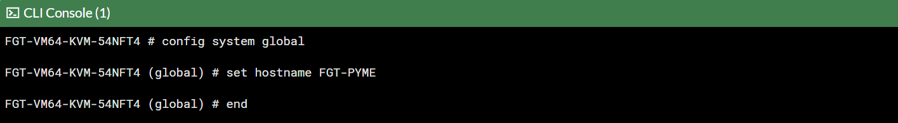

### 6. Interfaces

| Interfaz | Alias | Bridge Proxmox | Red | IP FortiGate | Acceso admin |
|---|---|---|---|---|---|
| port1 | WAN | vmbr0 | 192.168.1.0/24 | 192.168.1.201 | PING, HTTPS, SSH |
| port2 | LAN | vmbr1 | 10.10.10.0/24 | 10.10.10.1 | PING, HTTPS, SSH |
| port3 | DMZ | vmbr2 | 10.10.20.0/24 | 10.10.20.1 | PING |

```
config system interface
    edit port1
        set alias WAN
    next
    edit port2
        set alias LAN
        set mode static
        set ip 10.10.10.1 255.255.255.0
        set allowaccess ping https ssh
    next
    edit port3
        set alias DMZ
        set mode static
        set ip 10.10.20.1 255.255.255.0
        set allowaccess ping
    next
end
```

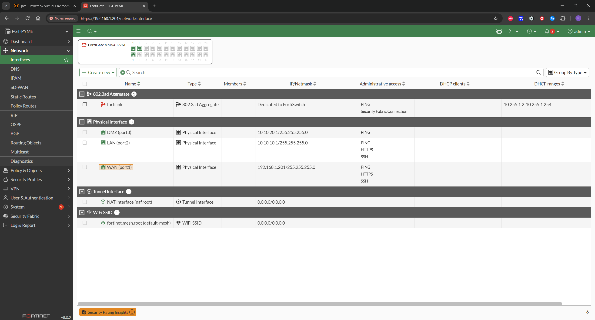

Ruta por defecto: `0.0.0.0/0` hacia 192.168.1.1 por port1.

### 7. Objetos

| Objeto | Tipo | Valor |
|---|---|---|
| Red-Casa | Dirección | 192.168.1.0/24 |
| VIP-DMZ-SRV | IP virtual (DNAT estático) | 192.168.1.210 → 10.10.20.10 |

```
config firewall address
    edit "Red-Casa"
        set subnet 192.168.1.0 255.255.255.0
    next
end

config firewall vip
    edit "VIP-DMZ-SRV"
        set extintf "port1"
        set extip 192.168.1.210
        set mappedip "10.10.20.10"
    next
end
```

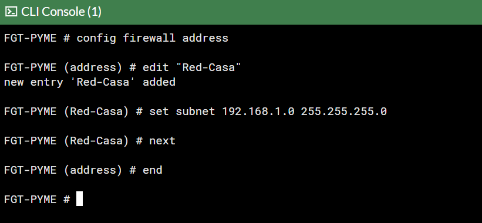
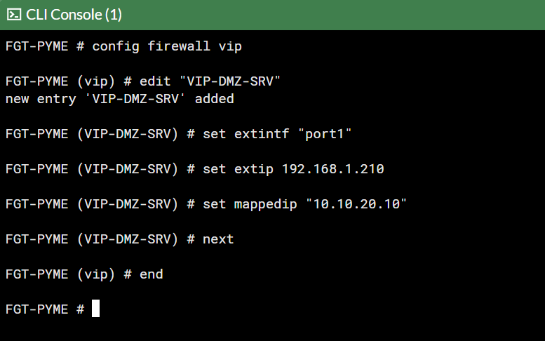
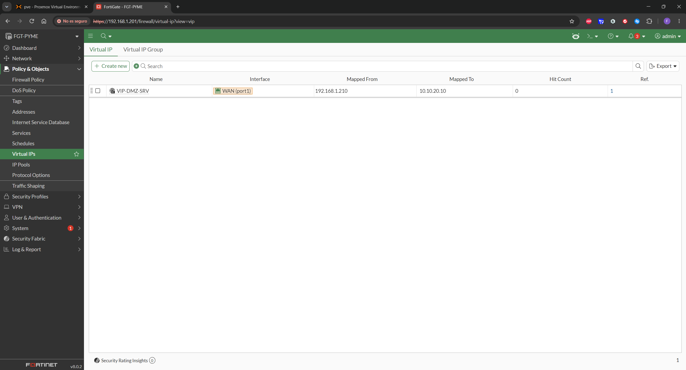

### 8. Políticas de firewall

| # | Nombre | Origen → Destino | Servicios | NAT |
|---|---|---|---|---|
| 1 | LAN-a-Internet | LAN → WAN | ALL | Sí |
| 2 | DMZ-a-Internet | DMZ → WAN | HTTP, HTTPS, DNS, NTP, PING | Sí |
| 3 | Casa-a-DMZ-publicado | WAN (Red-Casa) → VIP-DMZ-SRV | HTTP, HTTPS, SSH | No |
| 0 | Implicit Deny | todo | todo | — |

```
config firewall policy
    edit 1
        set name "LAN-a-Internet"
        set srcintf "port2"
        set dstintf "port1"
        set srcaddr "all"
        set dstaddr "all"
        set action accept
        set schedule "always"
        set service "ALL"
        set nat enable
        set logtraffic all
    next
    edit 2
        set name "DMZ-a-Internet"
        set srcintf "port3"
        set dstintf "port1"
        set srcaddr "all"
        set dstaddr "all"
        set action accept
        set schedule "always"
        set service "HTTP" "HTTPS" "DNS" "NTP" "PING"
        set nat enable
        set logtraffic all
    next
    edit 3
        set name "Casa-a-DMZ-publicado"
        set srcintf "port1"
        set dstintf "port3"
        set srcaddr "Red-Casa"
        set dstaddr "VIP-DMZ-SRV"
        set action accept
        set schedule "always"
        set service "HTTP" "HTTPS" "SSH"
        set logtraffic all
    next
end
```

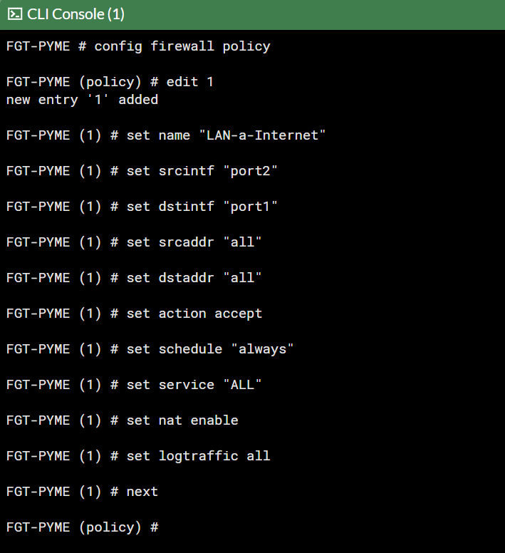
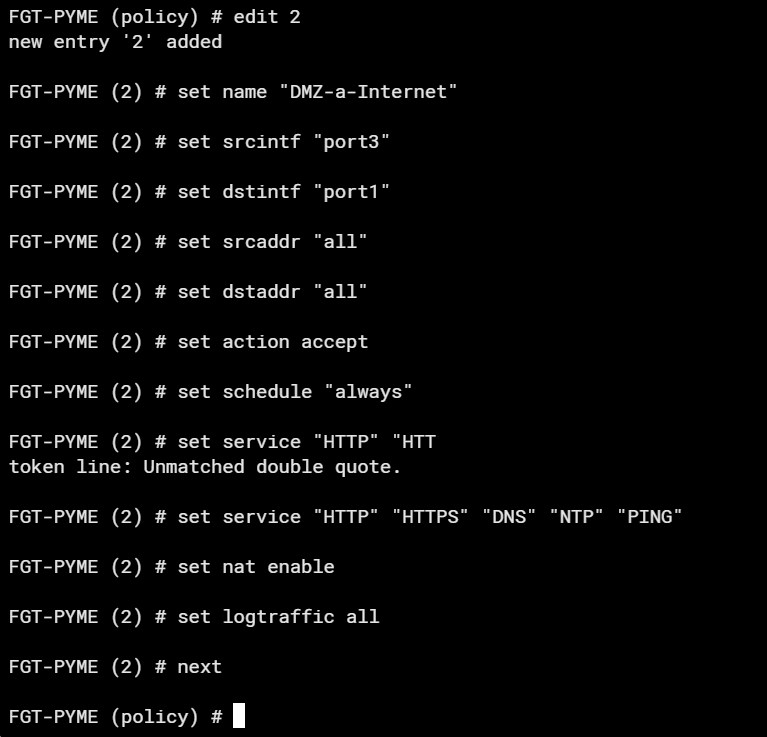
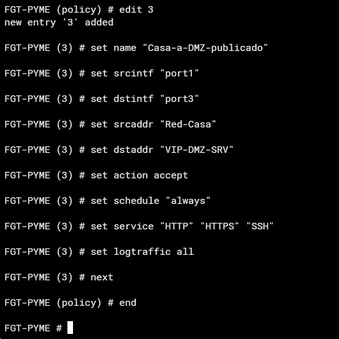
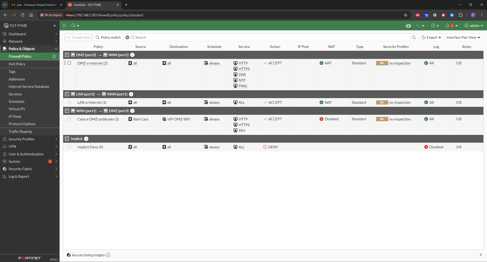

Todas las políticas registran el tráfico (`logtraffic all`). Además, se activa el log de la denegación implícita para ver lo que se bloquea:

```
config log setting
    set fwpolicy-implicit-log enable
end
```

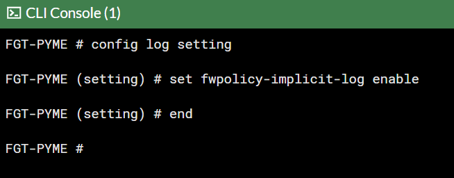

### 9. Copia de seguridad y snapshot final

Backup de la configuración desde *admin → Configuration → Backup*, con la opción **Encrypt sensitive information only**: contraseñas y certificados quedan cifrados con una clave propia y el resto de la configuración se puede leer.

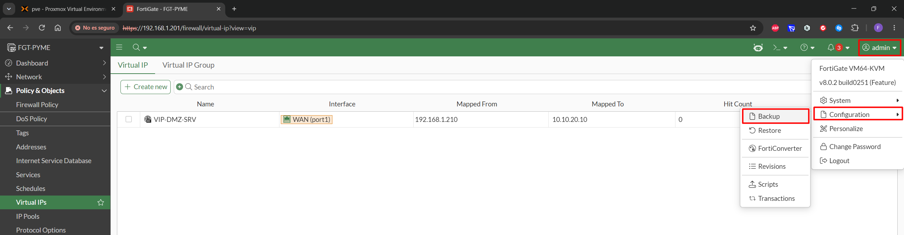
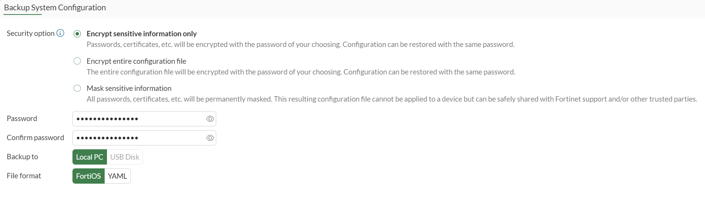

Snapshot de Proxmox `fase2-ok` con la fase terminada:

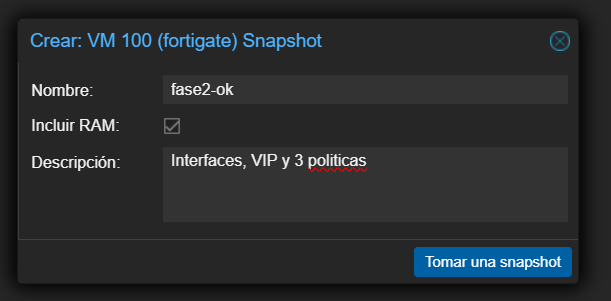

### Decisiones de diseño

- **Límite de la licencia (3 políticas, 3 interfaces, 3 rutas):** el diseño cabe exactamente en el límite. Al crear la tercera política, la GUI desactiva el botón *Create new*.
- **Snapshots antes y después:** `licencia-ok` protege la licencia, que no se puede repetir, y `fase2-ok` permite volver a una configuración que se sabe que funciona.
- **DMZ aislada de la LAN:** no hay ninguna política entre LAN y DMZ. Si el servidor de la DMZ quedara comprometido, no tendría camino hacia el controlador de dominio.
- **Mínimo privilegio en la DMZ:** el servidor solo puede salir a Internet con los servicios que necesita (actualizaciones, imágenes de Docker, DNS y NTP).
- **Publicación con VIP:** el servidor de la DMZ se expone con una IP de la red "externa" mediante DNAT, igual que se publicaría un servicio en una IP pública. El acceso está limitado a la red de origen `Red-Casa`.
- **Log de la denegación implícita:** sin él, el tráfico bloqueado no deja rastro y los diagnósticos se complican.
- **Sin DHCP en el FortiGate para la LAN:** lo da el controlador de dominio de Windows Server, como en una pyme típica.
- **Acceso de administración por WAN:** en este lab la WAN es la red de casa, así que se dejan HTTPS y SSH abiertos por comodidad. En producción se quitarían y se administraría desde la LAN o por VPN.

### Verificación

- `execute ping 8.8.8.8` desde el FortiGate: correcto.
- GUI accesible en `https://192.168.1.201`, con la licencia FGVMEV activa (1/1 vCPU y 2/2 GB).
- Las 3 políticas y la VIP están creadas.
- `ping 192.168.1.210` desde Proxmox no responde todavía: el servidor 10.10.20.10 no existe hasta la Fase 4, y la política 3 no incluye PING. La publicación se validará entonces con HTTP/SSH.

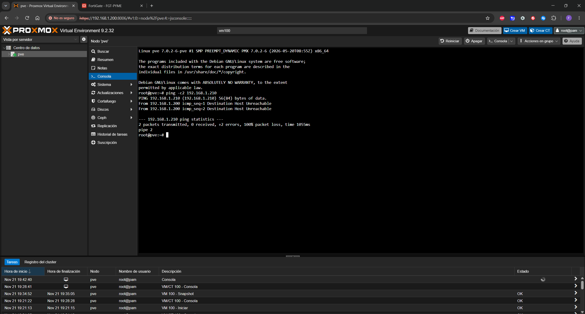
