# Fase 4 — Servidor Ubuntu con Docker en la DMZ

Ubuntu Server 26.04.1 LTS desplegado como VM 103 (`DMZ01`) en la DMZ. Aloja los servicios publicados de la pyme en contenedores Docker: un **proxy inverso Nginx** con HTTPS como único punto de entrada, la **web corporativa** y **Uptime Kuma** para la monitorización y la página de estado. El FortiGate los publica con la VIP `VIP-DMZ-SRV` (192.168.1.210 → 10.10.20.10). Al final se comprueba que la DMZ no puede llegar a la LAN y se corrige la política 2 para que tampoco llegue a la red de casa.

| Elemento | Valor |
|---|---|
| VM | 103 `DMZ01`, hostname `dmz01` |
| SO | Ubuntu Server 26.04.1 LTS (Resolute Raccoon), kernel 7.0 |
| Recursos | 2 vCPU (`host`), 2048 MiB con ballooning (mínimo 1024), disco de 32 GiB |
| Red | `ens18` 10.10.20.10/24, gateway 10.10.20.1 (FortiGate, port3), DNS 8.8.8.8 y 9.9.9.9 |
| Publicación | VIP 192.168.1.210 → 10.10.20.10, política 3 (Red-Casa → VIP: HTTP, HTTPS, SSH) |
| Usuario | `fbertomeu` (sudo), acceso SSH solo con clave ed25519 |
| Docker | Docker Engine 29.10.0 y Docker Compose v5.8.0, repositorio oficial |
| Servicios | `proxy` (nginx, 80/443), `web` (nginx, estático), `estado` (Uptime Kuma 2) |
| Nombres | `www.pyme.test` y `estado.pyme.test` → 192.168.1.210 |
| Configuración | [`configs/04-dmz01/`](../configs/04-dmz01/) y [`scripts/04-gen-cert.sh`](../scripts/04-gen-cert.sh) |

### 1. Subir la ISO

La ISO `ubuntu-26.04.1-live-server-amd64.iso` se sube desde el PC con *local (pve) → Imágenes ISO → Cargar*, igual que en la Fase 3. También se puede descargar directamente en el nodo, desde *pve → Consola*:

```bash
cd /var/lib/vz/template/iso
wget https://releases.ubuntu.com/26.04.1/ubuntu-26.04.1-live-server-amd64.iso
```

### 2. Crear la VM DMZ01

Asistente *Crear VM* con la casilla **Avanzado** marcada:

| Pestaña | Campo | Valor |
|---|---|---|
| General | VM ID / Nombre | `103` / `DMZ01` |
| | Iniciar al arranque / Orden | ✅ / `3` (ver nota) |
| SO | Imagen ISO | `ubuntu-26.04.1-live-server-amd64.iso` |
| | Tipo / Versión | Linux / 7.x - 2.6 Kernel |
| Sistema | Tarjeta gráfica / Máquina / BIOS | Por defecto / q35 / SeaBIOS |
| | Controlador SCSI / Qemu Agent / TPM | VirtIO SCSI single / ✅ / no |
| Discos | Bus / Almacenamiento / Tamaño | SCSI 0 / local-lvm / 32 GiB |
| | Descartar / IO thread | ✅ / ✅ |
| CPU | Zócalos / Núcleos / Tipo | 1 / 2 / host |
| Memoria | Memoria / Mínimo | 2048 MiB / 1024 MiB, ballooning ✅ |
| Red | Puente / Modelo / Cortafuego | `vmbr2` (DMZ) / VirtIO / desactivado |

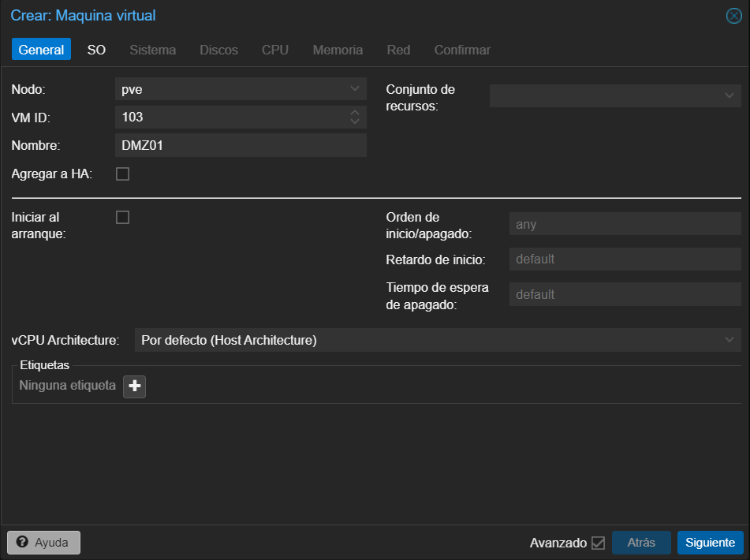
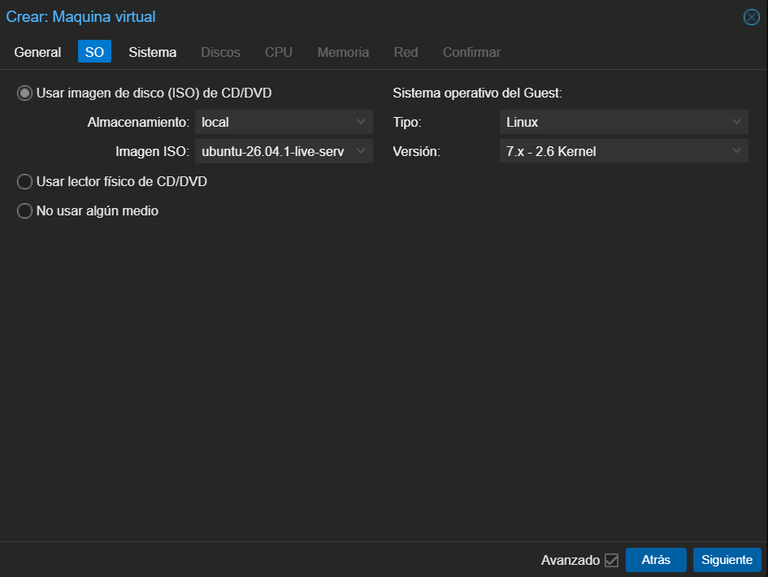
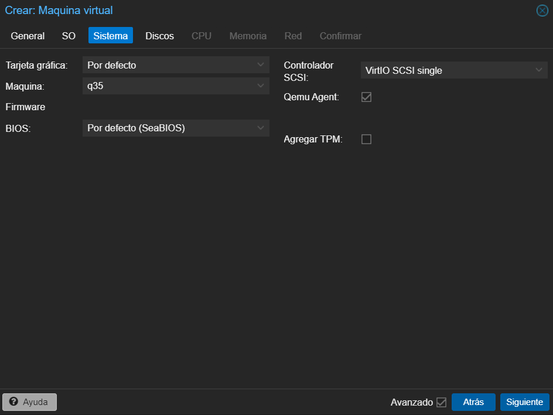
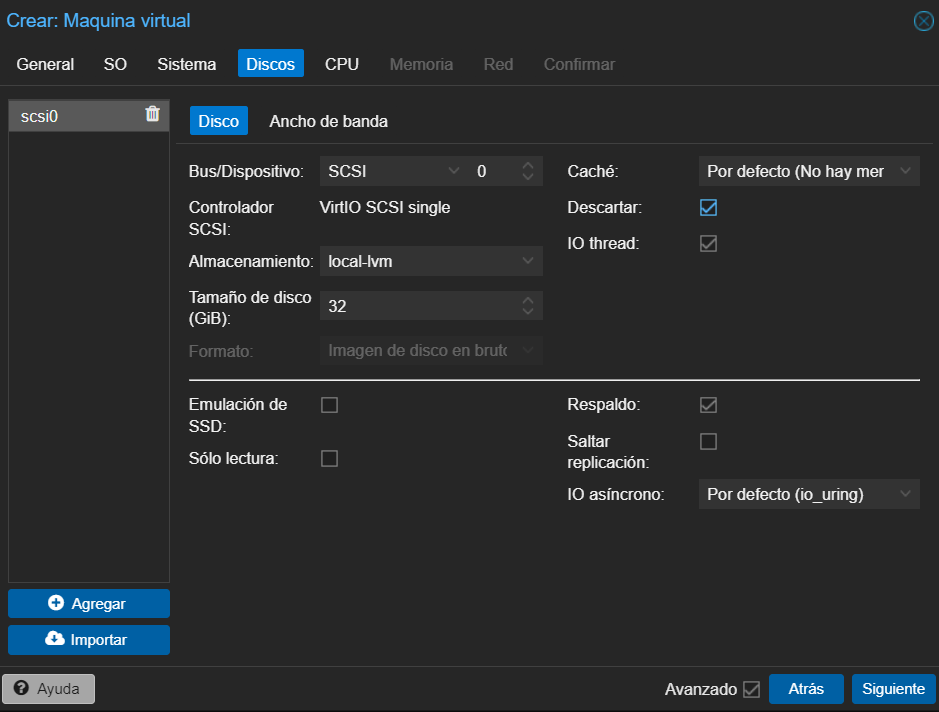
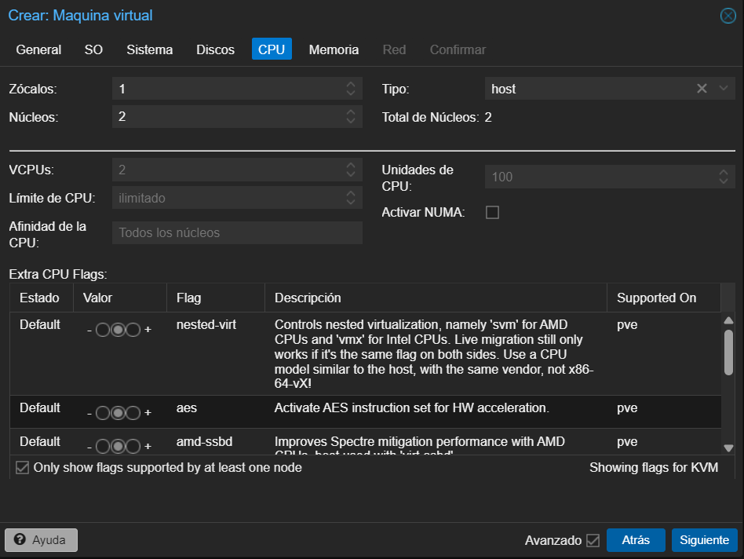
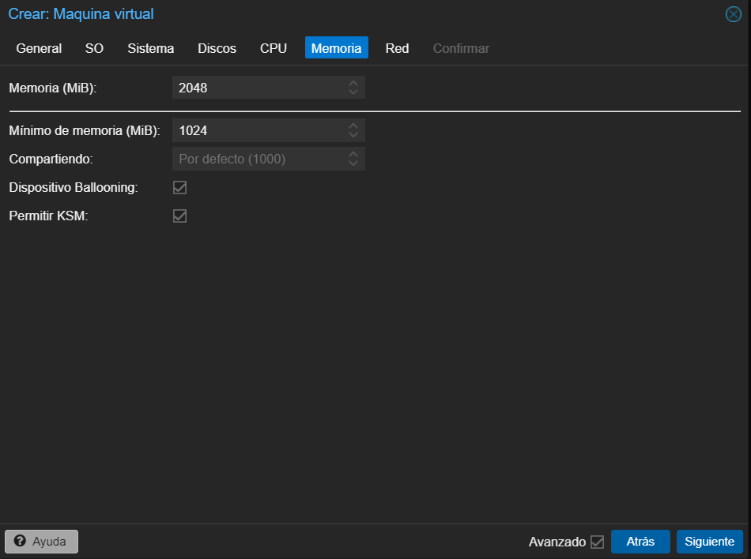
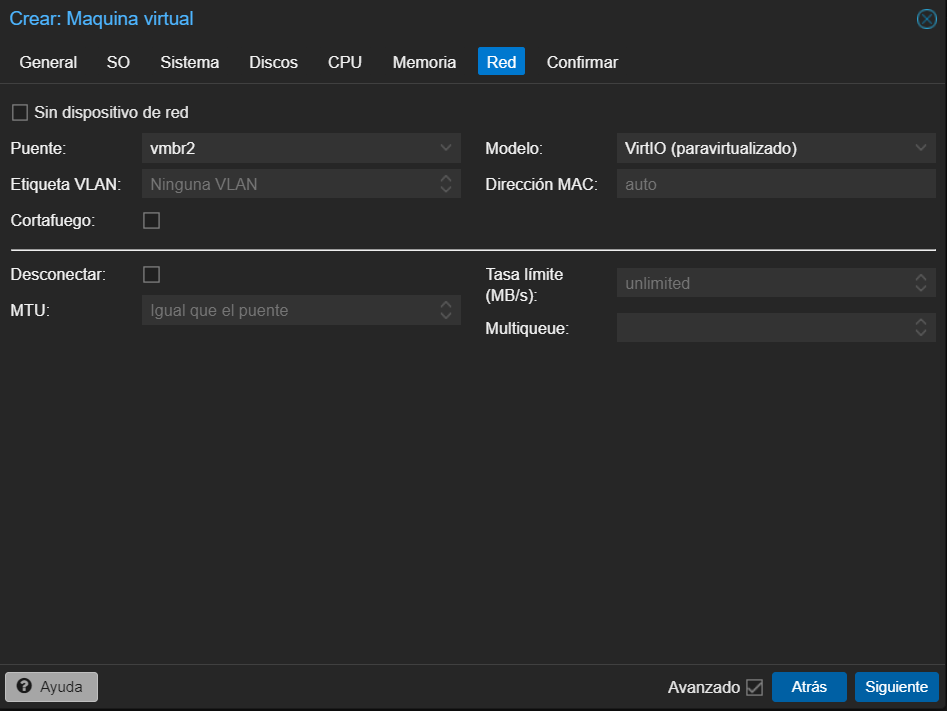

> **Nota:** el inicio automático se activó después de crear la VM, en *103 → Opciones → Iniciar al arranque* (orden 3, detrás del FortiGate y del DC). Por eso aparece desmarcado en la captura.

### 3. Instalar Ubuntu Server

- **Idioma:** English. Teclado **Spanish / Spanish**.
- **Tipo de instalación:** *Ubuntu Server* (no la versión minimized), sin drivers de terceros.

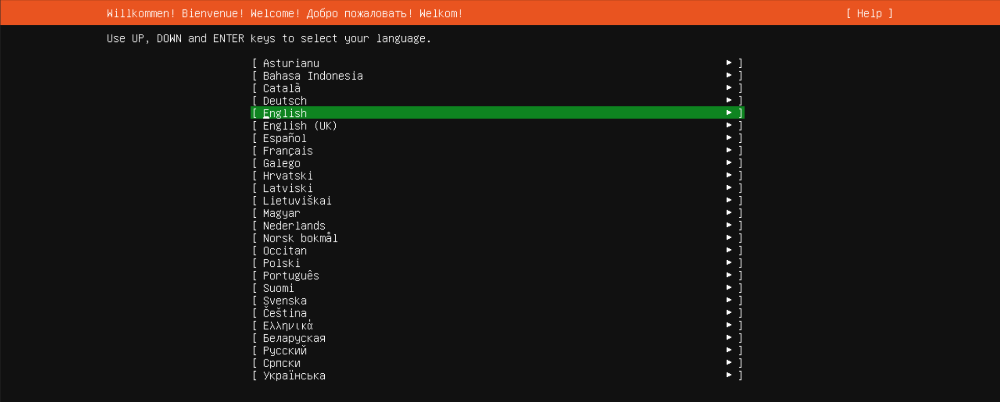
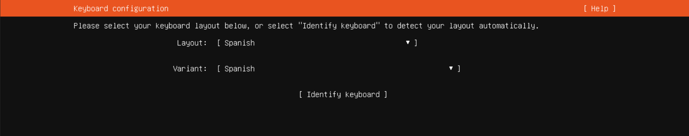
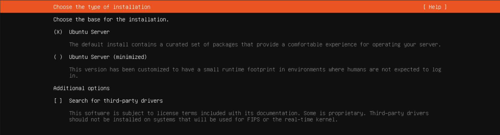

**Red:** en el FortiGate no hay DHCP para la DMZ, así que la autoconfiguración falla. *ens18 → Edit IPv4 → Manual*:

| Campo | Valor |
|---|---|
| Subnet | `10.10.20.0/24` |
| Address | `10.10.20.10` |
| Gateway | `10.10.20.1` |
| Name servers | `8.8.8.8,9.9.9.9` |
| Search domains | (vacío) |

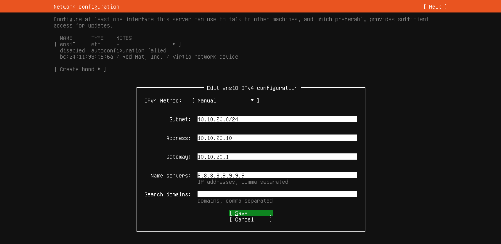

El proxy se deja vacío. El instalador propone el mirror `http://es.archive.ubuntu.com/ubuntu/` y la prueba es correcta: la política 2 del FortiGate ya permite HTTP desde la DMZ.

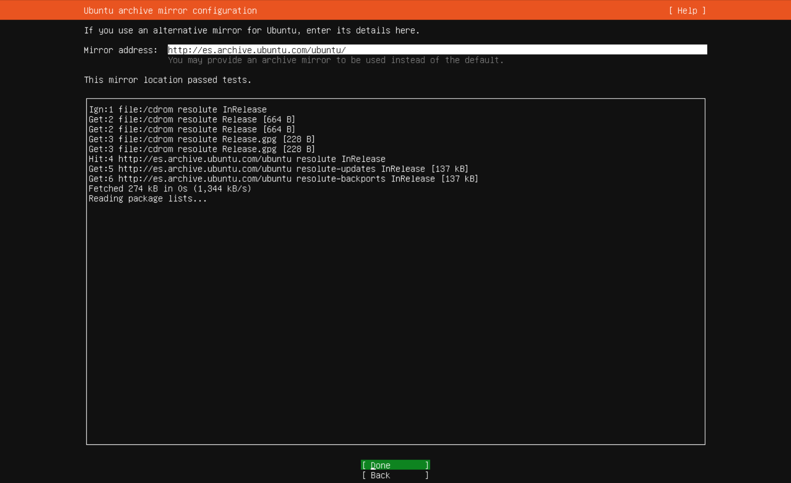

**Almacenamiento:** *Use an entire disk* + *Set up this disk as an LVM group*, sin cifrado LUKS. Por defecto el instalador solo asigna al volumen `ubuntu-lv` la mitad del grupo (14.996G) y deja 15 GB libres. Hay que editar `ubuntu-lv` y ponerle el tamaño máximo (**29.996G**).

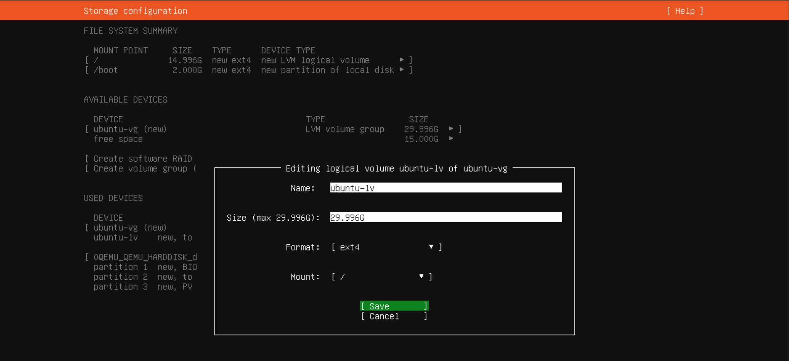

**Perfil:** *Your name* `Ferran Bertomeu`, *server name* `dmz01`, usuario `fbertomeu`. Ubuntu Pro: *Skip for now*.

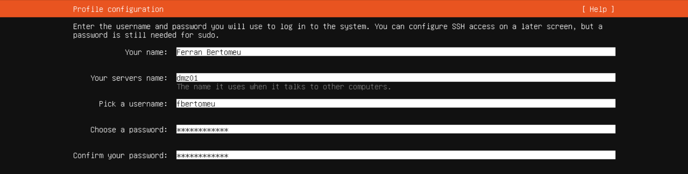

- **SSH:** *Install OpenSSH server* ✅, sin importar claves y con *Allow password authentication* ✅. La contraseña solo se usa para copiar la clave pública (paso 6); después se desactiva.
- **Featured snaps:** ninguno. Sobre todo, no el snap de Docker: se instala desde el repositorio oficial (paso 9).

Al terminar, *Reboot Now* y se quita la ISO: *103 → Hardware → Unidad CD/DVD → Editar → No usar ningún medio*.

### 4. Primera comprobación y SSH por la VIP

Desde la consola de la VM:

```bash
ip -br a
ping -c2 10.10.20.1
ping -c2 8.8.8.8
df -h /
```

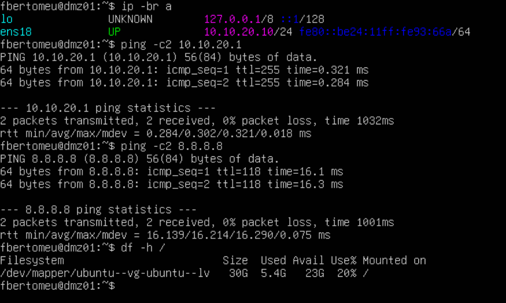

La IP es la correcta, el FortiGate responde, hay salida a Internet por la política 2 y `/` tiene 30 GB gracias a la ampliación del LVM.

Primer acceso desde el PC, a través de la VIP del FortiGate y la política 3:

```powershell
ssh fbertomeu@192.168.1.210
```

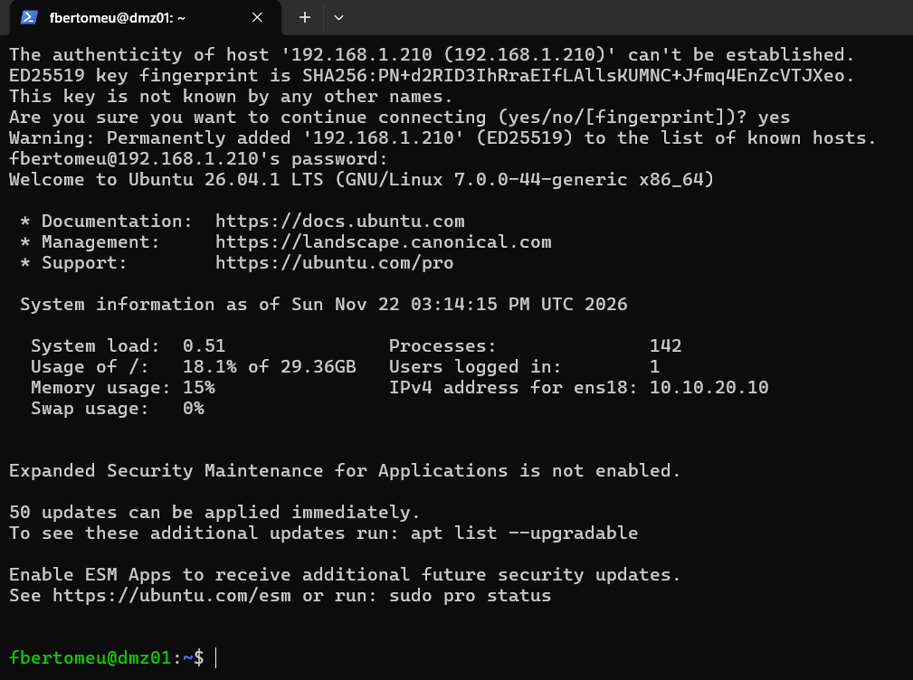

### 5. Zona horaria, actualización y QEMU Guest Agent

```bash
sudo timedatectl set-timezone Europe/Madrid
sudo apt update && sudo apt full-upgrade -y
sudo apt install -y qemu-guest-agent
sudo reboot
```

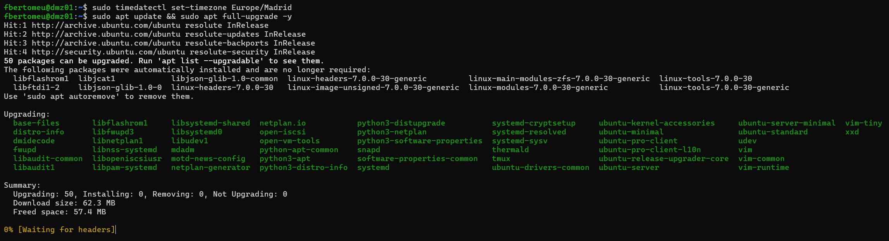

Tras reconectar:

```bash
timedatectl | grep -E "Local time|Time zone|synchronized"
systemctl is-active qemu-guest-agent
sudo cat /etc/netplan/*.yaml
```

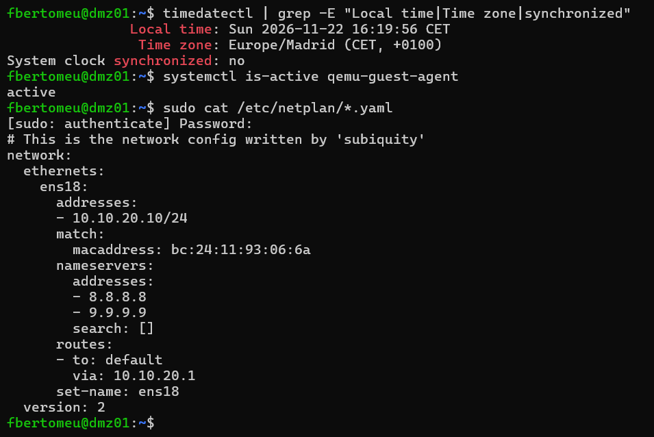

Justo después del reinicio el reloj todavía no estaba sincronizado (`synchronized: no`). Al cabo de poco pasó a `yes`: la política 2 permite NTP. La configuración de red que generó el instalador está guardada en [`configs/04-dmz01/netplan-dmz01.yaml`](../configs/04-dmz01/netplan-dmz01.yaml):

```yaml
# This is the network config written by 'subiquity'
network:
  ethernets:
    ens18:
      addresses:
      - 10.10.20.10/24
      match:
        macaddress: bc:24:11:93:06:6a
      nameservers:
        addresses:
        - 8.8.8.8
        - 9.9.9.9
        search: []
      routes:
      - to: default
        via: 10.10.20.1
      set-name: ens18
  version: 2
```

Con el agente funcionando, Proxmox muestra la IP en *103 → Resumen*:

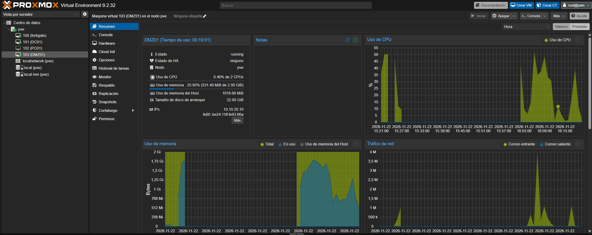

### 6. SSH solo con clave

En el PC (PowerShell), se genera la clave si no existe y se copia al servidor. Este es el último acceso con contraseña:

```powershell
Test-Path $env:USERPROFILE\.ssh\id_ed25519
ssh-keygen -t ed25519 -C "ferran@homelab-pyme"
type $env:USERPROFILE\.ssh\id_ed25519.pub | ssh fbertomeu@192.168.1.210 "mkdir -p ~/.ssh && chmod 700 ~/.ssh && cat >> ~/.ssh/authorized_keys && chmod 600 ~/.ssh/authorized_keys"
```

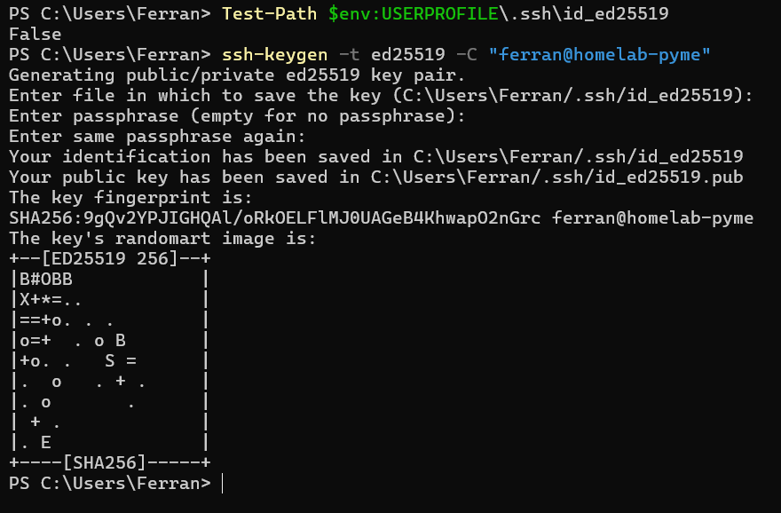
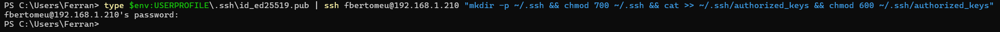

Hardening de `sshd` con un archivo propio en `sshd_config.d`:

```bash
sudo tee /etc/ssh/sshd_config.d/10-hardening.conf >/dev/null <<'EOF'
PermitRootLogin no
PasswordAuthentication no
KbdInteractiveAuthentication no
PubkeyAuthentication yes
AllowUsers fbertomeu
MaxAuthTries 3
LoginGraceTime 30
X11Forwarding no
EOF
sudo rm -f /etc/ssh/sshd_config.d/50-cloud-init.conf
sudo sshd -t && sudo systemctl reload ssh
sudo sshd -T | grep -Ei "^(permitrootlogin|passwordauthentication|kbdinteractiveauthentication|allowusers)"
```

`50-cloud-init.conf` lo crea el instalador al marcar *Allow password authentication* y contiene `PasswordAuthentication yes`. `sshd` lee los archivos por orden alfabético y se queda con el primer valor, así que `10-hardening.conf` ya ganaría. Aun así se borra, para no dejar una configuración contradictoria.

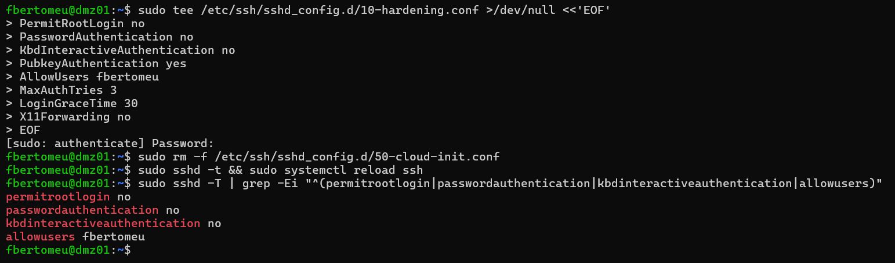

Prueba desde el PC, forzando el acceso sin clave:

```powershell
ssh -o PubkeyAuthentication=no fbertomeu@192.168.1.210
```

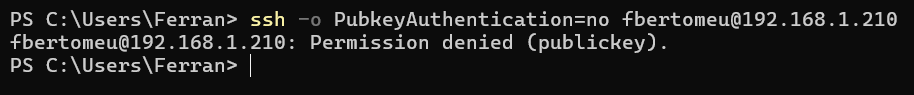

### 7. UFW y actualizaciones automáticas de seguridad

```bash
sudo ufw default deny incoming
sudo ufw default allow outgoing
sudo ufw limit from 192.168.1.0/24 to any port 22 proto tcp comment 'SSH desde Red-Casa'
sudo ufw allow 80/tcp comment 'HTTP'
sudo ufw allow 443/tcp comment 'HTTPS'
sudo ufw enable
sudo ufw status verbose
```

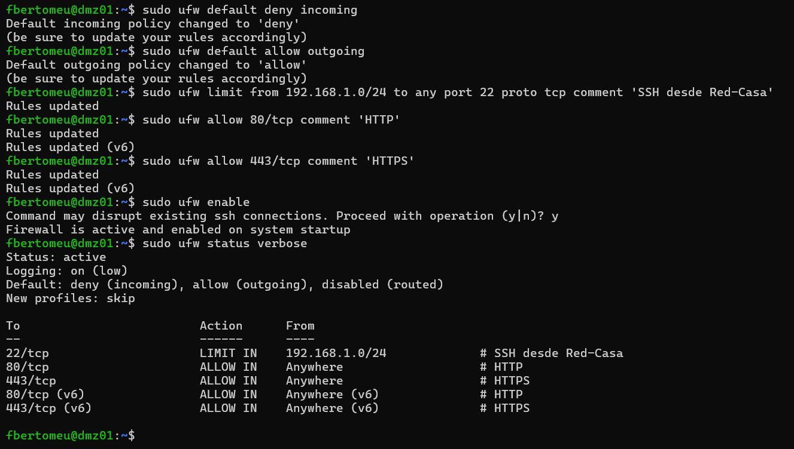

SSH solo se admite desde la red de casa y con `limit` (bloquea una IP que abra más de 6 conexiones en 30 segundos). La política 3 no hace SNAT, así que el servidor ve la IP real del cliente y la regla funciona.

`unattended-upgrades` ya viene instalado (2.12ubuntu9). Se activa de forma explícita:

```bash
sudo tee /etc/apt/apt.conf.d/20auto-upgrades >/dev/null <<'EOF'
APT::Periodic::Update-Package-Lists "1";
APT::Periodic::Unattended-Upgrade "1";
EOF
grep -A4 "Allowed-Origins" /etc/apt/apt.conf.d/50unattended-upgrades | grep -v "//"
sudo unattended-upgrade --dry-run --debug 2>&1 | tail -n 5
```

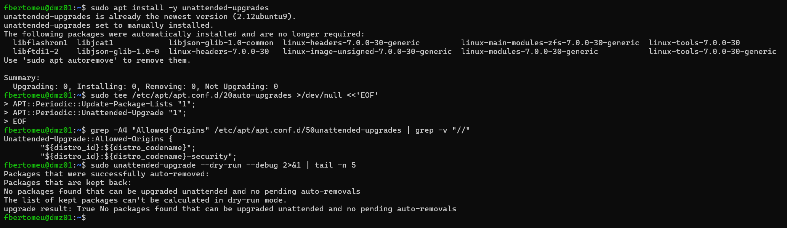

Solo se instalan automáticamente las actualizaciones de `resolute` y `resolute-security`, sin reinicio automático. El dry-run termina con `upgrade result: True`.

### 8. Snapshot antes de Docker

*103 → Snapshots → Tomar una snapshot*: nombre `pre-docker`, sin RAM, descripción *Ubuntu 26.04.1 instalado, red, SSH solo con clave, UFW y actualizaciones automáticas. Antes de Docker*.

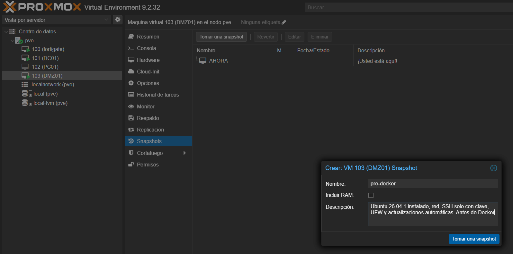

### 9. Docker Engine y Compose

Primero se eliminan los kernels antiguos que dejó la actualización y se añade la clave del repositorio oficial de Docker:

```bash
sudo apt autoremove -y
sudo apt install -y ca-certificates curl
sudo install -m 0755 -d /etc/apt/keyrings
sudo curl -fsSL https://download.docker.com/linux/ubuntu/gpg -o /etc/apt/keyrings/docker.asc
sudo chmod a+r /etc/apt/keyrings/docker.asc
```

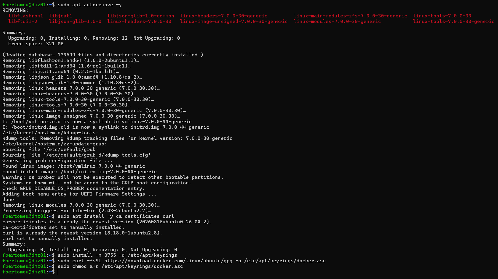

El repositorio se define en formato deb822. Se escribe con un único `printf` para evitar problemas al pegar (ver [Incidencias](#incidencias-y-diagnóstico)):

```bash
printf 'Types: deb\nURIs: https://download.docker.com/linux/ubuntu\nSuites: %s\nComponents: stable\nArchitectures: %s\nSigned-By: /etc/apt/keyrings/docker.asc\n' "$(. /etc/os-release && echo "${UBUNTU_CODENAME:-$VERSION_CODENAME}")" "$(dpkg --print-architecture)" | sudo tee /etc/apt/sources.list.d/docker.sources
sudo apt update
sudo apt install -y docker-ce docker-ce-cli containerd.io docker-buildx-plugin docker-compose-plugin
sudo usermod -aG docker fbertomeu
```

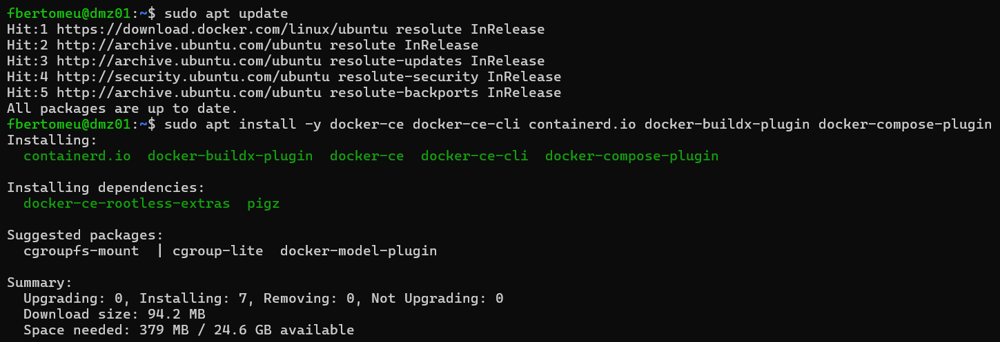

Configuración del daemon: rotación de logs y `live-restore`.

```bash
sudo tee /etc/docker/daemon.json >/dev/null <<'EOF'
{
  "log-driver": "json-file",
  "log-opts": { "max-size": "10m", "max-file": "3" },
  "live-restore": true
}
EOF
sudo systemctl restart docker
exit
```

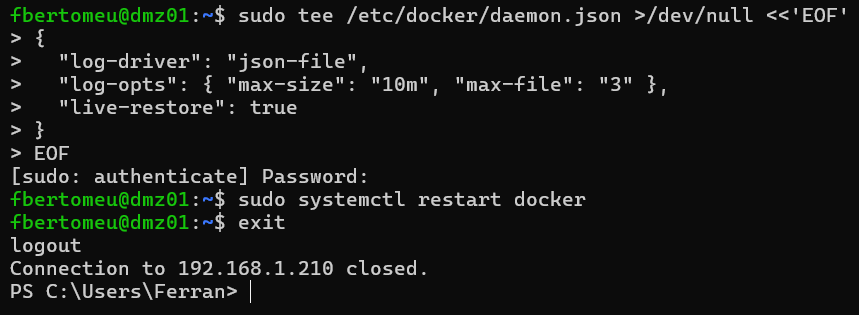

Hay que salir y volver a entrar para que se aplique el grupo `docker`. Verificación:

```bash
docker version --format 'Engine {{.Server.Version}}'
docker compose version
docker info --format 'Logging: {{.LoggingDriver}} | Live restore: {{.LiveRestoreEnabled}}'
docker run --rm hello-world
systemctl is-enabled docker
```

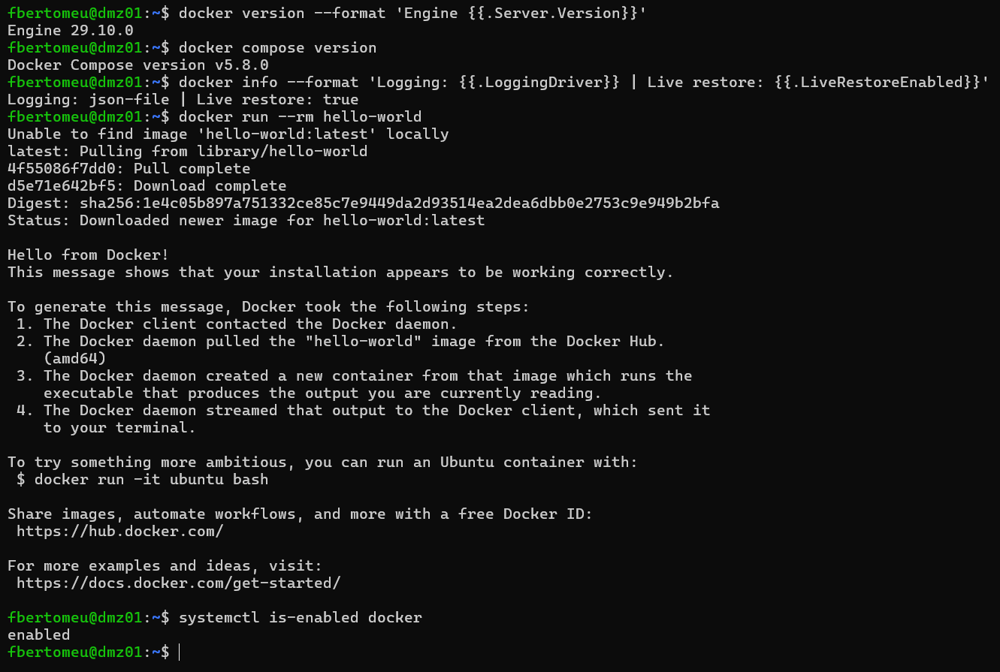

`hello-world` se descarga de Docker Hub por HTTPS, a través de la política 2.

### 10. Stack de servicios en el repositorio

Todo el stack es configuración como código en [`configs/04-dmz01/`](../configs/04-dmz01/):

```
configs/04-dmz01/
├── docker-compose.yml
├── netplan-dmz01.yaml      ← red del servidor (referencia)
├── .gitignore              ← ignora nginx/certs/
├── nginx/conf.d/
│   ├── 00-comun.conf       ← TLS 1.2/1.3, server_tokens off, cabeceras de proxy, WebSocket
│   ├── 10-default.conf     ← 80 → 301 a HTTPS; 443 default_server → 444
│   ├── 20-www.conf         ← www.pyme.test → web:80 + cabeceras de seguridad
│   └── 30-estado.conf      ← estado.pyme.test → estado:3001 (WebSocket)
└── web/index.html          ← web de la empresa ficticia "PYME Lab S.L."
scripts/04-gen-cert.sh      ← certificado autofirmado (idempotente)
```

| Servicio | Imagen | Redes | Puertos publicados | Función |
|---|---|---|---|---|
| `proxy` | `nginx:stable-alpine` | frontend, interno | 80, 443 | Proxy inverso, TLS, redirección HTTP → HTTPS |
| `web` | `nginx:stable-alpine` | interno | — | Web corporativa estática, con healthcheck |
| `estado` | `louislam/uptime-kuma:2-slim` | frontend | — | Monitorización y página de estado |

- **Red `frontend`:** bridge normal, con salida a Internet (la necesitan los monitores de Kuma).
- **Red `interno`:** `internal: true`, sin salida a Internet. La web solo es accesible a través del proxy.
- **Solo `proxy` publica puertos.** `proxy` espera a que `web` esté *healthy* (`depends_on` con `condition: service_healthy`).
- **Cabeceras en `www`:** `X-Content-Type-Options: nosniff`, `X-Frame-Options: SAMEORIGIN`, `Referrer-Policy: strict-origin-when-cross-origin` y `Content-Security-Policy: default-src 'self'; style-src 'self' 'unsafe-inline'`.
- **Certificado** ([`scripts/04-gen-cert.sh`](../scripts/04-gen-cert.sh)): RSA 3072, SHA-256, 825 días, CN `www.pyme.test`, SAN `www.pyme.test`, `estado.pyme.test` e IP 192.168.1.210, `CA:FALSE`, EKU `serverAuth`. La clave privada se queda en el servidor con permisos 600 y no se sube al repo.

Subida al repositorio desde el PC:

```powershell
cd C:\Users\Ferran\Documents\GitHub\homelab-pyme
git add configs/04-dmz01 scripts/04-gen-cert.sh
git update-index --chmod=+x scripts/04-gen-cert.sh
git commit -m "Fase 4: stack Docker de la DMZ (proxy, web, Uptime Kuma)"
git push
```

### 11. Despliegue y pruebas locales

En dmz01, el repositorio se clona en `/opt` y el stack se levanta desde ahí:

```bash
sudo git clone https://github.com/baRdeNNy/homelab-pyme.git /opt/homelab-pyme
sudo chown -R fbertomeu:fbertomeu /opt/homelab-pyme
cd /opt/homelab-pyme/configs/04-dmz01
bash ../../scripts/04-gen-cert.sh
docker compose pull
docker compose up -d
docker compose ps
```

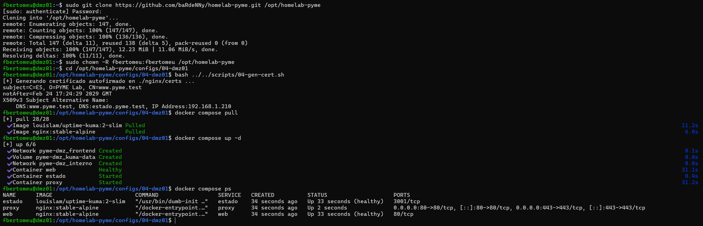

El script muestra el sujeto, la caducidad (24/02/2029) y los SAN del certificado. Los tres contenedores están levantados, `web` y `estado` en *healthy*, y solo `proxy` publica los puertos 80 y 443.

Para aplicar un cambio que ya está en el repositorio:

```bash
cd /opt/homelab-pyme && git pull && cd configs/04-dmz01 && docker compose up -d
```

Pruebas desde el propio servidor:

```bash
curl -sI -H "Host: www.pyme.test" http://127.0.0.1 | head -3
curl -skI --resolve www.pyme.test:443:127.0.0.1 https://www.pyme.test | head -8
curl -skI --resolve estado.pyme.test:443:127.0.0.1 https://estado.pyme.test | head -3
curl -sk https://127.0.0.1 ; echo "exit=$?"
docker exec web wget -q -T5 -O- http://example.com >/dev/null 2>&1 && echo "web CON salida" || echo "web SIN salida: OK"
```

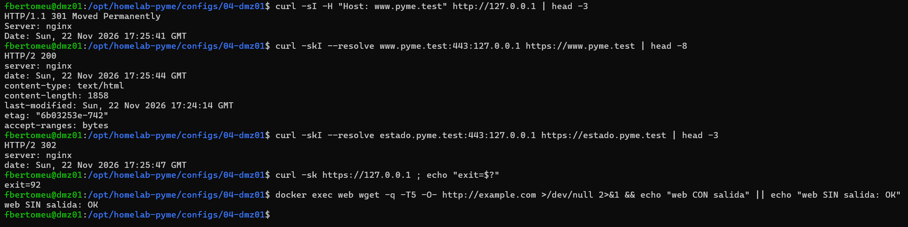

| Prueba | Resultado | Significado |
|---|---|---|
| HTTP a `www.pyme.test` | `301 Moved Permanently` | HTTP redirige a HTTPS |
| HTTPS a `www.pyme.test` | `HTTP/2 200` | La web responde a través del proxy |
| HTTPS a `estado.pyme.test` | `HTTP/2 302` | Uptime Kuma responde (redirige a su login) |
| HTTPS por IP, sin nombre | `exit=92` | El `default_server` cierra la conexión sin responder (444) |
| Salida a Internet desde `web` | `web SIN salida: OK` | La red `interno` no tiene salida |

### 12. Acceso desde el PC

No hay DNS público para `.test`, así que los nombres se resuelven con el archivo `hosts` del PC (PowerShell como administrador):

```powershell
Add-Content C:\Windows\System32\drivers\etc\hosts "`n192.168.1.210  www.pyme.test estado.pyme.test"
ipconfig /flushdns
curl.exe -skI https://www.pyme.test
curl.exe -sI http://www.pyme.test
```

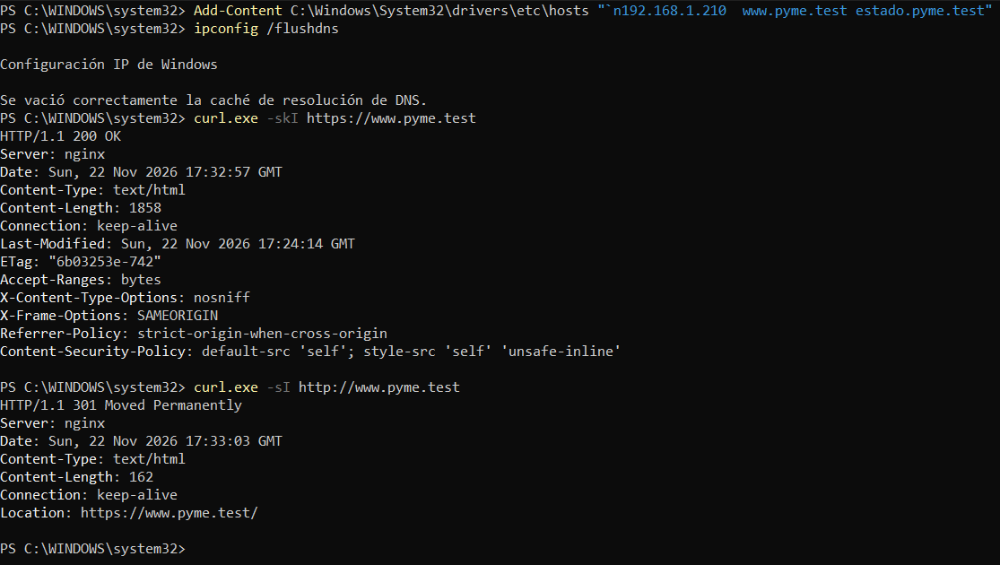

HTTPS responde `200` con las cuatro cabeceras de seguridad, y HTTP responde `301` hacia `https://www.pyme.test/`.

En el navegador, `https://www.pyme.test` muestra el aviso de certificado autofirmado. Tras continuar se ve la web:

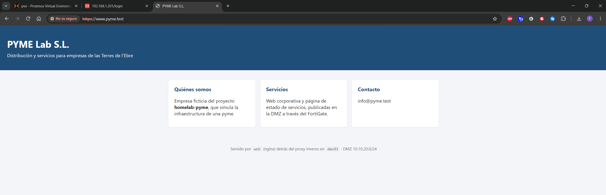
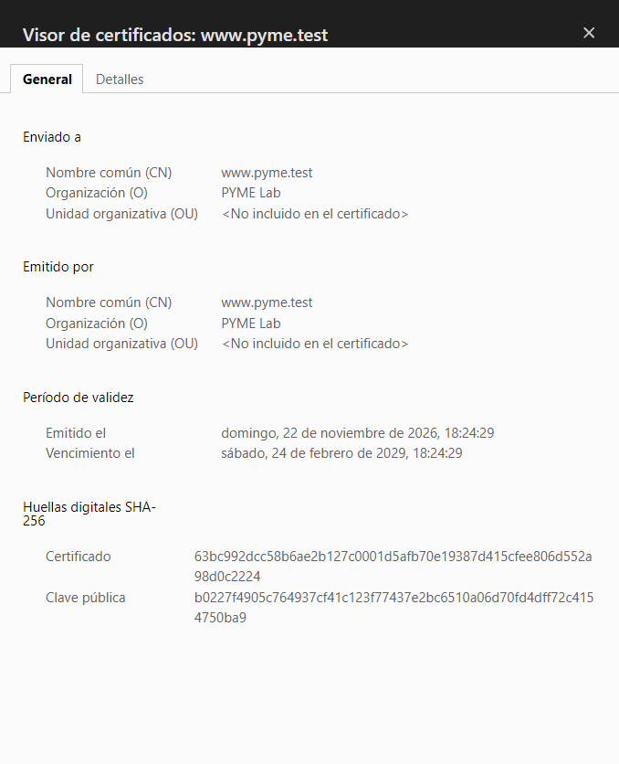

### 13. Uptime Kuma

Primer acceso a `https://estado.pyme.test`: idioma **Español**, base de datos **SQLite** y cuenta de administrador `admin`.

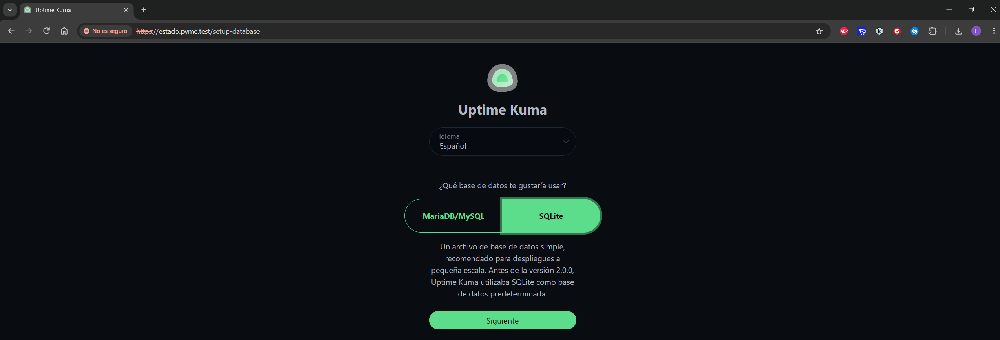
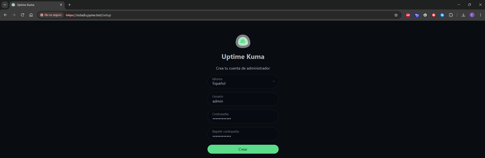

Monitores (*Añadir nuevo monitor*):

| Tipo | Nombre | Valores |
|---|---|---|
| HTTP(s) | Web corporativa | `https://www.pyme.test`, cada 60 s, 0 reintentos, *Ignorar errores TLS/SSL* ✅ |
| Ping | Salida a Internet | `8.8.8.8`, cada 60 s |
| DNS | Resolución DNS | `www.google.com`, registro A, resolvedor `8.8.8.8`, puerto 53 |

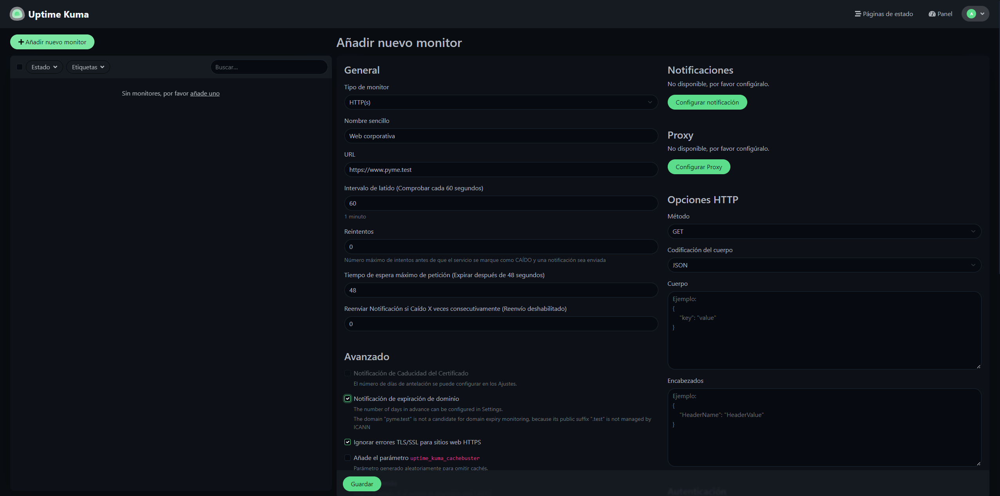
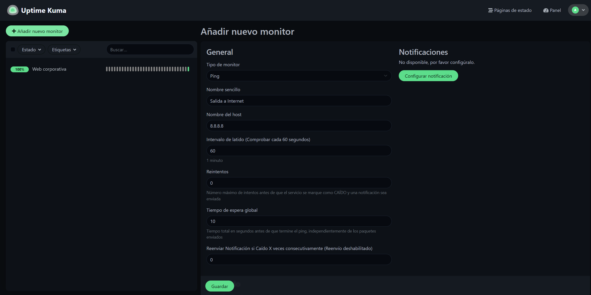
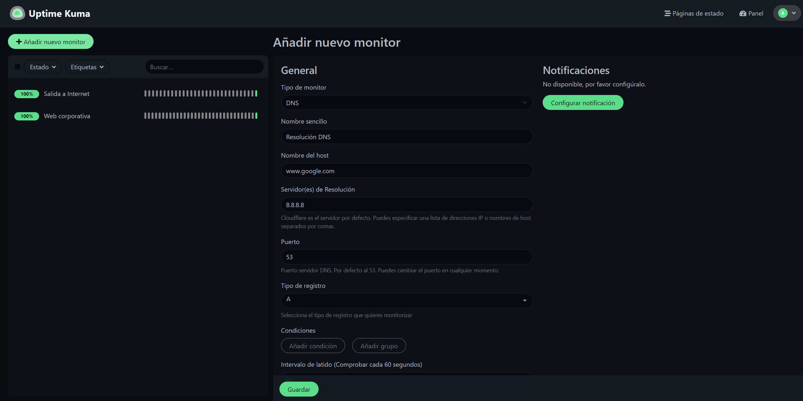

El aviso de caducidad del certificado no está activado. Kuma marca por defecto el aviso de expiración de dominio, pero indica que no se puede aplicar a `.test`, porque no es un TLD gestionado por ICANN.

**Monitorizar la web por el camino publicado.** Dentro del contenedor `estado` no se resuelve `www.pyme.test`: el `hosts` solo está en el PC. Se añade al servicio en `docker-compose.yml`:

```yaml
    extra_hosts:
      - "www.pyme.test:host-gateway"
```

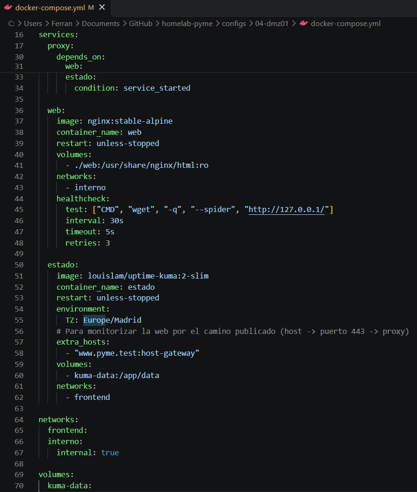

`host-gateway` es la IP del host en el bridge de Docker (172.17.0.1). Así Kuma entra por el puerto 443 publicado y pasa por el proxy, igual que un usuario, sin necesidad de meterlo en la red interna. Se sube el cambio desde el PC y se despliega en dmz01:

```powershell
git commit -am "Fase 4: Uptime Kuma monitoriza la web por el proxy"
git push
```

```bash
cd /opt/homelab-pyme && git pull && cd configs/04-dmz01 && docker compose up -d
docker exec estado getent hosts www.pyme.test
```

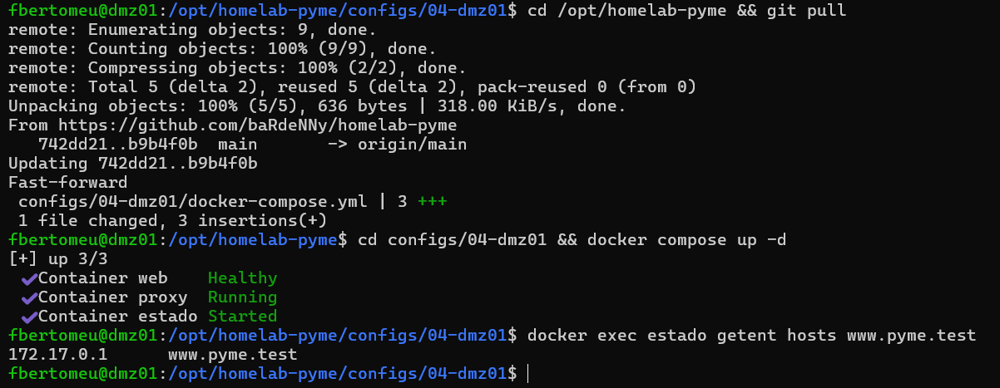

Los tres monitores, en verde y al 100 %:

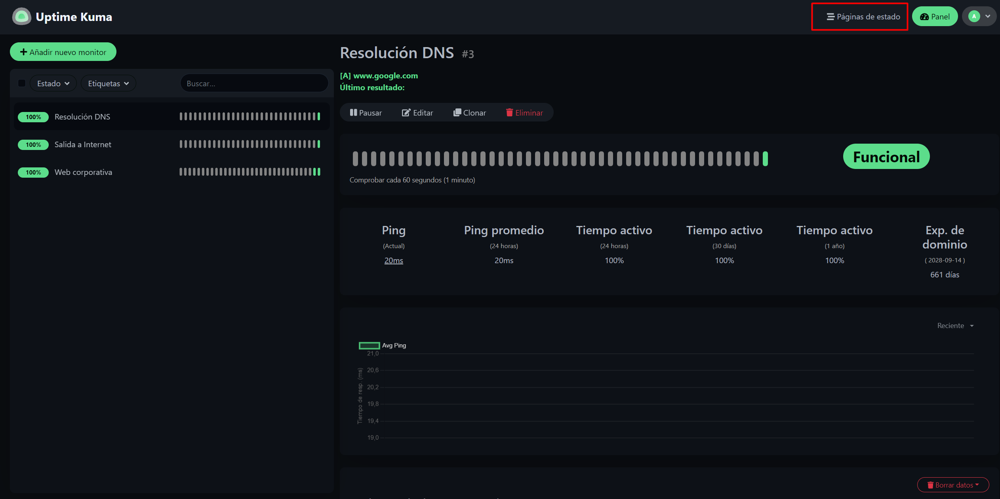

**Página de estado:** *Páginas de estado → Nueva Página de Estado*, nombre `Estado de servicios PYME`, slug `pyme`. Se añade un grupo `Servicios` con los tres monitores y se guarda. Queda publicada en `https://estado.pyme.test/status/pyme`.

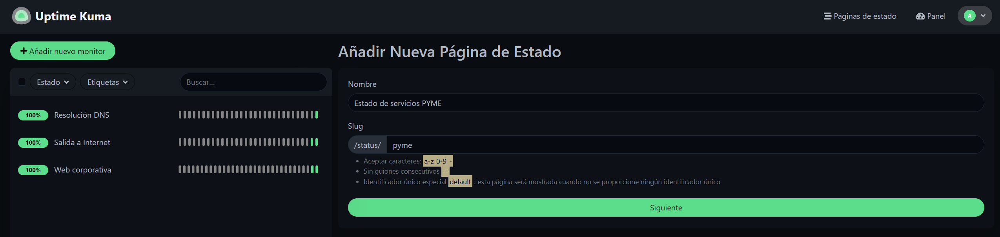
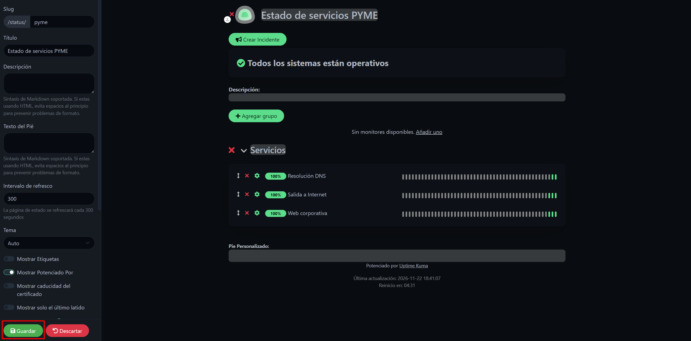

### 14. Aislamiento DMZ → LAN

No hay ninguna política de la DMZ hacia la LAN, así que el tráfico debe caer en la denegación implícita. Se comprueba con un debug flow en el FortiGate (*CLI Console*), filtrando de dmz01 a DC01:

```
diagnose debug reset
diagnose debug flow filter clear
diagnose debug flow filter saddr 10.10.20.10
diagnose debug flow filter daddr 10.10.10.10
diagnose debug flow show function-name enable
diagnose debug flow trace start 20
diagnose debug enable
```

Mientras tanto, desde dmz01 se prueba ICMP, DNS y SMB contra el DC:

```bash
ping -c2 -W2 10.10.10.10
nc -zv -w3 10.10.10.10 53
nc -zv -w3 10.10.10.10 445
```

Al terminar, `diagnose debug disable` en el FortiGate.

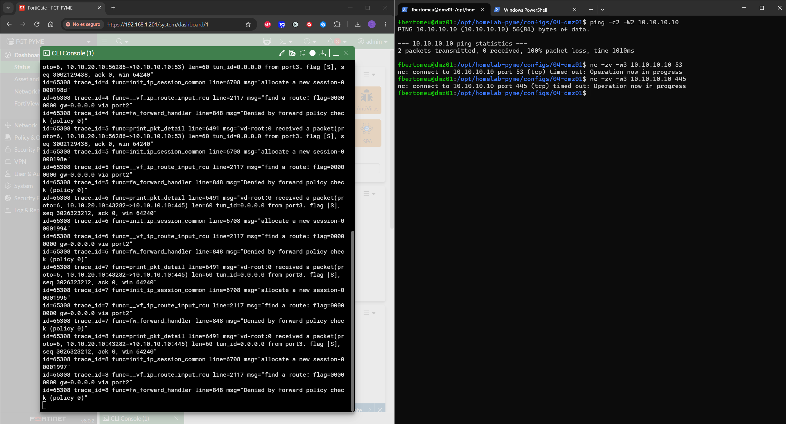
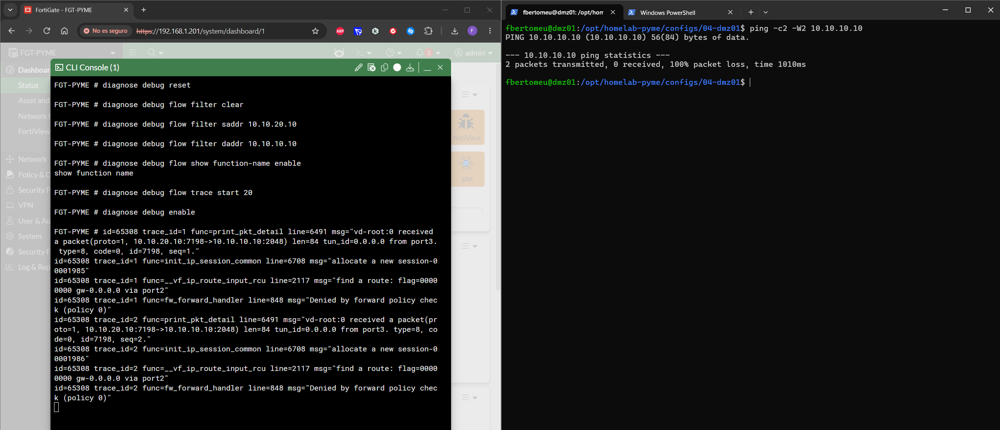

Las tres pruebas fallan en dmz01: 100 % de pérdida en el ping y *timed out* en los puertos 53 y 445. El FortiGate recibe los paquetes por port3, encuentra la ruta por port2 y los descarta con `Denied by forward policy check (policy 0)`, es decir, con la denegación implícita.

Lo mismo se ve en *Log & Report → Forward Traffic*, filtrando por origen 10.10.20.10. Las consultas DNS y los pings a 8.8.8.8 salen por *DMZ-a-Internet (2)*, y todo lo que va a 10.10.10.10 (PING, SMB y DNS) queda en *Deny / Implicit Deny*:

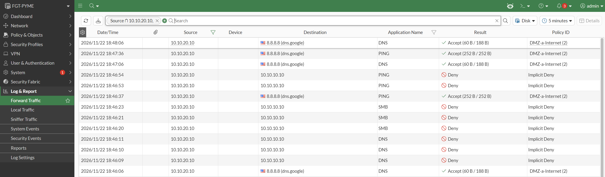

Filtrando por destino 192.168.1.210 se ven los accesos HTTPS y SSH desde el PC (192.168.1.133) aceptados por *Casa-a-DMZ-publicado (3)*. El origen es la IP real del PC, porque la política 3 no hace SNAT:

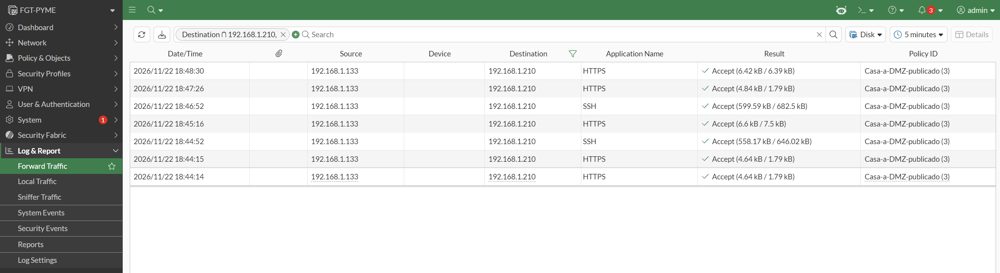

### 15. Corrección de la política 2

Durante las pruebas apareció un hueco: la política 2 (*DMZ-a-Internet*) tenía como destino `all` por port1, y port1 es la red de casa. Por lo tanto, la DMZ podía abrir HTTP/HTTPS contra cualquier equipo de 192.168.1.0/24. Por ejemplo, la web del router responde:

```bash
curl -sI -m5 http://192.168.1.1 | head -1
```

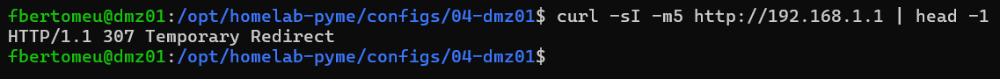

La licencia de evaluación solo permite 3 políticas, así que no se puede añadir una de denegación. Se corrige **negando el destino** de la propia política 2: todo excepto `Red-Casa`.

```
config firewall policy
    edit 2
        set dstaddr "Red-Casa"
        set dstaddr-negate enable
    next
end
```


Comprobación:

```bash
curl -sI -m5 http://192.168.1.1 | head -1 ; echo "exit=$?"
curl -sI -m5 https://download.docker.com | head -1
```


El router ya no devuelve ninguna línea: curl agota los 5 segundos de `-m5`. El `exit=0` es el código de `head`, el último comando de la tubería, no el de curl. Internet sigue funcionando (`HTTP/2 200` de download.docker.com) y los monitores de Kuma siguen en verde. La tabla y el bloque CLI de [docs/02-fortigate.md](02-fortigate.md) ya reflejan este cambio.

### 16. Snapshot final y backup del FortiGate

Snapshot `fase4-ok`, sin RAM, de la VM 103: *Docker + proxy Nginx HTTPS + web + Uptime Kuma publicados por la VIP. DMZ aislada de LAN y de Red-Casa*. También se hace un snapshot `fase4-ok` de la VM 100 (FortiGate), porque su configuración ha cambiado.


Backup nuevo de la configuración del FortiGate desde *admin → Configuration → Backup*, con **Encrypt sensitive information only**, igual que en la Fase 2:


### Incidencias y diagnóstico

**`docker.sources` mal formado.** La primera vez, el repositorio se escribió pegando un bloque *heredoc*, y `apt update` falló con `Malformed entry 1 in sources file /etc/apt/sources.list.d/docker.sources (URI)`. Con `cat` se ve la causa: al pegar se colaron **líneas en blanco entre los campos**.


En el formato deb822, una línea en blanco separa una entrada de la siguiente. Así, la entrada 1 quedaba solo con `Types: deb`, sin `URIs:`, y de ahí el error. Solución: reescribir el archivo con un único `printf` (comando del paso 9), que no depende de cómo pegue la terminal los saltos de línea.

**`curl` contra el `default_server` devuelve exit 92, no 52.** Con HTTP/1.1, cerrar la conexión sin responder (código 444 de nginx) da *Empty reply from server* (52). Por HTTP/2, curl lo informa como un error de flujo HTTP/2 (92). El comportamiento es el esperado.

**Cabeceras de seguridad "ausentes" en las pruebas locales.** No aparecían porque `head -8` cortaba la salida antes de llegar a ellas. Con `grep` sí salen:

```bash
curl -skI --resolve www.pyme.test:443:127.0.0.1 https://www.pyme.test | grep -iE "x-frame|x-content|referrer|content-security"
```

### Decisiones de diseño

- **Ubuntu Server 26.04.1 LTS:** la LTS actual, con soporte hasta 2031 y soportada oficialmente por Docker (repositorio `resolute`).
- **2 vCPU / 2 GB con ballooning / 32 GB:** suficiente para tres contenedores ligeros y deja RAM libre para el appliance de Acronis de la Fase 6. Con 20 GB en la VM de Proxmox: Proxmox ~2, FortiGate 2, DC01 4, PC01 4 (apagada cuando no se usa) y DMZ01 2. En Linux el ballooning funciona bien, al contrario que en el DC con Windows.
- **VirtIO + Guest Agent:** dispositivos paravirtualizados, IP visible en Proxmox, apagados limpios y backups consistentes en la Fase 6.
- **Instalador en inglés con teclado español:** mismo criterio que en la Fase 3.
- **IP fija desde el instalador (netplan) con DNS públicos:** no hay política DMZ → LAN, así que el servidor no puede usar el DNS del DC. Es lo correcto en una DMZ. Se usa 8.8.8.8 porque 1.1.1.1 está bloqueado en la red de casa (ver Fase 3).
- **LVM ampliado al disco completo:** por defecto el instalador solo asigna la mitad.
- **SSH solo con clave ed25519, sin root y con `AllowUsers`:** la contraseña solo se usó para copiar la clave. Archivo propio en `sshd_config.d` en vez de editar `sshd_config`, que así queda como lo deja el paquete.
- **UFW como segunda capa detrás del FortiGate** (defensa en profundidad): SSH solo desde 192.168.1.0/24 y con `limit`.
- **Docker se salta UFW con los puertos publicados:** por eso solo el proxy publica 80/443 y el resto de contenedores no publica nada.
- **Actualizaciones automáticas solo de Ubuntu (`resolute` y `-security`), sin reinicio automático:** reiniciar un servidor publicado lo decide el administrador.
- **Docker desde el repositorio oficial** (no el snap ni el paquete `docker.io`): versiones actuales y el plugin de Compose v2. Docker no se actualiza solo porque no está en *Allowed-Origins*: actualizar el Engine reinicia los contenedores, así que se hace en una ventana de mantenimiento.
- **Usuario en el grupo `docker`:** equivale a ser root. Se acepta porque `fbertomeu` ya es administrador con sudo y solo entra con clave.
- **`daemon.json` con rotación de logs (10 MB × 3) y `live-restore`:** los logs de los contenedores no pueden llenar el disco, y los contenedores siguen en marcha si se reinicia el daemon.
- **Proxy inverso nginx como único punto de entrada:** es el patrón de publicación habitual, con un solo certificado, redirección HTTP → HTTPS, cabeceras de seguridad y `server_tokens off`. La configuración es código en el repo. Se descartó Nginx Proxy Manager: su configuración vive en una GUI (peor para Git) y además necesita el puerto 81, que la política 3 no permite.
- **`default_server` con 444:** quien entra por IP o con un nombre desconocido no recibe nada.
- **Hosts virtuales en `.test`:** TLD reservado para pruebas (RFC 2606/6761), separado del dominio interno `pyme.internal` de AD.
- **Certificado autofirmado con SAN, generado en el servidor por script:** la clave privada nunca se sube al repo (`.gitignore`). En producción se usaría Let's Encrypt o un certificado comercial.
- **Sin HSTS:** con un certificado autofirmado, HSTS impediría saltarse el aviso del navegador. Se activaría con un certificado de confianza.
- **Dos redes Docker:** la web va en una red `internal` sin salida a Internet. Si se comprometiera, no podría descargar nada ni conectarse a un servidor de control. Uptime Kuma necesita salida para sus monitores.
- **Uptime Kuma (`2-slim`, SQLite):** monitorización y página de estado, lo que un MSP ofrece a sus clientes. Se usa el tag `2` porque `latest` está obsoleto, y la variante slim ocupa ~177 MB frente a ~590 MB. Con SQLite no hace falta un contenedor de base de datos.
- **`extra_hosts: www.pyme.test:host-gateway`:** Kuma vigila la web por el mismo camino que un usuario (443 → proxy) sin estar en la red interna.
- **Repositorio clonado en `/opt/homelab-pyme` y despliegue con `git pull` + `docker compose up -d`:** lo que se ejecuta es exactamente lo que hay en el repo (GitOps básico).
- **Política 2 con destino negado (todo excepto Red-Casa):** la DMZ sale a Internet pero no a la red de casa, sin gastar otra política (la licencia permite 3).
- **Snapshots sin RAM:** ocupan mucho menos y para el lab son suficientes.

### Verificación

- `ip -br a`: ens18 con 10.10.20.10/24. Ping a 10.10.20.1 y 8.8.8.8 correcto. `df -h /`: 30G.
- Reloj en Europe/Madrid y sincronizado. Guest Agent activo e IP visible en Proxmox.
- SSH por la VIP solo con clave. Sin clave → `Permission denied (publickey)`.
- UFW activo (22 desde Red-Casa con `limit`, 80 y 443). `unattended-upgrades` con dry-run correcto.
- Docker 29.10.0, Compose v5.8.0, `json-file` + `live-restore`, hello-world correcto y servicio *enabled*.
- Tres contenedores en marcha (`web` y `estado` *healthy*). Pruebas locales: 301, 200, 302 y 444 (exit 92). La web no tiene salida a Internet.
- Desde el PC: `https://www.pyme.test` responde 200 con las cabeceras de seguridad y `http://` responde 301. Certificado con SAN.
- Uptime Kuma: tres monitores al 100 % y página de estado `/status/pyme` con *Todos los sistemas están operativos*.
- DMZ → LAN (10.10.10.10) denegado por la denegación implícita (debug flow y logs). DMZ → Red-Casa denegado tras el cambio en la política 2, y la salida a Internet sigue funcionando.
- Snapshots `pre-docker` y `fase4-ok` (VM 103) y `fase4-ok` (VM 100). Backup nuevo de la configuración del FortiGate.
