# Fase 5 — Automatización con las APIs de FortiGate y Proxmox

Un script en Python ([`scripts/05-automatizacion.py`](../scripts/05-automatizacion.py)) usa dos APIs REST:

1. **FortiGate (API de FortiOS):** descarga un backup **cifrado** de la configuración y conserva los últimos 14.
2. **Proxmox VE:** genera un informe en Markdown con el estado del nodo, las VMs (CPU, RAM, disco, uptime y snapshots) y el almacenamiento.

Cada API usa un **token de mínimo privilegio**. Los secretos se guardan en un archivo `.env` que no se sube al repositorio. El script se ejecuta cada día con el Programador de tareas de Windows.

| Elemento | Valor |
|---|---|
| Equipo que ejecuta el script | PC host con Windows 11, 192.168.1.133, Python 3.14 |
| Dependencias | Ninguna: solo la librería estándar de Python |
| FortiGate | `https://192.168.1.201`, usuario REST API `api-backup` |
| Proxmox | `https://192.168.1.200:8006`, token `automation@pve!informe` |
| Salida | `salida/` (backups, informes y log), excluida del repo |

### 1. FortiGate: perfil y usuario de API

**Perfil de administrador** con el grupo *System* en lectura/escritura y todo lo demás sin acceso (*CLI Console* de la GUI):

```
config system accprofile
    edit "api-backup"
        set comments "Solo backup de config (Fase 5)"
        set secfabgrp none
        set ftviewgrp none
        set authgrp none
        set sysgrp read-write
        set netgrp none
        set loggrp none
        set fwgrp none
        set vpngrp none
        set utmgrp none
        set wanoptgrp none
        set wifi none
    next
end
```

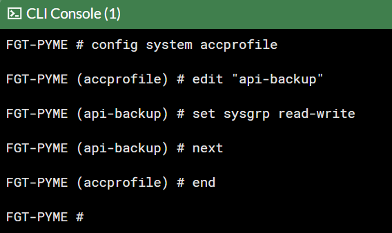

**Usuario REST API** asociado al perfil y limitado por *trusthost* a la IP del equipo que ejecuta el script. Al guardar, FortiOS pide la contraseña del administrador actual.

```
config system api-user
    edit "api-backup"
        set comments "Backup de config por script"
        set accprofile "api-backup"
        config trusthost
            edit 1
                set ipv4-trusthost 192.168.1.133 255.255.255.255
            next
        end
    next
end
```

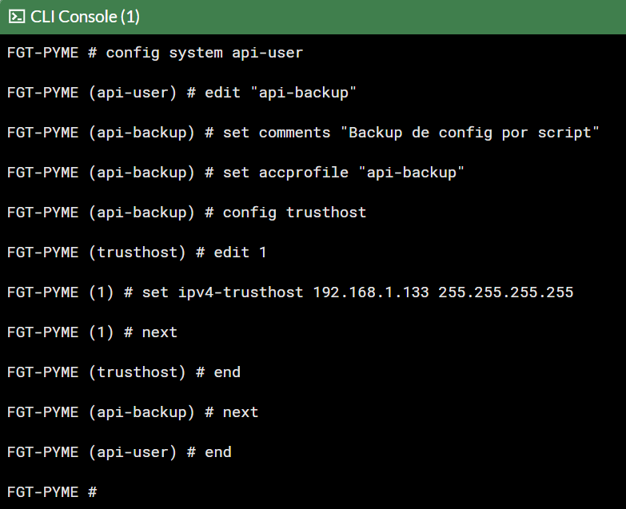

**Generar el token.** Solo se muestra una vez, así que se guarda en el gestor de contraseñas:

```
execute api-user generate-key api-backup
```

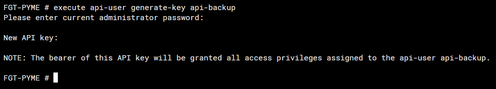

**Prueba de acceso** desde PowerShell. El token se pide con `Read-Host` para que no quede en el historial de comandos:

```powershell
$t = Read-Host "Token FortiGate"
curl.exe -k -H "Authorization: Bearer $t" https://192.168.1.201/api/v2/monitor/system/status
```

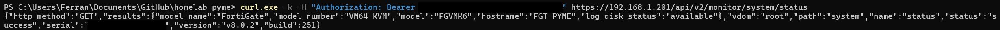

**Prueba de backup.** En FortiOS 8.0 el backup se pide por **POST** y exige una **clave de cifrado**:

```powershell
$p = Read-Host "Clave de cifrado del backup"
@{destination="file"; scope="global"; password=$p} | ConvertTo-Json -Compress | Set-Content -NoNewline -Encoding ascii body.json
curl.exe -k -X POST -H "Authorization: Bearer $t" -H "Content-Type: application/json" -d "@body.json" https://192.168.1.201/api/v2/monitor/system/config/backup -o prueba.conf -w "HTTP %{http_code}`n"
(Get-Item prueba.conf).Length
Get-Content prueba.conf -TotalCount 3
Remove-Item prueba.conf, body.json
```

Se obtiene `HTTP 200` y un archivo de unos 6 KB que empieza por `#FGBK|6|FGVMK6|8|00|0251|`, la cabecera de un backup cifrado de FortiOS 8.0.2 (build 251).

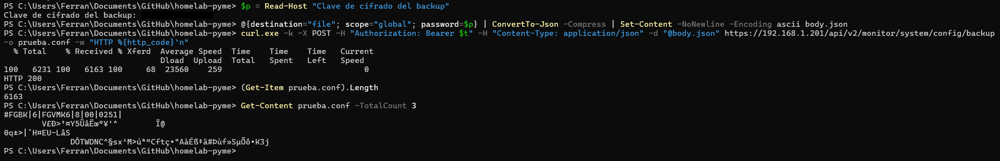

### 2. Proxmox: usuario, rol y token

En *pve → Shell*:

```bash
pveum user add automation@pve --comment "Informe de VMs por script (Fase 5)"
pveum acl modify / --users automation@pve --roles PVEAuditor
pveum user token add automation@pve informe --privsep 1 --comment "Script homelab-pyme"
pveum acl modify / --tokens 'automation@pve!informe' --roles PVEAuditor
```

- El usuario `automation@pve` **no tiene contraseña**: no puede iniciar sesión en la web y solo existe para el token.
- **PVEAuditor** es un rol de solo lectura: permite ver nodo, VMs y almacenamiento, sin poder cambiar nada.
- Con `--privsep 1` el token tiene sus propias ACL, que nunca pueden superar las del usuario.

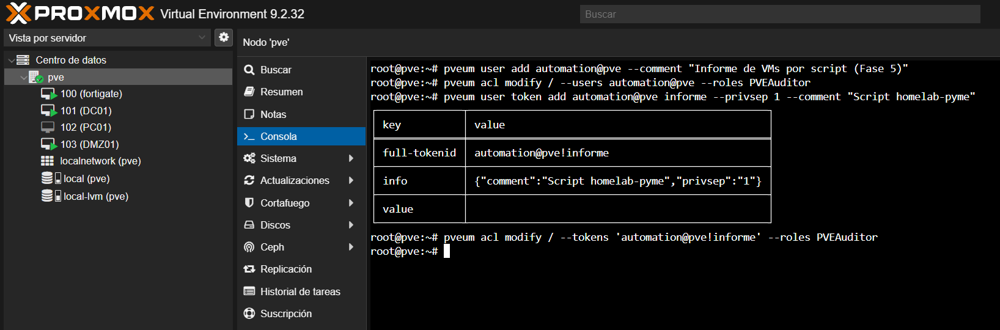

**Prueba de lectura:**

```powershell
$pt = Read-Host "Token Proxmox"
curl.exe -k -H "Authorization: PVEAPIToken=automation@pve!informe=$pt" https://192.168.1.200:8006/api2/json/nodes/pve/qemu -w "`nHTTP %{http_code}`n"
```

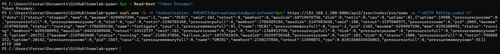

**Prueba de que no puede escribir:** intentar crear un pool devuelve `403 Permission check failed (/pool/test, Pool.Allocate)`.

```powershell
curl.exe -k -X POST -H "Authorization: PVEAPIToken=automation@pve!informe=$pt" -d "poolid=test" https://192.168.1.200:8006/api2/json/pools -w "`nHTTP %{http_code}`n"
```

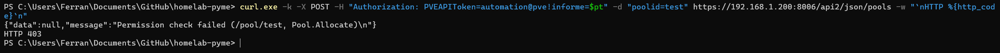

### 3. Script

| Archivo | Contenido |
|---|---|
| `scripts/05-automatizacion.py` | Script principal |
| `.env.example` | Plantilla de configuración, sin secretos |
| `.env` | Configuración real con los tokens y la clave. **Excluido por `.gitignore`** |
| `salida/` | Backups, informes y log. **Excluido por `.gitignore`** |

Configuración:

```powershell
Copy-Item .env.example .env
notepad .env      # rellenar FGT_TOKEN, FGT_BACKUP_PASSWORD y PVE_TOKEN_SECRET
```

Comprobación de que el `.env` no se sube:

```powershell
git status --short
git check-ignore -v .env
```

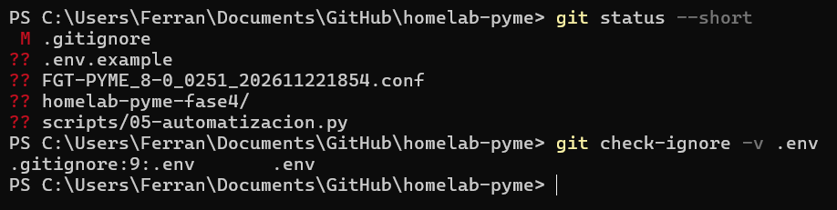

Ejecución:

```powershell
python scripts\05-automatizacion.py              # backup + informe
python scripts\05-automatizacion.py --backup     # solo backup del FortiGate
python scripts\05-automatizacion.py --informe    # solo informe de Proxmox
```

Qué hace el script:

- **Backup:** consulta el hostname y la versión (`/api/v2/monitor/system/status`) y pide el backup por POST con la clave de cifrado (`/api/v2/monitor/system/config/backup`). Comprueba que la respuesta sea de verdad un backup (cabecera `#FGBK` o `#config-version`), porque FortiOS puede devolver un error en JSON con HTTP 200. Lo guarda como `salida/backups/fortigate/FGT-PYME_AAAAMMDD-HHMMSS.conf` y borra los más antiguos según `FGT_RETENCION`.
- **Informe:** consulta `/nodes/pve/status`, `/version`, `/nodes/pve/qemu`, los snapshots de cada VM y `/nodes/pve/storage`, y escribe `salida/informes/informe-proxmox_AAAAMMDD-HHMMSS.md`.
- **Log y código de salida:** todo queda en `salida/automatizacion.log`. Devuelve `0` si todo va bien, `1` si falla alguna tarea y `2` si hay un error de configuración, para que el Programador de tareas detecte los fallos.

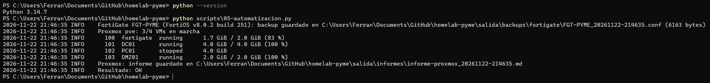
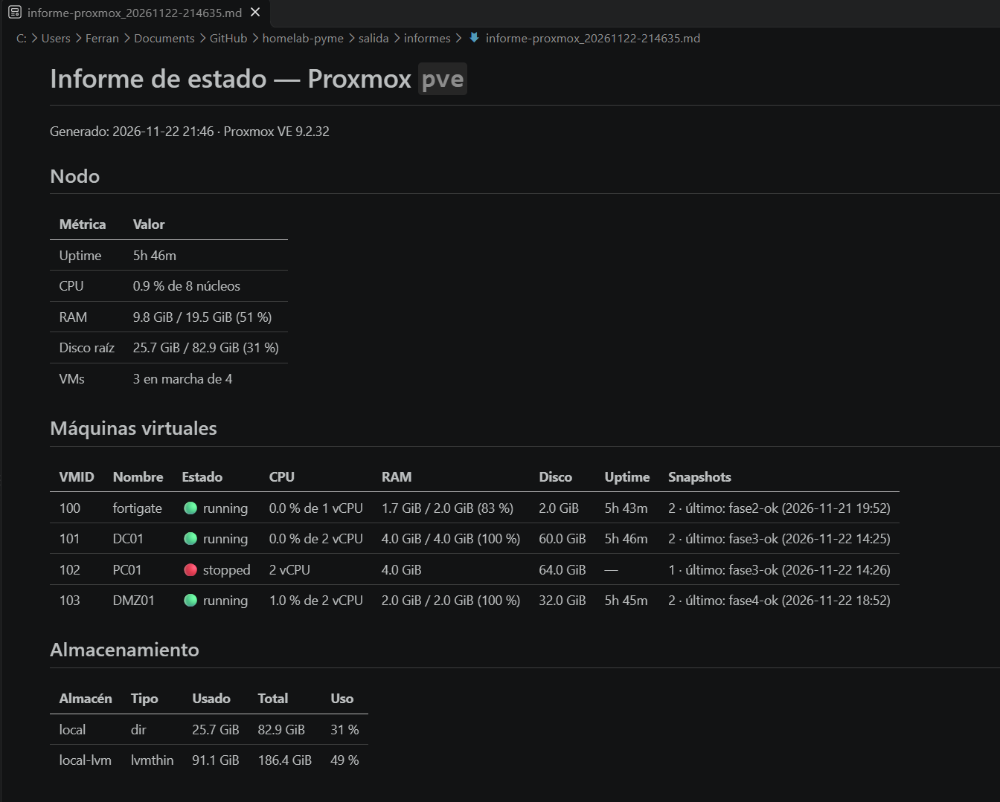

La RAM al 100 % de DC01 y DMZ01 no indica un problema: Proxmox mide la memoria desde el host, y una VM sin el driver de *balloon* activo aparece con toda su memoria asignada como usada.

### 4. Ejecución programada

Tarea diaria a las 21:00. Con `-StartWhenAvailable`, si el PC está apagado a esa hora, la tarea se ejecuta en cuanto se enciende.

```powershell
$repo = "C:\Users\Ferran\Documents\GitHub\homelab-pyme"
$py   = (Get-Command python).Source
$accion = New-ScheduledTaskAction -Execute $py -Argument "`"$repo\scripts\05-automatizacion.py`"" -WorkingDirectory $repo
$disparador = New-ScheduledTaskTrigger -Daily -At 21:00
$ajustes = New-ScheduledTaskSettingsSet -StartWhenAvailable -ExecutionTimeLimit (New-TimeSpan -Minutes 10)
Register-ScheduledTask -TaskName "homelab-pyme - backup e informe" -Action $accion -Trigger $disparador -Settings $ajustes -Description "Fase 5: backup del FortiGate e informe de Proxmox"
```

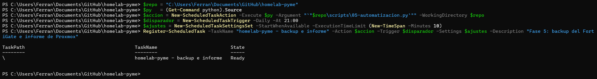

Prueba lanzándola a mano:

```powershell
Start-ScheduledTask -TaskName "homelab-pyme - backup e informe"
Start-Sleep 15
Get-ScheduledTaskInfo -TaskName "homelab-pyme - backup e informe" | Select-Object LastRunTime, LastTaskResult
Get-Content salida\automatizacion.log -Tail 8
```

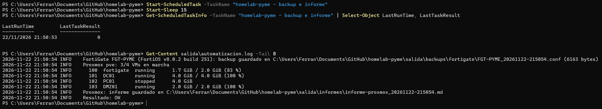

### Decisiones de diseño

- **Tokens de API en lugar de usuario y contraseña:** cada token se puede revocar por separado, no sirve para entrar en la interfaz web y deja claro en los logs quién hace cada acción.
- **Mínimo privilegio en Proxmox:** rol PVEAuditor (solo lectura) y token con `privsep`. Se comprueba con una prueba de escritura que devuelve 403.
- **Permisos del FortiGate:** en FortiOS 8.0.2, el backup de configuración por API necesita el grupo *System* en lectura/escritura (`sysgrp read-write`). El resto de grupos quedan en `none`, y para limitar el riesgo el usuario solo acepta conexiones desde una IP (*trusthost*) y no tiene acceso a la GUI.
- **Backup cifrado obligatorio:** FortiOS 8.0 no permite descargar la configuración sin clave de cifrado. Por la API cifra el archivo entero, no solo los datos sensibles como la opción de la GUI. La clave se guarda en el gestor de contraseñas: sin ella no se puede restaurar.
- **Sin contraseñas en el repo:** los secretos están en `.env`, que `.gitignore` excluye junto con `salida/`. En el repo solo hay `.env.example` con los campos vacíos.
- **Solo librería estándar:** el script funciona con cualquier Python 3 sin instalar paquetes, lo que facilita usarlo en otro equipo o servidor.
- **Validar el contenido, no solo el código HTTP:** FortiOS responde con 200 incluso en algunos errores, así que el script comprueba la cabecera del archivo antes de darlo por bueno.
- **Certificados autofirmados:** en el lab la verificación TLS se desactiva desde el `.env` (`*_VERIFY_TLS=false`). En producción se instalarían certificados de una CA interna y se indicarían con `FGT_CA` y `PVE_CA`.
- **Ejecución desde el PC host:** suficiente para el lab y no requiere guardar la contraseña de Windows en la tarea. En una pyme se ejecutaría en un servidor de gestión, con una cuenta de servicio o con cron.

### Verificación

- Llamada a `/monitor/system/status` con el token: `HTTP 200` con FortiOS v8.0.2 build 251.
- Backup por API: `HTTP 200`, archivo de 6163 bytes con cabecera `#FGBK`.
- Token de Proxmox: lectura de las 4 VMs con `HTTP 200`; creación de un pool rechazada con `HTTP 403`.
- `git check-ignore -v .env` confirma que el `.env` está excluido.
- Ejecución manual del script y de la tarea programada: `Resultado: OK` y `LastTaskResult` = 0.
