# Fase 6 — Backup y restauración con Acronis Cyber Protect

Copias de seguridad **sin agente dentro de las VMs** de Proxmox con **Acronis Cyber Protect Cloud**, siguiendo la regla 3-2-1: los datos en producción, una copia local en un disco distinto y una réplica **inmutable** en Acronis Cloud. La fase se valida con dos pruebas reales:

1. **Desastre completo:** se destruye la VM DMZ01 (discos y snapshots incluidos) y se restaura desde el backup. **RTO real: menos de 4 minutos.**
2. **Recuperación de un archivo** borrado de la carpeta compartida de DC01, **desde la copia en Acronis Cloud**, comprobando el hash.

| Elemento | Valor |
|---|---|
| Consola | Acronis Cyber Protect Cloud (prueba de 30 días, sin tarjeta) |
| Agente | Agent for Linux + Agent for Proxmox VE en el nodo `pve` (192.168.1.200) |
| Copia 1 (local) | `\\192.168.1.133\AcronisBackups$` → `F:\Backups\Acronis` (HDD de 4 TB del PC host) |
| Copia 2 (fuera) | Réplica automática en Acronis Cloud, con almacenamiento inmutable |
| Planes | `PYME - VMs Proxmox` (DC01, DMZ01) y `PYME - FortiGate (crash-consistent)` (fortigate) |
| Programación | Cada día a las 21:30, incremental, después del script de la Fase 5 (21:00) |
| Cifrado | AES 256 en todos los backups |
| Seguridad de la consola | 2FA (TOTP) y notificaciones de fallo, aviso y recuperación |

### Cómo protege Acronis un Proxmox

Acronis no necesita nada dentro de las VMs ni un appliance (al contrario que con VMware): se instala **Agent for Linux + Agent for Proxmox VE en el propio nodo**, que usa las APIs nativas de Proxmox para hacer snapshots y leer los discos. La tabla oficial de plataformas soportadas incluye Proxmox VE 8.2 a 9.2. El agente se instala como root, necesita al menos 2 GB libres y solo abre conexiones **salientes** hacia Acronis (443 y 7770–7800), así que no hace falta abrir puertos de entrada.

### Producción real vs lab

| | Pyme gestionada por un MSP | Este lab |
|---|---|---|
| Consola | Cyber Protect Cloud del MSP, un cliente (tenant) por empresa | Cyber Protect Cloud de prueba, cuenta propia |
| Agente | En **cada nodo** del clúster Proxmox | En el único nodo `pve` |
| Copia local | NAS o repositorio dedicado, separado del hipervisor, en una VLAN de gestión aislada, con credenciales propias e inmutabilidad | Carpeta SMB en otro disco (F:) del mismo PC físico |
| Copia fuera | Réplica inmutable en Acronis Cloud | Igual: réplica inmutable en Acronis Cloud |
| Pruebas | Restauraciones periódicas documentadas y alertas a un equipo | Una restauración completa y una de archivo, con alertas por email |
| Red | Tráfico de backup por la red de gestión | El nodo está en la red de casa, delante del FortiGate |

**Mismo diseño, distinto hardware.** En el lab no hay NAS ni segundo equipo: todo corre en un solo PC, la licencia es de prueba y la subida a Internet es doméstica. Por eso la copia local va a un disco distinto del mismo PC y la copia fuera de casa a Acronis Cloud.

**Alternativas descartadas:**

- **Servidor de gestión on-premises (Cyber Protect 17)** en el PC o en una VM: consume RAM y no aporta nada en un lab de un solo nodo.
- **Servidor de gestión en la LAN o la DMZ:** necesitaría una política más en el FortiGate, y la licencia de prueba solo admite 3.
- **Almacén `local` de Proxmox como destino:** está en el mismo disco que las VMs; si se pierde el disco, se pierden las VMs y sus copias a la vez.

---

### 1. Requisitos en el nodo

En *pve → Shell*:

```bash
pveversion                          # pve-manager/9.2.32, kernel 7.0.14-30-pve
timedatectl | grep synchronized     # yes: la hora correcta es imprescindible para TLS y para la programación
df -h /                             # 53 GB libres (el agente pide 2 GB)
free -h                             # 9,6 GB disponibles
```

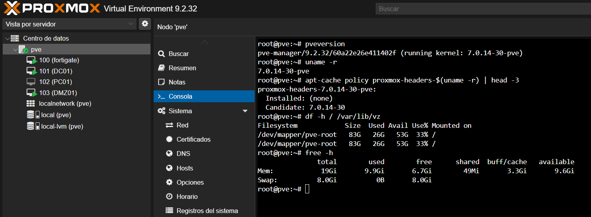

Cabeceras del kernel, por si el instalador necesita compilar su módulo:

```bash
apt update
apt install -y proxmox-headers-$(uname -r)
ls -d /lib/modules/$(uname -r)/build && echo "Cabeceras OK"
```

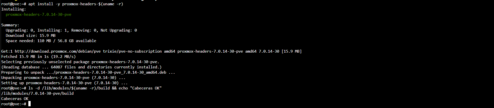

### 2. Registro y consola

Prueba de 30 días en acronis.com (versión para empresas). Da acceso a la consola **Acronis Cyber Protect Cloud** con todas las funciones y 1 TB de Acronis Cloud Storage.

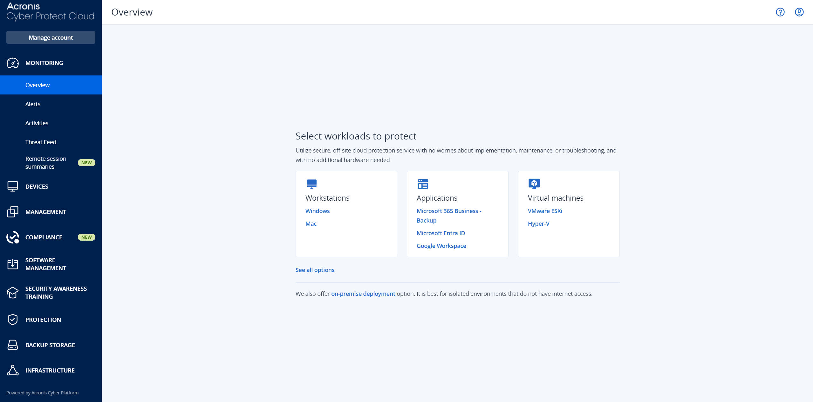

### 3. Instalación del agente en pve

**Descargar el instalador:** *DEVICES → All devices → Add → Virtualization hosts → Proxmox VE* → instalador de Linux.

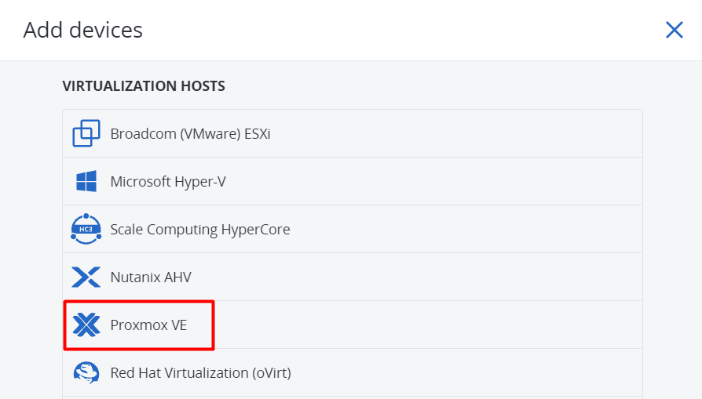

**Copiarlo al nodo** desde PowerShell en el PC:

```powershell
$bin = Get-ChildItem "$env:USERPROFILE\Downloads\*.bin" | Sort-Object LastWriteTime | Select-Object -Last 1
scp $bin.FullName root@192.168.1.200:/root/
```

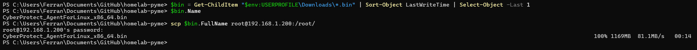

**Ejecutarlo** en pve:

```bash
cd /root
chmod +x ./CyberProtect_AgentForLinux_x86_64.bin
./CyberProtect_AgentForLinux_x86_64.bin
```

- El instalador pide el paquete **`rpm`**: lo usa en Debian para gestionar sus propios paquetes. *Continue* y lo instala con APT.
- Componentes: **Agent for Linux** y **Agent for Proxmox**.

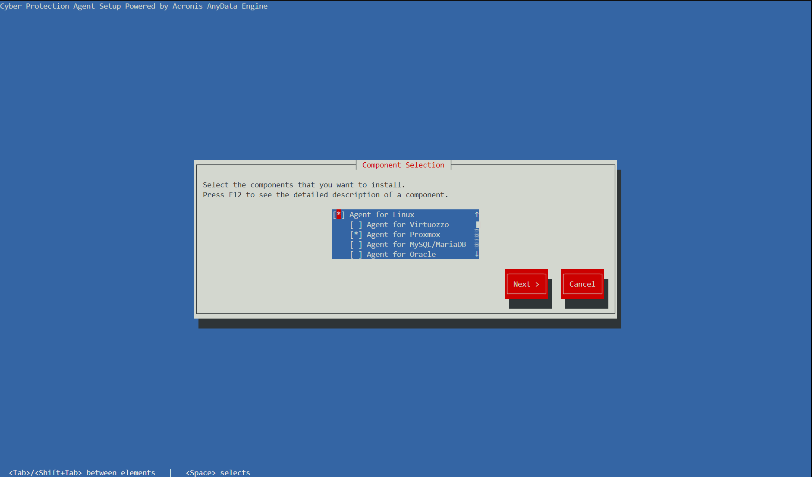

**Registro.** El nodo no tiene entorno gráfico, así que el instalador muestra un enlace y un código de registro que se introducen en la consola desde el PC.

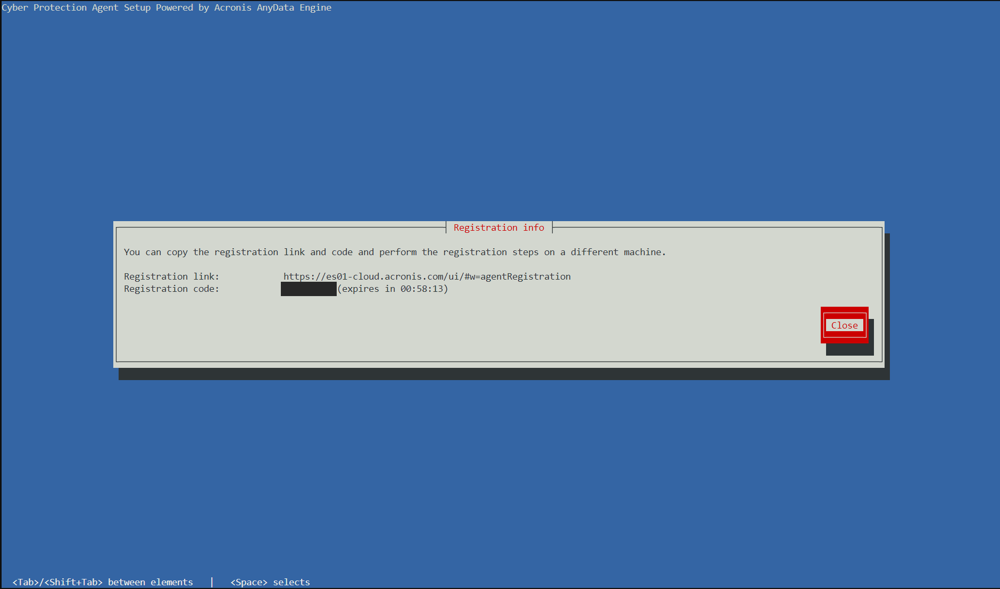
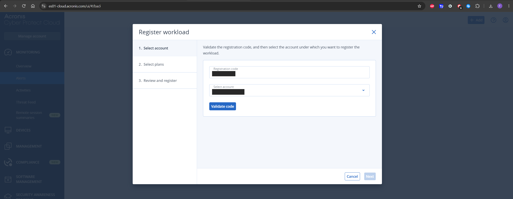

En el asistente de registro, el plan por defecto es *Complete protection*. Se cambia a **ningún plan** (*Change → Do not apply*): si no, se aplicaría al propio hipervisor (backup del host y antimalware en él). Los planes se crean después y se aplican solo a las VMs.

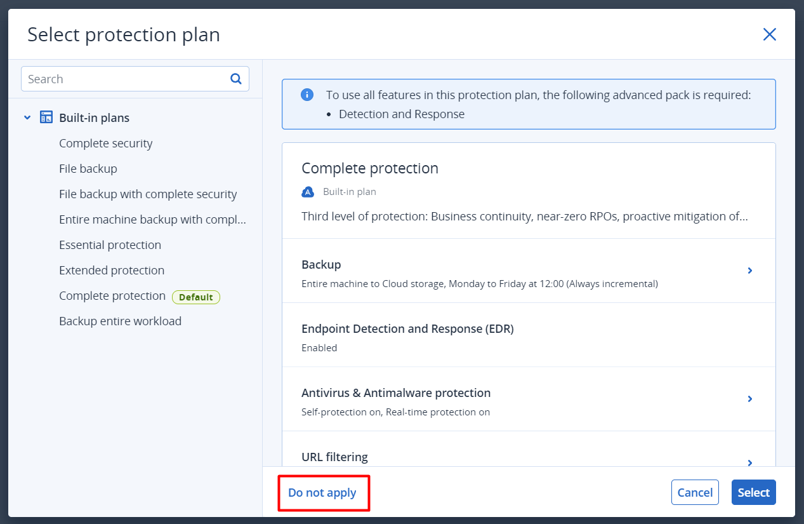
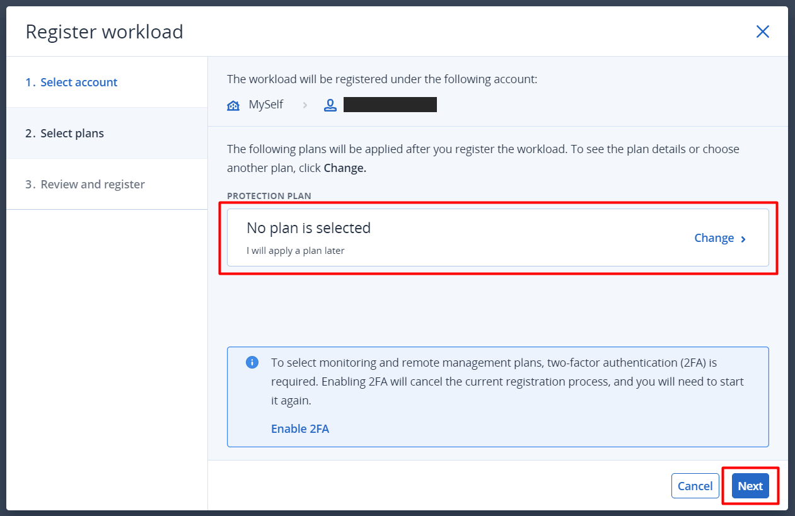

Al terminar, el instalador avisa de que *"A firewall has been detected"*. No hace falta hacer nada: el agente solo abre conexiones salientes.

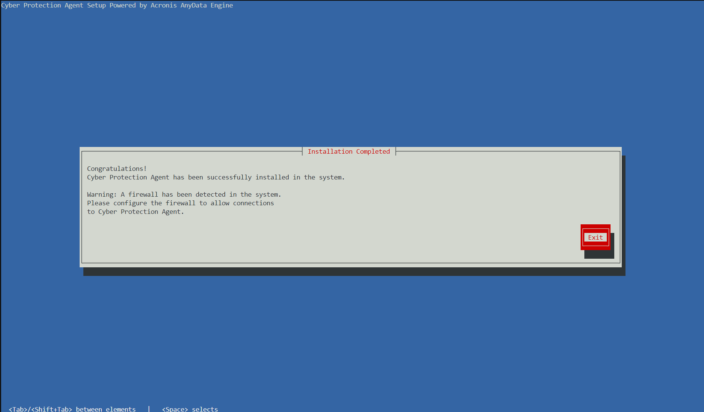

**Verificación:**

```bash
systemctl list-units --type=service | grep -iE "acronis|aakore"
```

`aakore`, `acronis_mms` y `acronis_schedule` en *active running*.

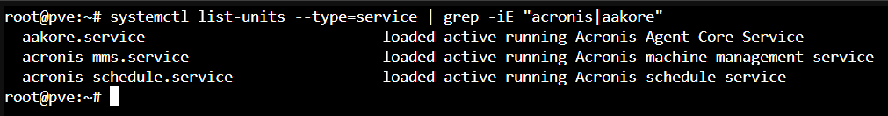

En *DEVICES* aparecen `pve`, DC01, DMZ01, fortigate y PC01. `pve` sale como "VM" porque Proxmox corre anidado en VMware.

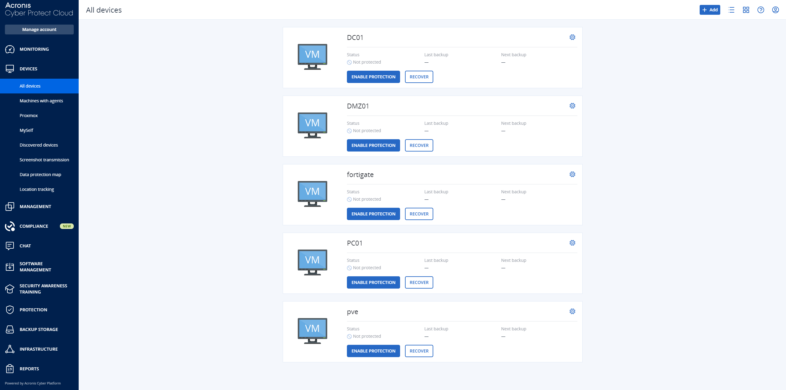

### 4. Seguridad de la consola

Quien entra en la consola de backup puede borrar las copias, así que la cuenta se protege igual que un acceso de administrador.

**2FA:** *Manage account → Settings → Security → Two-factor authentication* → activar. Después se cierra sesión, se vuelve a entrar, se escanea el código QR con la aplicación de autenticación y se guarda el código de recuperación en el gestor de contraseñas.

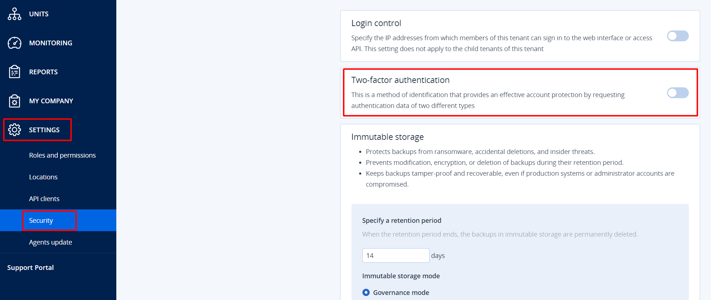
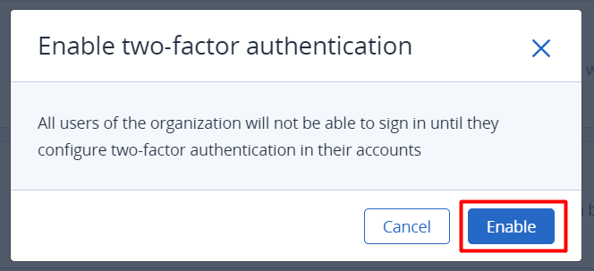
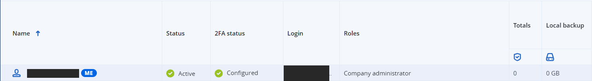

En esa misma pantalla está el **almacenamiento inmutable** (*Immutable storage*) de Acronis Cloud, activo con una retención de 14 días: las copias borradas se conservan ese tiempo y no se pueden modificar ni cifrar, aunque alguien obtenga la cuenta.

**Notificaciones:** *Manage account → usuario → Services → Settings* → solo **Failure**, **Warning** y **Recovery notifications**. Así llega un email cuando algo falla o se restaura, sin el ruido de los avisos de éxito diarios.

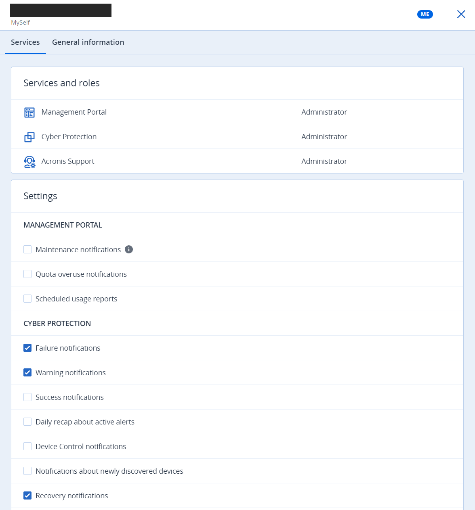

### 5. Destino local: carpeta SMB en F:

PowerShell **como administrador** en el PC host. Primero, un usuario local dedicado, sin grupos, que solo sirve para escribir los backups:

```powershell
$pw = Read-Host "Contraseña para svc-acronis" -AsSecureString
New-LocalUser -Name "svc-acronis" -Password $pw -FullName "Acronis backup (homelab-pyme)" -Description "Solo escritura en F:\Backups\Acronis" -PasswordNeverExpires -UserMayNotChangePassword
```

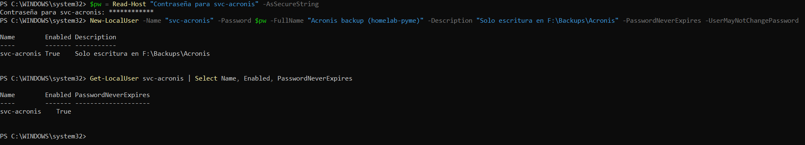

**Carpeta y permisos NTFS:** sin herencia, control total para SYSTEM y Administradores, y solo *Modify* para `svc-acronis`:

```powershell
New-Item -ItemType Directory -Path F:\Backups\Acronis -Force | Out-Null
icacls F:\Backups\Acronis /inheritance:r /grant:r "*S-1-5-18:(OI)(CI)F" "*S-1-5-32-544:(OI)(CI)F" "svc-acronis:(OI)(CI)M"
icacls F:\Backups\Acronis
```

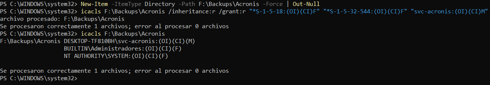

**Recurso compartido oculto** (`$`), con permiso de cambio solo para `svc-acronis`:

```powershell
New-SmbShare -Name 'AcronisBackups$' -Path F:\Backups\Acronis -ChangeAccess "$env:COMPUTERNAME\svc-acronis" -Description "Destino de backups Acronis (homelab-pyme)"
Get-SmbShareAccess -Name 'AcronisBackups$'
```

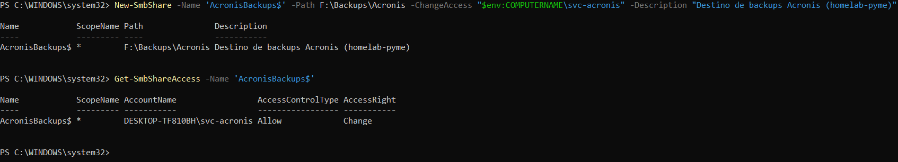

**Firewall de Windows:** SMB (445) solo desde el nodo pve:

```powershell
New-NetFirewallRule -DisplayName "homelab-pyme - SMB desde pve (Acronis)" -Direction Inbound -Protocol TCP -LocalPort 445 -RemoteAddress 192.168.1.200 -Action Allow -Profile Any
```

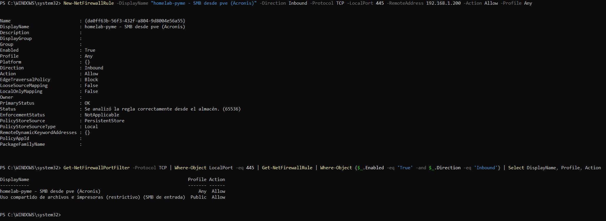

**Prueba desde pve:**

```bash
timeout 3 bash -c '</dev/tcp/192.168.1.133/445' && echo "445 abierto desde pve" || echo "445 CERRADO"
```

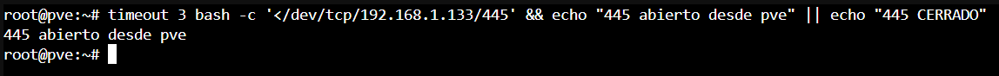

La IP 192.168.1.133 del PC debe estar reservada en el DHCP del router para que el destino no cambie.

### 6. Planes de protección

*MANAGEMENT → Protection plans → Create plan → Create your own plan*.

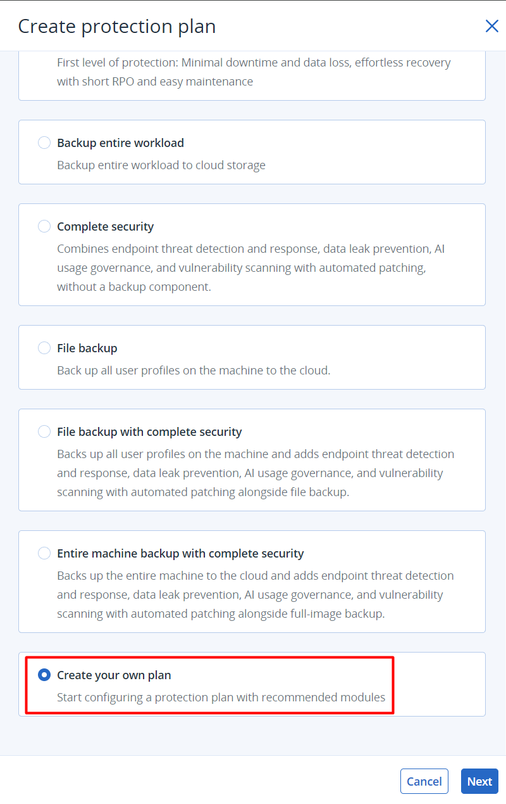

#### Plan `PYME - VMs Proxmox` (DC01 y DMZ01)

| Campo | Valor |
|---|---|
| Módulos | Solo **Backup**. EDR, antimalware, filtrado de URL, etc. desactivados: no aplican sin agente dentro de las VMs |
| What to back up | Entire machine |
| Where to back up | Network folder `\\192.168.1.133\AcronisBackups$`, credenciales `NOMBREPC\svc-acronis` |
| Schedule | Always incremental (single-file), todos los días a las 21:30 |
| How many to keep (local) | 14 backups |
| Encryption | AES 256, contraseña guardada en el gestor de contraseñas |
| 2nd location | Cloud storage (*+ Add location* del propio plan, no el del diálogo *Where to back up*) |
| How long to keep (cloud) | GFS: diarias 30 días, semanales 5 semanas, mensuales 2 meses |
| Backup options → VSS for virtual machines | *Take a quiesced snapshot* = **Yes**, *Fail backup if taking a quiesced snapshot is not possible* desmarcado |

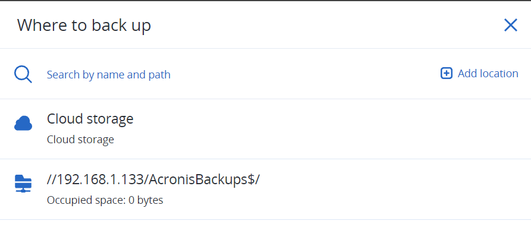
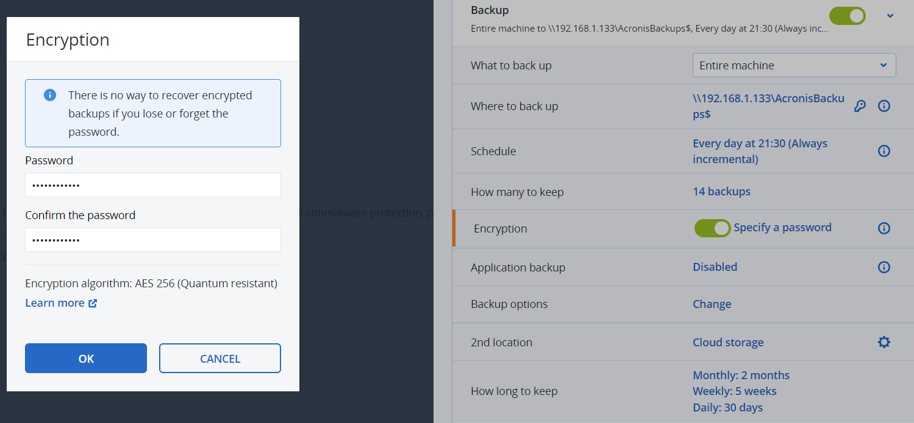
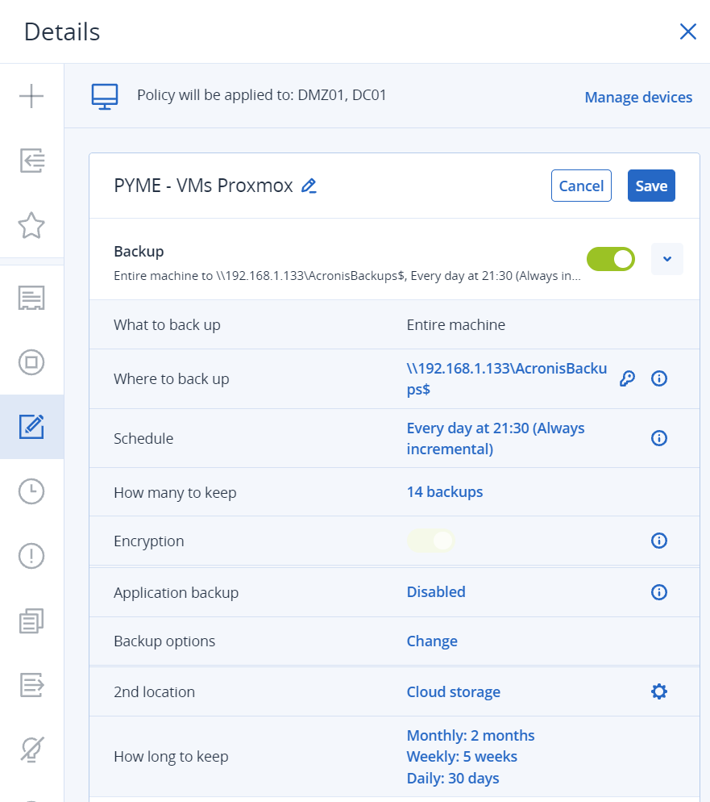

- **Cifrado:** sin la contraseña no se puede restaurar, y no se puede cambiar después de crear el plan. Por eso se guarda en el gestor antes de pulsar *OK*.
- **Copia consistente:** con *quiesced snapshot*, Acronis pide al QEMU Guest Agent de cada VM que congele el sistema de archivos (y en Windows, VSS) antes del snapshot. Si el agente fallara, el backup se hace igualmente sin congelar y queda un aviso, en lugar de quedarse sin copia ese día.

#### Plan `PYME - FortiGate (crash-consistent)` (fortigate)

Igual que el anterior, pero con *VSS for virtual machines → Take a quiesced snapshot* = **No**.

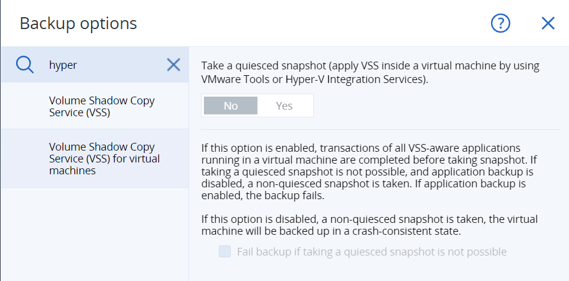
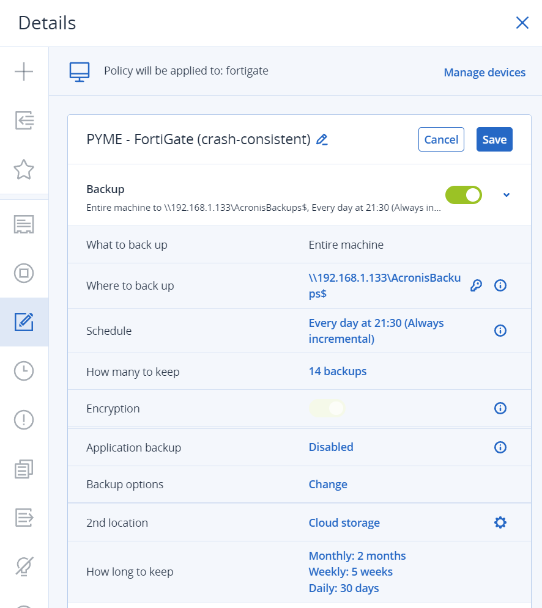

FortiOS no lleva QEMU Guest Agent, así que con el plan general la VM del FortiGate daría cada día *"Failed to create an application-consistent snapshot… QEMU Guest Agent is disabled"*. Desactivar el *quiesce* solo para ella deja un backup **crash-consistent** (como si se le cortara la corriente), suficiente para un firewall sin bases de datos. **Una política por tipo de equipo**: así el plan general no se degrada sin avisar y el aviso de DC01 o DMZ01 sigue significando algo. Además, la configuración del FortiGate ya se guarda cifrada por API cada día (Fase 5); la imagen sirve para recuperar la VM entera rápido.

PC01 y pve no se protegen: PC01 es un puesto cliente sin datos y el hipervisor se reinstala.

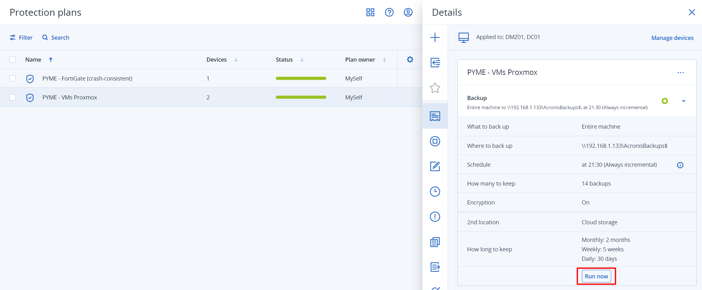

### 7. Primer backup

*Protection plans → plan → Run now* en los dos planes.

- **Plan de las VMs:** 21,8 GB procesados y 10,6 GB ahorrados (compresión y bloques vacíos), a 133–173 MB/s. El cuello de botella es la escritura en el destino (HDD). Unos 8–9 minutos.
- **Plan del FortiGate:** 562 MB procesados en 40 segundos, sin avisos.

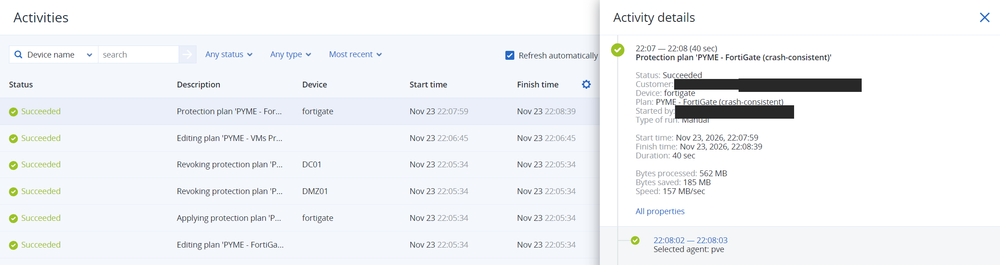

Después del backup local, Acronis replica cada copia a la nube. Resultado: **un archivo por VM** (formato single-file) en cada ubicación, cifrados (candado), con el almacenamiento inmutable activo en la nube.

| Archivo | Tamaño |
|---|---|
| `DC01 - PYME - VMs Proxmox` | 10,6 GB |
| `DMZ01 - PYME - VMs Proxmox` | 2,97 GB |
| `fortigate - PYME - FortiGate (crash-consistent)` | 185 MB |

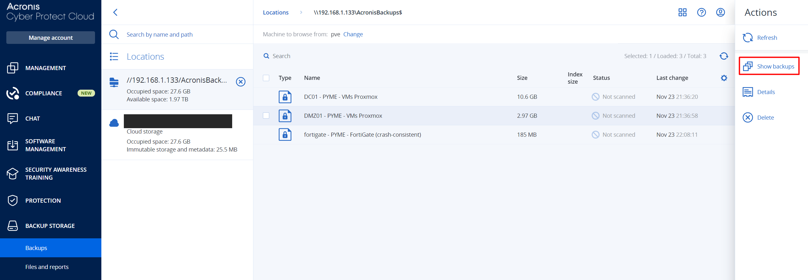

Comprobación en el PC:

```powershell
Get-ChildItem F:\Backups\Acronis -Recurse | Measure-Object Length -Sum | Select Count, @{n='GB';e={[math]::Round($_.Sum/1GB,2)}}
```

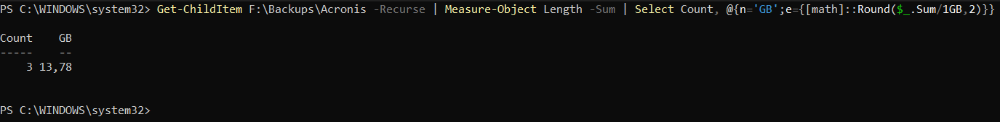

### 8. Desastre y restauración de DMZ01

**Estado previo:** la web responde y Uptime Kuma tiene los 3 monitores en verde. Se guarda la configuración de la VM para compararla después.

```powershell
curl.exe -skI https://www.pyme.test | Select-Object -First 1     # HTTP/1.1 200 OK
```

```bash
qm config 103 > /root/vm103-antes.txt && cat /root/vm103-antes.txt
```

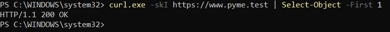
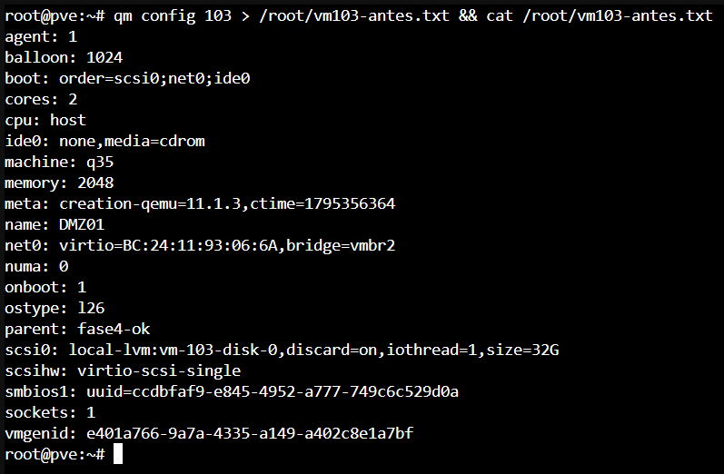
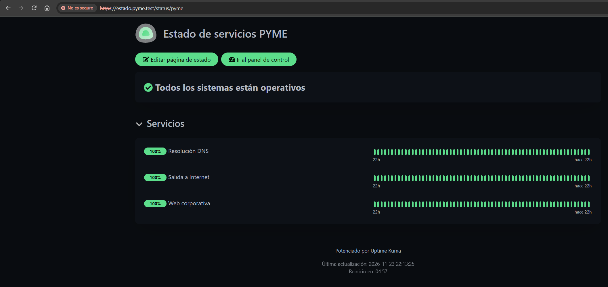

**Desastre:** se para y se destruye la VM con sus discos. Se pierden también los snapshots `pre-docker` y `fase4-ok`: no hay forma de volver atrás desde Proxmox.

```bash
qm stop 103
qm destroy 103 --purge 1 --destroy-unreferenced-disks 1
qm list ; lvs | grep -c vm-103 || echo "Sin discos de la VM 103"
```

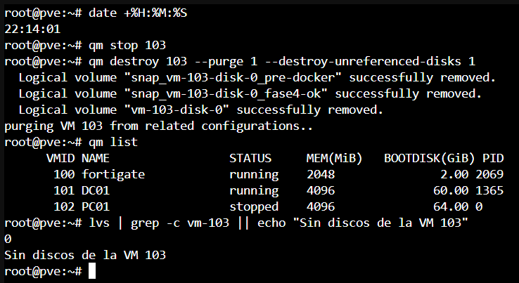

La web deja de responder (`curl` sale con código 28, *timeout*):

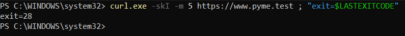

**Restauración.** La VM ya no existe en *DEVICES*, así que se entra por el almacenamiento: *BACKUP STORAGE → Backups → `\\192.168.1.133\AcronisBackups$` → DMZ01 - PYME - VMs Proxmox → Show backups → último punto → Recover → Entire machine*.

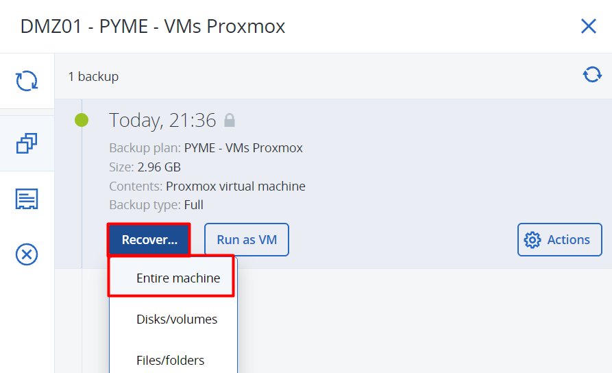

| Campo | Valor |
|---|---|
| Recover to | Virtual machine |
| Target machine | **New machine** → Standalone Nodes → `pve`, nombre `DMZ01` |
| Storage / Disk mapping | `local-lvm` / Disk 1 → local-lvm, 32 GB |
| VM settings | 2 GB de memoria, 2 vCPU, **Network adapter 1 → `vmbr2`** |
| Recovery options → VM power management | *Power on the target virtual machine when recovery is complete* = **Yes** |

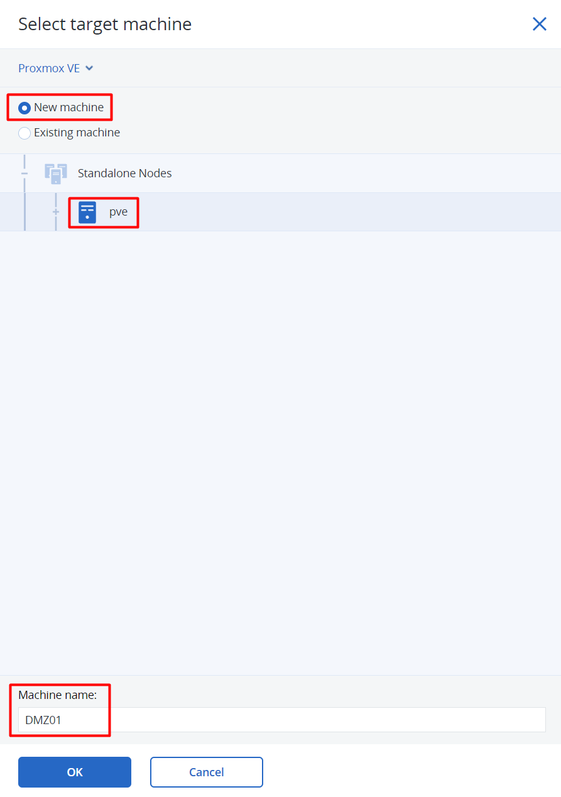
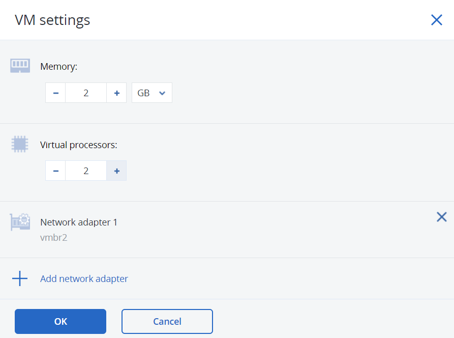
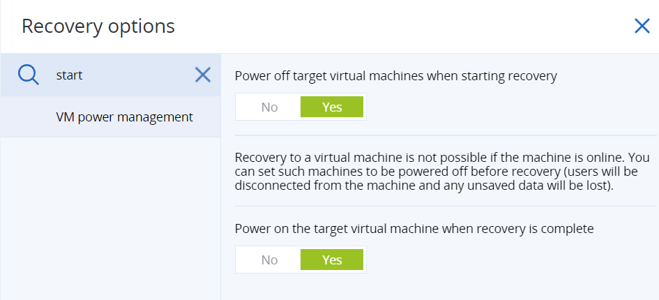
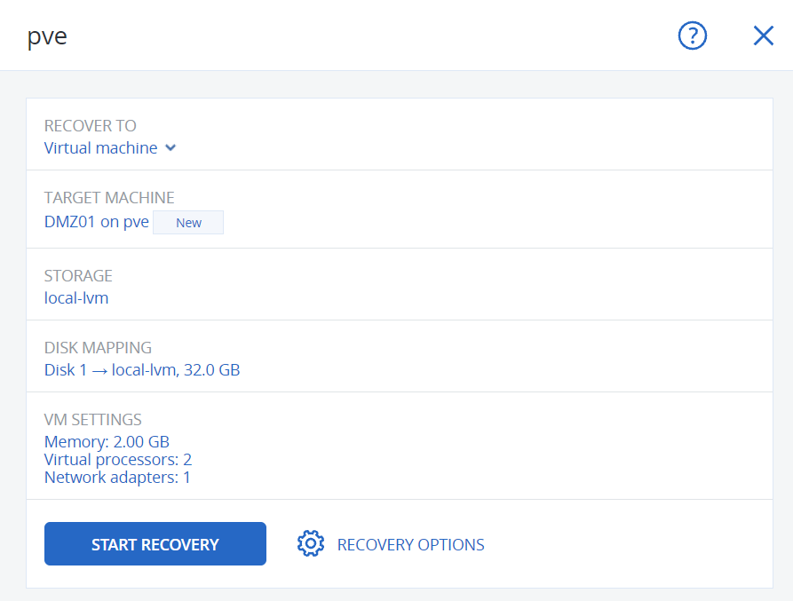

> ⚠️ **El adaptador de red hay que revisarlo a mano.** Si no se asigna a `vmbr2`, la VM arranca en un bridge equivocado y queda sin servicio aunque la restauración salga *Succeeded*.

**Resultado:** *Recovering virtual machine → Succeeded* en **50 segundos** (7,51 GB a 236 MB/s): preparación, creación de la VM, recuperación de discos y *Fixing virtual machine bootability*. Proxmox le asigna el VMID 103 (el primero libre).

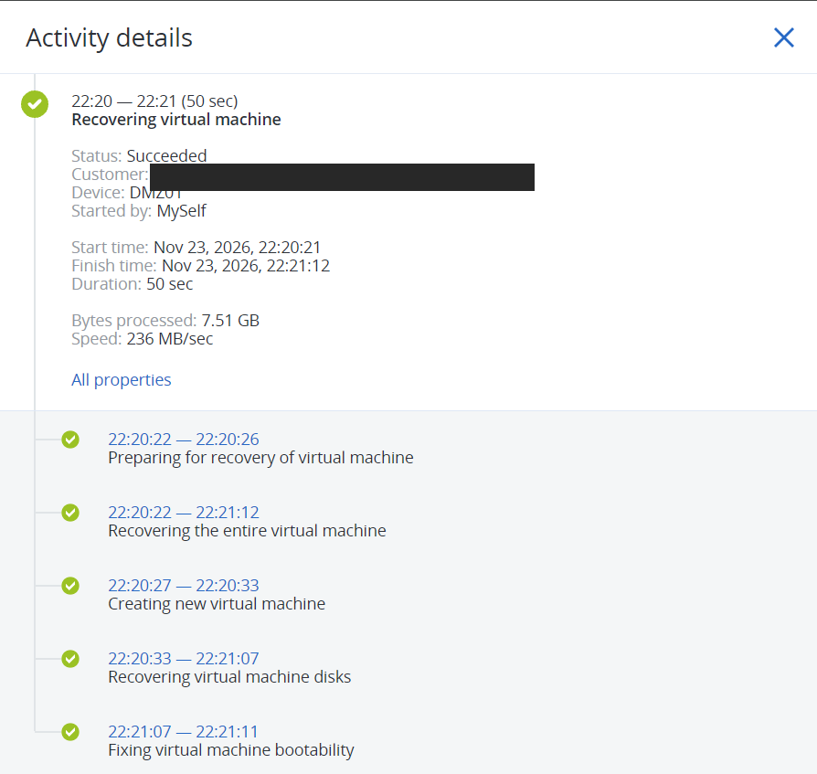

**Verificación** desde el PC:

```powershell
Get-Date -Format "HH:mm:ss"
curl.exe -skI https://www.pyme.test | Select-Object -First 1
ssh fbertomeu@192.168.1.210 "hostname; ip -br a show ens18; docker compose -f /opt/homelab-pyme/configs/04-dmz01/docker-compose.yml ps --format 'table {{.Name}}\t{{.Status}}'"
```

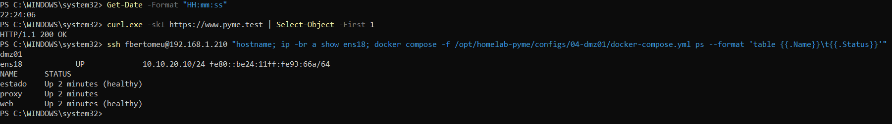

- `dmz01`, `ens18` con 10.10.20.10/24 y la **misma MAC** (`BC:24:11:93:06:6A`), así que la reserva y las reglas siguen funcionando.
- Contenedores `estado` y `web` *healthy* y `proxy` *Up*.
- SSH sin aviso de cambio de clave del host: el disco se restaura entero, claves incluidas.
- Kuma: *"Todos los sistemas están operativos"* y los 3 monitores al 100 % **con el historial intacto**, porque sus datos están en un volumen del disco restaurado.

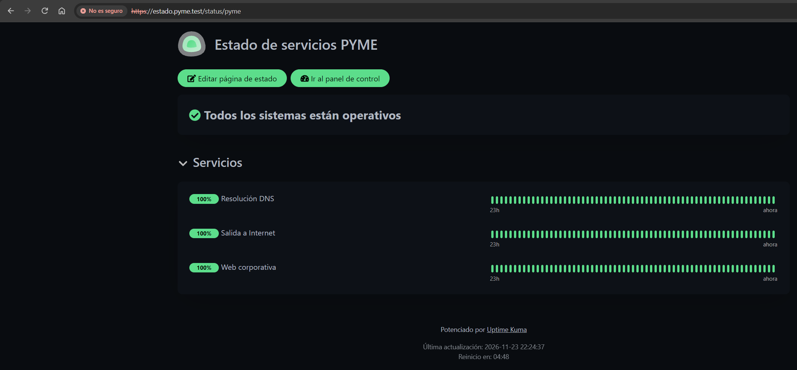

**RTO real: inicio de la restauración 22:20:21 → web respondiendo 22:24:06 = menos de 4 minutos.**

### 9. Ajustes de la VM después de restaurar

Una restauración completa recupera **los discos**, pero no copia la configuración de Proxmox línea a línea: Acronis **vuelve a crear la VM a partir de su propio modelo de hardware**. Por eso hay que comparar la configuración nueva con la original, que se guardó antes del desastre.

```bash
VMID=$(qm list | awk '$2=="DMZ01"{print $1}'); echo "VMID=$VMID"
qm config $VMID > /root/vm-restaurada.txt
diff <(grep -vE '^(meta|vmgenid|smbios1|digest)' /root/vm103-antes.txt | sort) \
     <(grep -vE '^(meta|vmgenid|smbios1|digest)' /root/vm-restaurada.txt | sort)
```

Se excluyen `meta`, `vmgenid`, `smbios1` y `digest` porque cambian siempre en una VM nueva y solo meterían ruido. En el `diff`, las líneas con `<` son de la VM original y las de `>`, de la restaurada.

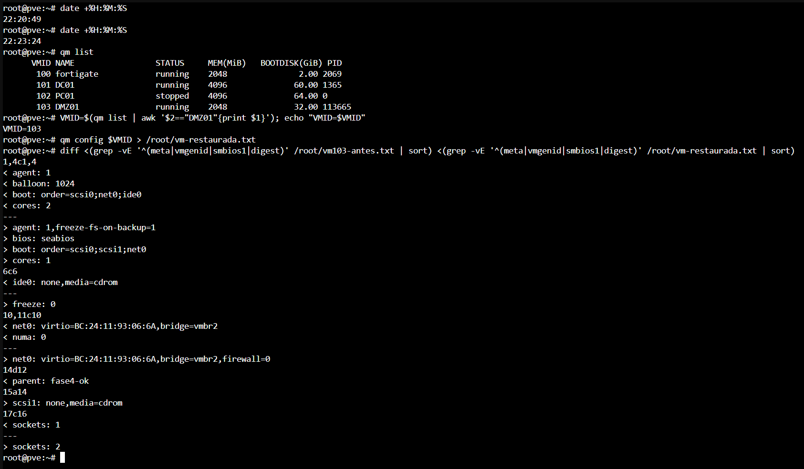

| Opción | Original | Restaurada | ¿Importa? |
|---|---|---|---|
| CPU | `sockets: 1`, `cores: 2` | `sockets: 2`, `cores: 1` | **Sí.** Mismos 2 vCPU, pero con 2 sockets Linux ve dos nodos de CPU separados. Se vuelve al diseño original de 1 × 2 |
| Ballooning | `balloon: 1024` | (no aparece) | **Sí.** Sin balloon, la VM tiene siempre 2 GB reservados. Con él puede bajar a 1 GB si el host lo necesita, y en un lab de 20 GB de RAM eso cuenta |
| Unidad de CD | `ide0: none,media=cdrom` | `scsi1: none,media=cdrom` | **Sí.** El CD vacío pasa al bus SCSI y entra en el orden de arranque |
| Orden de arranque | `order=scsi0;net0;ide0` | `order=scsi0;scsi1;net0` | **Sí.** Se deja solo disco y red |
| Agente QEMU | `agent: 1` | `agent: 1,freeze-fs-on-backup=1` | No: es el valor por defecto escrito de forma explícita |
| BIOS / freeze / firewall / NUMA | — | `bios: seabios`, `freeze: 0`, `firewall=0`, sin `numa: 0` | No: son los valores por defecto |
| Snapshots | `parent: fase4-ok` | (no aparece) | Esperado: **los snapshots no forman parte del backup** |
| Se conservan | MAC, `bridge=vmbr2`, disco de 32 GB, `onboot` | | |

**Corrección.** Los cambios hay que hacerlos **con la VM apagada**:

- `scsi1` está en el orden de arranque, y Proxmox no permite desconectar en caliente un disco de arranque (*"hotplug problem - can't unplug bootdisk 'scsi1'"*).
- Los cambios de CPU y de memoria con la VM encendida quedan *pendientes* (en naranja en la GUI) hasta el siguiente apagado.

Así que se planifica una parada corta, igual que se haría en producción:

```bash
qm shutdown 103 --timeout 120
qm set 103 --sockets 1 --cores 2 --balloon 1024 --delete scsi1 --boot 'order=scsi0;net0'
qm start 103
qm config 103 | grep -E "sockets|cores|balloon|boot|onboot|startup"
```

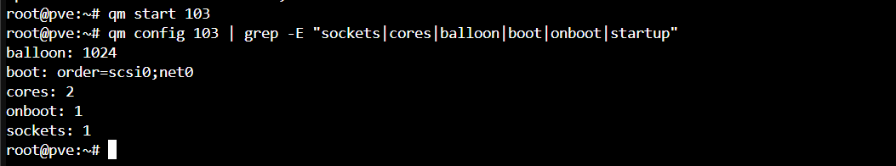

Hardware final: memoria 1,00/2,00 GiB (ballooning), 2 vCPU (1 socket, 2 cores, tipo `host`), SeaBIOS, q35, VirtIO SCSI single, `scsi0` en local-lvm de 32 GB y `net0` virtio en `vmbr2`. La web vuelve a responder después del reinicio:

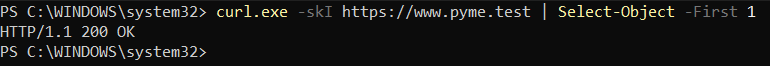

**Lección:** una restauración completa no termina cuando la consola dice *Succeeded*. Hay que:

1. Tener guardada la configuración original de la VM. En producción, copiar periódicamente `/etc/pve/qemu-server/*.conf` junto a los backups (el script de la Fase 5 es un buen sitio para hacerlo).
2. Comparar la configuración restaurada con la original y corregir las diferencias en una parada corta.
3. Volver a crear los snapshots que hagan falta, porque no se restauran.

### 10. Volver a proteger DMZ01

Para Proxmox, y por tanto para Acronis, la VM restaurada es **una máquina nueva** (otro `vmgenid` y otro UUID), así que aparece como *Not protected* y no hereda el plan.

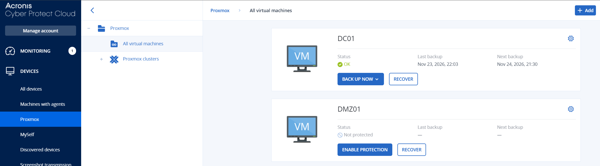

*MANAGEMENT → Protection plans → PYME - VMs Proxmox → Manage devices* → añadir la nueva DMZ01. Queda en *Backup scheduled* y se lanza un primer backup con *Back up now*.

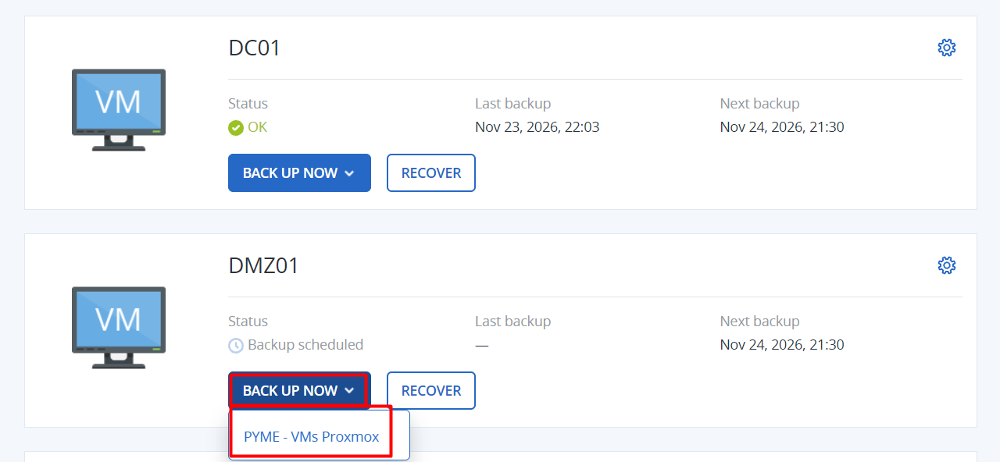


El archivo de backup de la DMZ01 antigua se conserva hasta que caduque por retención: es el punto de restauración anterior al desastre. Por eso en la nube se ven dos archivos de DMZ01.

### 11. Recuperar un archivo desde Acronis Cloud

Prueba de un caso diario: un usuario borra un archivo de la carpeta compartida y hay que recuperarlo **desde la copia fuera de casa**, como si la copia local no estuviera disponible.

**Crear el archivo** en DC01 (PowerShell como `adm.fbertomeu`) y anotar su hash:

```powershell
$f = "C:\Shares\Datos\Comun\presupuesto-2027.txt"
"Presupuesto 2027 - PYME`r`nCreado: $(Get-Date -Format s)" | Set-Content $f
Get-FileHash $f -Algorithm SHA256 | Format-List Path, Hash
```


**Backup** con el archivo dentro: *Protection plans → PYME - VMs Proxmox → Run now*, y esperar en *MONITORING → Activities* a que terminen el backup de DC01 y la réplica a la nube.

**Borrado:**

```powershell
Remove-Item $f -Force
Test-Path $f      # False
```


**Recuperación** desde el navegador de DC01 (consola de Acronis con 2FA):

1. *BACKUP STORAGE → Backups* → ubicación **Cloud storage** → `DC01 - PYME - VMs Proxmox` → **Show backups**.

   

2. Último punto (el incremental de 55 MB que contiene el archivo) → **Recover → Files/folders**.

   

3. Contraseña de cifrado del plan.

   

4. Navegar a `DC01 › C: › Shares › Datos › Comun`, marcar `presupuesto-2027.txt` → **Download**. Como no hay agente dentro de la VM, la recuperación de archivos sueltos se hace por descarga.

   

**Devolverlo a su sitio y comprobarlo:**

```powershell
Move-Item "C:\Users\adm.fbertomeu\Downloads\presupuesto-2027.txt" C:\Shares\Datos\Comun\
icacls C:\Shares\Datos\Comun\presupuesto-2027.txt /reset
Get-FileHash C:\Shares\Datos\Comun\presupuesto-2027.txt -Algorithm SHA256 | Format-List Path, Hash
```


El hash SHA-256 coincide con el original (`F57AA968…8481F`): el archivo recuperado de la nube es idéntico bit a bit.

`icacls /reset` es necesario porque, al mover un archivo dentro del mismo volumen, Windows mantiene los permisos que tenía en Descargas (solo `adm.fbertomeu`, SYSTEM y Administradores). Con `/reset` vuelve a heredar los de `Comun`, y los usuarios del dominio lo ven otra vez en `P:\Comun`.

### 12. Snapshots de cierre

```bash
for id in 100 101 103; do qm snapshot $id fase6-ok --description "Fase 6: Acronis Cyber Protect configurado y restauración de DMZ01 verificada"; done
qm listsnapshot 103
```


Los avisos de *thin pool* son normales en el lab: la suma de los tamaños virtuales de los discos y snapshots supera el tamaño del pool, aunque el espacio realmente usado es mucho menor.

### Decisiones de diseño

- **Acronis Cyber Protect Cloud en lugar de un servidor de gestión propio:** es el modelo de un MSP como Infotic (una consola para muchos clientes), no consume RAM del lab y da la réplica a la nube sin montar nada más.
- **Backup sin agente en las VMs:** un solo agente en el nodo protege todas las VMs, sin instalar ni mantener nada dentro de cada sistema, y funciona también con equipos cerrados como el FortiGate.
- **Ningún plan para el hipervisor:** el plan por defecto instalaría antimalware y haría backup del propio nodo. El hipervisor se reinstala; lo valioso son las VMs.
- **3-2-1 con inmutabilidad:** tres copias (producción, local y nube), en dos soportes distintos y una fuera de casa. La copia de la nube es inmutable, así que un ransomware o alguien con la cuenta no puede borrarla ni cifrarla.
- **Copia local en un disco distinto del de las VMs:** si falla el disco de las VMs, las copias siguen ahí, y la restauración local es mucho más rápida que bajarla de la nube (DMZ01 en 50 segundos).
- **Mínimo privilegio en el destino:** el agente corre como root en el nodo y no usa un usuario de Proxmox, así que el control se pone en el destino: usuario local sin grupos, NTFS solo *Modify* en esa carpeta, recurso oculto y solo para él, y el 445 abierto solo para 192.168.1.200. En la consola, 2FA; en la red, solo tráfico saliente.
- **Una política por tipo de equipo:** las VMs con agente QEMU usan snapshots consistentes y fallan con aviso si no se puede; el FortiGate, que no tiene agente, usa snapshots *crash-consistent* en su propio plan.
- **Incremental diario a las 21:30, después del script de la Fase 5:** el backup recoge la configuración del día ya guardada y no compite con el script por el disco.
- **Retención distinta por ubicación:** 14 copias en local para restaurar rápido lo reciente y GFS en la nube (30 días, 5 semanas, 2 meses) para tener historia sin disparar el espacio.
- **Cifrado AES 256:** las copias salen de casa, así que van cifradas de origen. La contraseña está en el gestor: sin ella no se restaura nada.
- **Notificaciones solo de fallo, aviso y recuperación:** un correo diario de éxito acaba sin leerse. Así cualquier email de Acronis es algo que revisar.
- **Probar la restauración, no solo el backup:** un backup sin prueba de restauración es una suposición. Se ha probado el peor caso (VM destruida sin snapshots) y el más habitual (un archivo borrado), y se ha medido el RTO.

### Verificación

- Agente: `aakore`, `acronis_mms` y `acronis_schedule` *active running*; `pve` registrado sin plan y las 4 VMs visibles en la consola.
- 2FA en estado *Configured*; notificaciones de fallo, aviso y recuperación activadas.
- SMB: puerto 445 accesible desde pve; recurso `AcronisBackups$` con acceso *Change* solo para `svc-acronis`.
- Primer backup de los dos planes *Succeeded*; tres archivos cifrados en F: (13,78 GB) replicados en Acronis Cloud con almacenamiento inmutable.
- Desastre: DMZ01 destruida, restaurada en 50 s y con la web respondiendo en **menos de 4 minutos**; misma IP, MAC y claves SSH, contenedores *healthy* y Kuma con el historial intacto.
- Configuración de la VM comparada con la original y corregida (1 socket × 2 cores, balloon 1024, arranque `order=scsi0;net0`).
- DMZ01 restaurada protegida de nuevo por `PYME - VMs Proxmox`.
- Archivo borrado recuperado desde Acronis Cloud con el mismo hash SHA-256.
- Snapshots `fase6-ok` de las VMs 100, 101 y 103.
